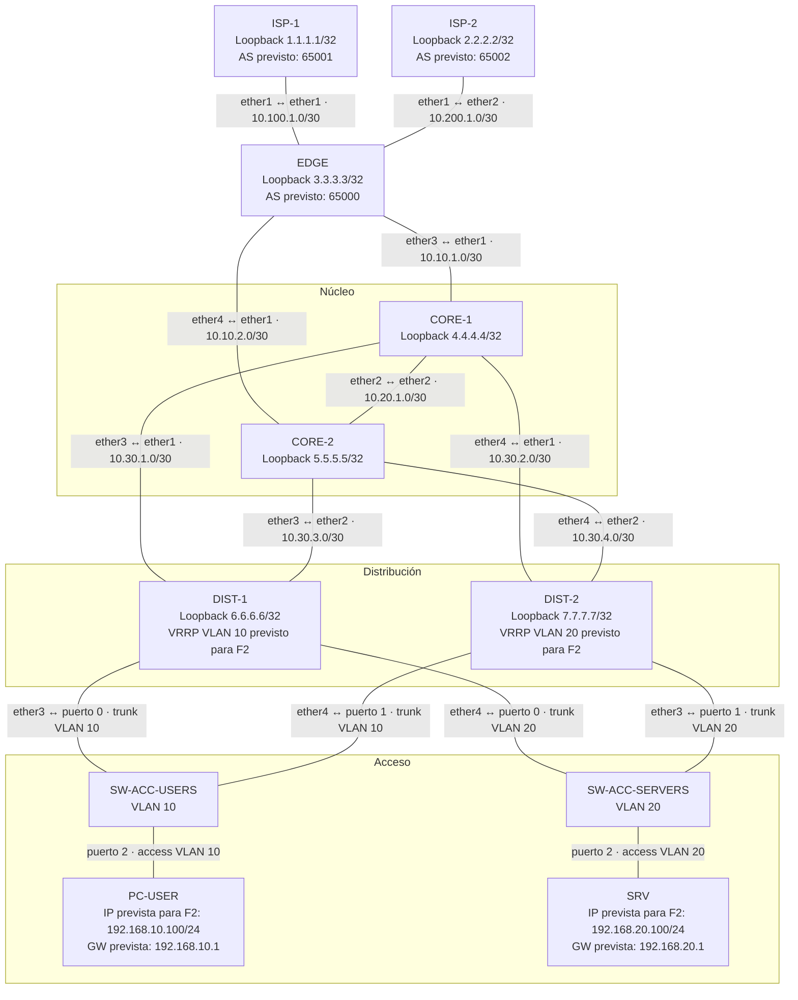
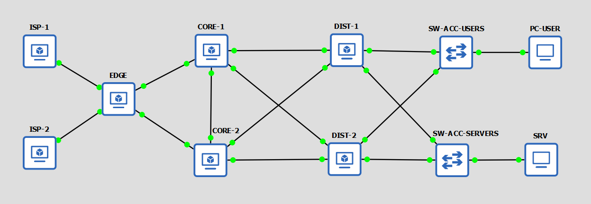
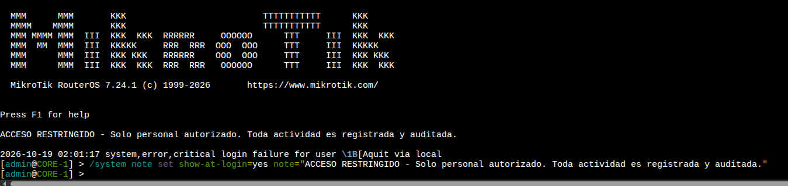
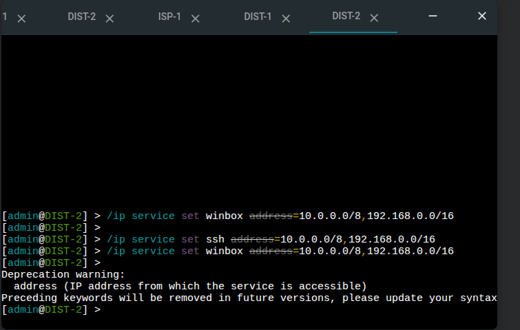
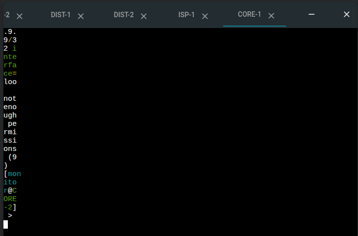
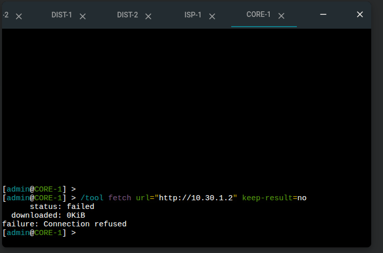

# Memoria Técnica del Laboratorio — Failover Routing

**Cátedra:** Gestión Operativa y Seguridad en Redes (GOYS)  
**Comisión:** 2026  
**Grupo:** 5  
**Fecha de Entrega Final (F5):** replanificada (la fecha original del 23/10/2026 venció; el cronograma vigente figura en el README, sección 7)
**Versión:** cierre de F4 con limitaciones y F5 completada documentalmente, 13/11/2026. Memoria, evidencias disponibles y configuraciones definitivas incorporadas; Change Log conciliado hasta `fa2d55a`. Configuraciones validadas estáticamente; importación en CHR limpio no realizada. Defensa oral pendiente, posterior a la entrega (ver §6.1 y §10).
**Entorno de Simulación:** GNS3 · MikroTik CHR (RouterOS v7)

---

## Integrantes y Matriz de Roles
# Reasignación de roles del equipo — 26/10/2026

Desde que empezamos a trabajar con la epic F2, Camila Baccarini (R1) dejó de cursar la materia. Para garantizar la continuidad del laboratorio, reorganizamos las responsabilidades técnicas y operativas de las fases pendientes.

| Integrante | Rol | Responsabilidad técnica | Responsabilidades transversales |
| :--- | :---: | :--- | :--- |
| **Juan Ignacio Atencio** | **R1 + R4** | **R1 — Borde/WAN:** EDGE, eBGP multi-homing, filtros BGP, redistribución OSPF↔BGP y firewall/NAT. **R4 — Distribución:** DIST-1/DIST-2, VRRP, VLAN 10/20 y conectividad de los hosts. | Coordinación técnica y documental, integración de entregables, control de consistencia de memoria, README, backlog, evidencias y exports. |
| **Alesandro Patricio Borda** | **R2 + R5 operativo** | **R2 — Proveedores:** ISP-1/ISP-2, sesiones eBGP del lado de los proveedores y rutas por defecto. | Coordinación de backups y restauraciones, Change Log, recopilación de evidencias y consolidación de post-mortems. |
| **Ian Vidmar** | **R3** | **Core/Backbone:** CORE-1/CORE-2, OSPF Área 0, enlace Core-Core y autenticación MD5. | QA independiente de configuraciones, exports y criterios de aceptación; seguimiento de logging y telemetría; revisión cruzada de los cambios de integración. |

R5 continúa como función operativa transversal y no representa un quinto integrante.

La reasignación aplica a tareas futuras y no modifica la autoría histórica de commits, configuraciones ni evidencias. Los cambios críticos del borde y de la integración quedan sujetos a revisión técnica cruzada, para mantener la trazabilidad y la calidad de las entregas.

---

## 1. Diseño Arquitectónico (Fase F0)

### 1.1 Corrección Crítica de Defectos del Diagrama Original

A partir del análisis exhaustivo del diagrama de referencia _"Enterprise Network Design (Cisco)"_, el equipo detectó cuatro fallas graves de diseño que comprometen la resiliencia, escalabilidad y seguridad de la infraestructura. A continuación se detallan los defectos y las soluciones de ingeniería adoptadas para nuestra topología de 7 nodos CHR:

```
+---------------------------------------------------------------------------------------------------+
| COMPARATIVA ARQUITECTÓNICA: DIAGRAMA ORIGINAL VS. REDISEÑO GRUPO 5                                |
+------------------------------------+--------------------------------------------------------------+
| Diseño Original con Defectos       | Rediseño Defendible y Corregido (Grupo 5)                    |
+------------------------------------+--------------------------------------------------------------+
| 1. Firewall Único en Borde (SPOF)  | 1. Dual-homing BGP multihoming a dos ISPs + dual uplink Core |
| 2. Sin enlace horizontal Core-Core | 2. Enlace /30 dedicado inter-Core en OSPF Área 0             |
| 3. HSRP colapsado en el Core       | 3. Core en Tránsito Puro; VRRP activo/activo en Distribución |
| 4. Subredes dispersas y solapadas  | 4. Plan IPAM jerárquico determinista (/30 enlaces, /24 VLANs)|
+------------------------------------+--------------------------------------------------------------+
```

#### Defecto 1: Punto Único de Falla (SPOF) en el Borde Perimetral

- **Diagnóstico Crítico:** El diagrama original implementa un único appliance de firewall/edge recibiendo las acometidas de los proveedores. Cualquier incidente físico, saturación de CPU por ataque DoS, falla de fuente o reinicio por actualización en ese nodo deja a toda la organización desconectada, anulando la supuesta redundancia de contar con múltiples enlaces hacia Internet.
- **Solución e Implementación en el Laboratorio:** En un entorno enterprise de producción, la solución estándar exige un clúster de Firewalls en Alta Disponibilidad (Active/Standby o Active/Active mediante protocolos de sincronización de tablas de estado como CARP o clúster propietario). En nuestro laboratorio sobre MikroTik CHR, documentamos este trade-off arquitectónico y mitigamos el riesgo en la capa de software:
  1. El router `EDGE` establece dos sesiones eBGP independientes con `ISP-1` (AS 65001) e `ISP-2` (AS 65002) sobre interfaces físicas dedicadas (`ether1` y `ether2`).
  2. Hacia el interior, `EDGE` bifurca el tránsito hacia el núcleo mediante dos enlaces punto a punto independientes: `ether3` hacia `CORE-1` (`10.10.1.0/30`) y `ether4` hacia `CORE-2` (`10.10.2.0/30`).
  3. De esta forma, el borde garantiza que una contingencia en un ISP o en uno de los routers de Core no interrumpa el flujo del tráfico, aislando el dominio externo del plano de control interno.

#### Defecto 2: Ausencia de Enlace Físico Directo Core-Core (Inter-Core Link)

- **Diagnóstico Crítico:** En el diseño original, los routers del núcleo (`CORE-1` y `CORE-2`) no poseían una interconexión directa entre sí. Ante la pérdida de un enlace vertical (por ejemplo, la caída del enlace `EDGE` ↔ `CORE-1`), el tráfico proveniente de la capa de distribución hacia `CORE-1` se ve obligado a descender nuevamente por la distribución para alcanzar `CORE-2` (_trombone routing_ / tráfico en zigzag). Esto genera saturación innecesaria en enlaces de acceso/distribución, introduce latencia impredecible y duplica el consumo de buffers en los switches intermedios.
- **Solución e Implementación en el Laboratorio:** Agregamos un enlace punto a punto `/30` físico dedicado entre ambos routers de Core (`CORE-1` `ether2` `10.20.1.1/30` ↔ `CORE-2` `ether2` `10.20.1.2/30`):
  1. **Convergencia Acelerada:** Permite el intercambio y flooding directo de LSAs Tipo 1 (Router LSA) en OSPF v2 Área 0 sin requerir saltos intermedios.
  2. **Tránsito Horizontal Óptimo:** Si `CORE-1` pierde conectividad con el borde, conmuta el tráfico hacia `CORE-2` en un único salto interno de Capa 3 a velocidad de interfaz.
  3. **Resiliencia ante Partición del Backbone:** Previene que el Área 0 quede dividida lógicamente en caso de fallas concurrentes en la capa de distribución.

#### Defecto 3: Mala Ubicación de la Redundancia de Primer Salto (FHRP en Core)

- **Diagnóstico Crítico:** El diseño original configuraba pasarelas redundantes (HSRP) directamente en los routers de Core. Esta arquitectura colapsada viola el principio de diseño modular de Cisco y de redes de alta velocidad: obliga al núcleo a mantener interfaces virtuales de Capa 2 (SVIs), procesar tormentas de broadcast ARP, responder a paquetes multicast de clientes y gestionar tablas de estados de host.
- **Solución e Implementación en el Laboratorio:** Redefinimos al Core como un **Núcleo de Tránsito Puro (Pure Transit Core)** y desplazamos el FHRP a la capa de **Distribución**:
  1. **Core Desacoplado:** `CORE-1` y `CORE-2` operan exclusivamente con interfaces enrutadas de Capa 3, conmutando paquetes por hardware mediante rutas OSPF de costo balanceado (ECMP), sin tablas ARP de estaciones finales.
  2. **VRRP Activo/Activo en Distribución:** `DIST-1` y `DIST-2` actúan como puertas de enlace predeterminadas mediante dos grupos VRRP con balanceo de carga (_Load-Sharing_):
     - **Grupo USERS (VRID 10):** `DIST-1` es Master (Prioridad 150) y `DIST-2` es Backup (Prioridad 100) para la subred `192.168.10.0/24` (IP Virtual: `192.168.10.1`).
     - **Grupo SERVERS (VRID 20):** `DIST-2` es Master (Prioridad 150) y `DIST-1` es Backup (Prioridad 100) para la subred `192.168.20.0/24` (IP Virtual: `192.168.20.1`).
  3. Esto maximiza la utilización del hardware disponible: ambos routers de distribución cursan tráfico simultáneamente en condiciones normales.

#### Defecto 4: Solapamiento y Desorganización del Direccionamiento IP

- **Diagnóstico Crítico:** El diagrama original repetía subredes de manera caótica (por ejemplo, utilizando el rango `192.168.10.0/24` en múltiples segmentos no interconectados) y empleaba máscaras inadecuadas en enlaces punto a punto. Esto imposibilita el enrutamiento dinámico, produce _blackholes_ de paquetes e impide la sumarización limpia de rutas.
- **Solución e Implementación en el Laboratorio:** Se diseñó un plan de direccionamiento IPAM determinista, jerárquico y de cero solapamiento, con máscaras `/30` para enlaces punto a punto y `/24` para segmentos de acceso, estructurado por bloques funcionales.

---

### 1.2 Plan Integral de Direccionamiento IP (IPAM)

El plan de direccionamiento se organiza mediante subredes específicas para los enlaces punto a punto, segmentos LAN y loopbacks de los siete routers. Las direcciones configuradas se verifican contra las salidas de RouterOS (`/ip address print` y `/interface vlan print`) y las evidencias de conectividad de F1.

Los bloques de direccionamiento agrupan las redes por función. Las subredes `/30` se utilizan en los enlaces de tránsito, las `/24` en las VLAN de acceso y las `/32` en las interfaces loopback. Las direcciones virtuales VRRP de las VLAN 10 y 20 y los Router-ID de OSPF de los cinco routers internos fueron configurados durante F2 y están verificados en las evidencias de esta fase. La configuración de BGP, incluidas las sesiones con los ISP, corresponde a F3.

| Bloque / Prefijo            | Función de Red       | Criterio de Diseño                                                                                            |
| :-------------------------- | :------------------- | :------------------------------------------------------------------------------------------------------------ |
| `10.100.1.0/30`             | WAN ISP-1            | Enlace punto a punto ISP-1 ↔ EDGE.                                                                            |
| `10.200.1.0/30`             | WAN ISP-2            | Enlace punto a punto ISP-2 ↔ EDGE.                                                                            |
| `10.10.1.0/30`              | EDGE–CORE-1          | Enlace de tránsito entre EDGE y CORE-1.                                                                       |
| `10.10.2.0/30`              | EDGE–CORE-2          | Enlace de tránsito entre EDGE y CORE-2.                                                                       |
| `10.20.1.0/30`              | CORE-1–CORE-2        | Enlace dedicado entre los dos routers de núcleo.                                                              |
| `10.30.1.0/30`              | CORE-1–DIST-1        | Enlace de tránsito entre CORE-1 y DIST-1.                                                                     |
| `10.30.2.0/30`              | CORE-1–DIST-2        | Enlace de tránsito entre CORE-1 y DIST-2.                                                                     |
| `10.30.3.0/30`              | CORE-2–DIST-1        | Enlace de tránsito entre CORE-2 y DIST-1.                                                                     |
| `10.30.4.0/30`              | CORE-2–DIST-2        | Enlace de tránsito entre CORE-2 y DIST-2.                                                                     |
| `192.168.10.0/24`           | VLAN 10 — Usuarios   | Segmento de acceso para PC-USER. Gateway virtual previsto para F2.                                            |
| `192.168.20.0/24`           | VLAN 20 — Servidores | Segmento de acceso para SRV. Gateway virtual previsto para F2.                                                |
| `1.1.1.1/32` a `7.7.7.7/32` | Loopbacks            | Identificadores asignados a las interfaces `lo`; previstos como Router-ID en los protocolos correspondientes. |

#### 1.2.1 Identificadores de Router (Router-ID previstos) y Loopbacks (/32)

Los siete routers tienen configurada una interfaz loopback llamada `lo`, con una dirección IPv4 `/32`. Estas direcciones proporcionan identificadores estables para el diseño del laboratorio.

**La existencia de la interfaz y su dirección IP no implica que el Router-ID ya esté configurado en OSPF o BGP.** Esa configuración se realizará y verificará durante las fases F2 y F3, según corresponda.

| Dispositivo | Capa de Red      | Dirección de Loopback | Máscara | Función prevista en el laboratorio                 |
| :---------- | :--------------- | :-------------------: | :-----: | :------------------------------------------------- |
| **ISP-1**   | WAN externa      |       `1.1.1.1`       |  `/32`  | Identificador del proveedor primario (AS 65001).   |
| **ISP-2**   | WAN externa      |       `2.2.2.2`       |  `/32`  | Identificador del proveedor secundario (AS 65002). |
| **EDGE**    | Borde perimetral |       `3.3.3.3`       |  `/32`  | Identificador previsto para BGP (AS 65000) y OSPF. |
| **CORE-1**  | Núcleo (Core)    |       `4.4.4.4`       |  `/32`  | Identificador previsto para OSPF Área 0.           |
| **CORE-2**  | Núcleo (Core)    |       `5.5.5.5`       |  `/32`  | Identificador previsto para OSPF Área 0.           |
| **DIST-1**  | Distribución     |       `6.6.6.6`       |  `/32`  | Identificador previsto para OSPF Área 0.           |
| **DIST-2**  | Distribución     |       `7.7.7.7`       |  `/32`  | Identificador previsto para OSPF Área 0.           |

#### 1.2.2 Matriz Completa de Enlaces Punto a Punto (/30)

La siguiente matriz identifica las nueve conexiones entre routers. Las direcciones de ambos extremos pertenecen a la misma subred `/30`, sin solapamientos.

| Enlace físico       |   Red / CIDR    | Dispositivo A | Interfaz A |      IP A       | Dispositivo B | Interfaz B |      IP B       |
| :------------------ | :-------------: | :------------ | :--------: | :-------------: | :------------ | :--------: | :-------------: |
| **ISP-1 ↔ EDGE**    | `10.100.1.0/30` | ISP-1         |  `ether1`  | `10.100.1.1/30` | EDGE          |  `ether1`  | `10.100.1.2/30` |
| **ISP-2 ↔ EDGE**    | `10.200.1.0/30` | ISP-2         |  `ether1`  | `10.200.1.1/30` | EDGE          |  `ether2`  | `10.200.1.2/30` |
| **EDGE ↔ CORE-1**   | `10.10.1.0/30`  | EDGE          |  `ether3`  | `10.10.1.1/30`  | CORE-1        |  `ether1`  | `10.10.1.2/30`  |
| **EDGE ↔ CORE-2**   | `10.10.2.0/30`  | EDGE          |  `ether4`  | `10.10.2.1/30`  | CORE-2        |  `ether1`  | `10.10.2.2/30`  |
| **CORE-1 ↔ CORE-2** | `10.20.1.0/30`  | CORE-1        |  `ether2`  | `10.20.1.1/30`  | CORE-2        |  `ether2`  | `10.20.1.2/30`  |
| **CORE-1 ↔ DIST-1** | `10.30.1.0/30`  | CORE-1        |  `ether3`  | `10.30.1.1/30`  | DIST-1        |  `ether1`  | `10.30.1.2/30`  |
| **CORE-1 ↔ DIST-2** | `10.30.2.0/30`  | CORE-1        |  `ether4`  | `10.30.2.1/30`  | DIST-2        |  `ether1`  | `10.30.2.2/30`  |
| **CORE-2 ↔ DIST-1** | `10.30.3.0/30`  | CORE-2        |  `ether3`  | `10.30.3.1/30`  | DIST-1        |  `ether2`  | `10.30.3.2/30`  |
| **CORE-2 ↔ DIST-2** | `10.30.4.0/30`  | CORE-2        |  `ether4`  | `10.30.4.1/30`  | DIST-2        |  `ether2`  | `10.30.4.2/30`  |

#### 1.2.3 Segmentos de Acceso LAN y Parámetros VRRP Planificados

Las redes LAN están asociadas a interfaces VLAN configuradas sobre interfaces físicas de los routers de distribución. Las direcciones IP indicadas en las columnas de DIST-1 y DIST-2 corresponden a las direcciones individuales actualmente asignadas a esas interfaces VLAN.

Las direcciones virtuales, los VRID y las prioridades se incluyen como parámetros de diseño previstos para F2; **no se afirma que VRRP esté configurado u operativo durante F1**.

| Segmento / VLAN  | ID VLAN |      Subred       | Interfaz DIST-1         |     IP DIST-1     | Interfaz DIST-2         |     IP DIST-2     | Gateway virtual previsto | VRID previsto |
| :--------------- | :-----: | :---------------: | :---------------------- | :---------------: | :---------------------- | :---------------: | :----------------------: | :-----------: |
| **VLAN-USERS**   |  `10`   | `192.168.10.0/24` | `vlan10` sobre `ether3` | `192.168.10.2/24` | `vlan10` sobre `ether4` | `192.168.10.3/24` |      `192.168.10.1`      |     `10`      |
| **VLAN-SERVERS** |  `20`   | `192.168.20.0/24` | `vlan20` sobre `ether4` | `192.168.20.2/24` | `vlan20` sobre `ether3` | `192.168.20.3/24` |      `192.168.20.1`      |     `20`      |

La planificación de prioridades para F2 es la siguiente:

| Grupo VRRP previsto | Router previsto como Master | Prioridad | Router previsto como Backup | Prioridad |
| :------------------ | :-------------------------- | :-------: | :-------------------------- | :-------: |
| VLAN 10 — USERS     | DIST-1                      |   `150`   | DIST-2                      |   `100`   |
| VLAN 20 — SERVERS   | DIST-2                      |   `150`   | DIST-1                      |   `100`   |

#### 1.2.4 Matriz de Interfaces Físicas y Conexiones de Acceso

La topología utiliza cuatro enlaces desde los routers de distribución hacia los switches de acceso, además de un enlace desde cada switch hacia su host. Esta distribución corresponde al diseño de 15 enlaces utilizado para reconstruir la topología de GOYS.

| Dispositivo de origen | Interfaz / Puerto de origen | Dispositivo de destino | Interfaz / Puerto de destino | Función                |
| :-------------------- | :-------------------------- | :--------------------- | :--------------------------- | :--------------------- |
| DIST-1                | `ether3`                    | SW-ACC-USERS           | Puerto `0`                   | Transporte de VLAN 10. |
| DIST-2                | `ether4`                    | SW-ACC-USERS           | Puerto `1`                   | Transporte de VLAN 10. |
| DIST-1                | `ether4`                    | SW-ACC-SERVERS         | Puerto `0`                   | Transporte de VLAN 20. |
| DIST-2                | `ether3`                    | SW-ACC-SERVERS         | Puerto `1`                   | Transporte de VLAN 20. |
| SW-ACC-USERS          | Puerto `2`                  | PC-USER                | `Ethernet0`                  | Acceso a VLAN 10.      |
| SW-ACC-SERVERS        | Puerto `2`                  | SRV                    | `Ethernet0`                  | Acceso a VLAN 20.      |

#### 1.2.5 Direccionamiento de los Hosts

Las siguientes direcciones son las previstas para los equipos terminales. El gateway indicado es la dirección virtual planificada para F2; su funcionamiento debe validarse después de configurar VRRP.

| Host        | Segmento             | Dirección IP prevista | Máscara | Gateway previsto |
| :---------- | :------------------- | :-------------------: | :-----: | :--------------: |
| **PC-USER** | VLAN 10 — Usuarios   |   `192.168.10.100`    |  `/24`  |  `192.168.10.1`  |
| **SRV**     | VLAN 20 — Servidores |   `192.168.20.100`    |  `/24`  |  `192.168.20.1`  |

#### Estado de implementación al cierre de F1-B

En esta etapa están configuradas las direcciones IP de los 7 routers, las interfaces loopback y las interfaces VLAN de distribución. Se ejecutaron y verificaron las pruebas de conectividad entre vecinos directos, incluidas las pruebas entre las direcciones VLAN de DIST-1 y DIST-2.

OSPF, BGP y VRRP no se implementaron porque corresponden a fases posteriores del laboratorio.

---

### 1.3 Política Integral de Seguridad

La política de seguridad establece medidas técnicas de hardening perimetral y autenticación criptográfica en los planos de control y gestión:

#### 1. Usuarios y Control de Acceso Basado en Roles (RBAC)

- Se eliminan las credenciales de fábrica (`admin` con contraseña vacía).
- Los comandos siguientes son plantillas documentales. Las contraseñas reales deben definirse localmente y no incorporarse al repositorio.
- Se crea una cuenta de administración segura local:
  ```routeros
  /user group add name=superadmin policy=local,telnet,ssh,ftp,reboot,read,write,policy,test,winbox,password,web,snmp,sensitive,api,romon,rest-api
  /user add name=netadmin group=superadmin password="<DEFINIR_LOCALMENTE>"
  ```
- Se crea un usuario de auditoría de solo lectura para monitoreo y verificación de estado:
  ```routeros
  /user add name=monitor group=read password="<DEFINIR_LOCALMENTE>"
  ```
- Se desactiva o remueve el usuario `admin` por defecto:
  ```routeros
  /user remove [find name=admin]
  ```
- **Estado final implementado (§2.3):** `netadmin` en el grupo integrado `full` y `monitor` en el grupo de solo lectura `monitor-ro`; el grupo `superadmin` quedó definido con `sniff` en lugar de `snmp`. Los scripts definitivos están en `configs/`.

#### 2. Hardening y Apagado de Servicios Inseguros

Para minimizar la superficie de ataque, se desactivan todos los servicios de administración en texto plano y no esenciales:

```routeros
/ip service set telnet disabled=yes
/ip service set ftp disabled=yes
/ip service set www disabled=yes
/ip service set api disabled=yes
/ip service set api-ssl disabled=yes
/ip service set ssh disabled=no port=22
/ip service set winbox disabled=no port=8291
```

- **Supresión de Protocolos de Descubrimiento:** Se desactiva MikroTik Neighbor Discovery Protocol (MNDP) y CDP en interfaces WAN públicas:
  ```routeros
  /ip neighbor discovery-settings set discover-interface-list=none
  ```

#### 3. Autenticación Criptográfica en Protocolos de Ruteo y Redundancia

- **OSPF v2 (Área 0):** Autenticación criptográfica obligatoria con **MD5** en todas las interfaces de tránsito. Las adyacencias rechazan paquetes hello o LSUs que no coincidan en la firma MD5.
  ```routeros
  /routing ospf interface-template add area=backbone interfaces=<INTERFACES_TRANSITO> auth=md5 auth-id=1 auth-key="<DEFINIR_LOCALMENTE>"
  ```
- **BGP (eBGP Multi-Homing):** Protección a nivel de socket TCP mediante la opción **TCP-MD5 Signature** (RFC 2385) entre EDGE e ISPs:

  ```routeros
  /routing bgp connection add name=peer-isp1 remote.address=10.100.1.1 .as=65001 tcp-md5-key="<DEFINIR_LOCALMENTE>"

  /routing bgp connection add name=peer-isp2 remote.address=10.200.1.1 .as=65002 tcp-md5-key="<DEFINIR_LOCALMENTE>"

  ```

- **VRRP v2/v3:** Autenticación por clave compartida (_Simple Authentication_) en los grupos VRID 10 y VRID 20 para evitar que hosts no autorizados en los segmentos LAN inyecten anuncios VRRP con prioridades arbitrarias.

---

### 1.4 Política de Operación y Gestión de Cambios

#### 1. Convención de Control de Versiones (Git)

Para garantizar la trazabilidad de cada intervención de ingeniería, el repositorio adopta de manera estricta la convención **Conventional Commits**:

```text
<tipo>(<alcance>): <descripción técnica concisa en imperativo>
```

- **Tipos permitidos:**
  - `feat`: Implementación de nuevas configuraciones, protocolos o políticas de red.
  - `fix`: Corrección de direccionamiento, filtros, rutas o discrepancias de sintaxis.
  - `docs`: Modificación o ampliación de memoria técnica, backlog o runbooks.
  - `ops`: Operaciones de respaldo, scripts de automatización o restauración.
  - `chore`: Creación de estructura de carpetas, `.gitkeep` o tareas administrativas.
- **Alcances válidos:** `ipam`, `roles`, `backlog`, `memoria`, `vrrp`, `ospf`, `bgp`, `firewall`, `hardening`, `drills`, `backup`.

#### 2. Política de Respaldos (Backup y Restore)

La salvaguarda de configuraciones sigue un esquema dual:

1. **Exportación Declarativa en Texto Plano (`/export`):**
   - Comando: `/export file=<router>-F1.rsc`
   - Formato editable y versionable en Git, libre de claves sensibles en commits públicos.
2. **Respaldo Binario del Estado del Sistema (`/system backup`):**
   - Comando: `/system backup save name=backups/<nombre-router>-<fase>.backup`
   - Respaldo de contingencia rápida para recuperación de desastres ante fallas del simulador.
3. **Frecuencia de Respaldo:**
   - Antes de iniciar cualquier drill destructivo (F4).
   - Al cierre de cada hito de configuración (F1, F2, F3).
   - Todo backup debe ser sometido a una prueba de restauración periódica en un nodo réplica para validar su integridad.

---

## 2. Topología de Red y Despliegue (Fase F1)

La topología está conformada por 7 routers MikroTik CHR, 2 switches Ethernet virtuales de Capa 2 y 2 terminales de prueba. El diseño contiene 9 enlaces entre routers, 4 enlaces entre distribución y acceso y 2 enlaces hacia los hosts, para un total de 15 enlaces internos.



### 2.1 Evidencia de la Topología Desplegada

La topología de 11 nodos y 15 enlaces internos fue desplegada en GNS3. La captura oficial se conserva en `capturas/f1/topologia/topologia-completa.png`.



Evidencias complementarias:

| Evidencia | Archivo |
| :-- | :-- |
| Proyecto operativo en GNS3 con los 7 routers encendidos (hosts aún sin iniciar) | `capturas/f1/topologia/gns3-topologia-operativa.png` |
| Configuración de puertos de SW-ACC-USERS | `capturas/f1/topologia/sw-acc-users-config.png` |
| Configuración de puertos de SW-ACC-SERVERS | `capturas/f1/topologia/sw-acc-servers-config.png` |

### 2.2 Entorno de Simulación y Problemas Encontrados

**Entorno final de ejecución:** GNS3 3.0.6 (instalado con `pipx`) con cliente de escritorio `gns3-gui`, sobre una VM Linux Mint, con MikroTik CHR RouterOS 7.24.1. Las consolas de los CHR se exponen por interfaz web para el acceso desde otros equipos.

**Problema:** al abrir la consola de cualquier CHR no era posible ingresar comandos (consola en blanco por telnet/SSH y reintentos de arranque reiterados por VNC).

| Variable probada | Resultado |
| :-- | :-- |
| Distintas versiones de MikroTik CHR y de QEMU | Sin cambios |
| Consolas telnet, SSH y VNC | Consola en blanco o reintentos de arranque |
| Distintas versiones de GNS3 (incluida alpha) | Sin cambios |
| Hosts Linux y Windows; virtualización anidada activada | Sin cambios; algunas combinaciones colgaban la VM o el host |
| GNS3 en VirtualBox con interfaz web | Falla (también con la aceleración desactivada) |

**Solución:** ejecutar GNS3 en una VM Linux Mint con `gns3-gui` y desactivar KVM en el servidor GNS3, ya que el CHR informaba un error de aceleración. En `~/.config/GNS3/2.2/gns3_server.conf` se agregó al final:

```toml
[Qemu]
enable_kvm = false
```

**Conclusión:** el origen del problema era la plataforma donde corría GNS3 y no la virtualización anidada en sí.

**Compatibilidad de proyectos:** el GNS3 del PPA `ppa:gns3/ppa` es 2.2.x y no importa proyectos de versión 3.x (la interfaz web falla sin mostrar error). Se reemplazó por GNS3 3.0.6:

```bash
sudo apt remove gns3-gui gns3-server
sudo apt install pipx python3-pyqt6 python3-pyqt6.qtwebsockets python3-pyqt6.qtsvg dynamips ubridge vpcs
pipx install gns3-server
pipx install gns3-gui
pipx inject gns3-gui gns3-server PyQt6
pipx ensurepath
sudo apt install libxcb-cursor0   # sin esto GNS3 abortaba con "Fatal Python error: Aborted"
gns3
```

Evidencias en `capturas/f1/troubleshooting/`: `consola-chr-en-blanco.png`, `consola-vnc-reintentos.png`, `error-aceleracion-kvm.png` y `gns3-server-conf-enable-kvm-false.png`.

### 2.3 Hardening de los 7 Routers (F1)

Se verificó la configuración de hardening en los siete routers. Las cuentas administrativas utilizan `netadmin` en el grupo `full`; el usuario `monitor` utiliza el grupo personalizado `monitor-ro`, y el usuario por defecto `admin` ya no aparece en las salidas de auditoría.

| Control | Estado verificado |
| :-- | :-- |
| Identidad y usuarios | Nombre correcto del router, `netadmin` en `full`, `monitor` en `monitor-ro` y ausencia de `admin`. |
| Servicios de administración | FTP, Telnet, HTTP, HTTPS de administración, API, API-SSL y reverse-proxy deshabilitados. |
| SSH y WinBox | Activos y restringidos a `10.0.0.0/8,192.168.0.0/16`. |
| Descubrimiento de vecinos | `discover-interface-list=none`. |
| Cliente DHCP | Cliente `client1` deshabilitado donde está presente. |
| Servidor de ancho de banda | `/tool bandwidth-server print` indica `enabled=no`. |
| Acceso MAC | `allowed-interface-list=none` para MAC Server y MAC WinBox; MAC ping deshabilitado. |
| Usuario `monitor` | En los siete routers, el intento de agregar `9.9.9.9/32` a `lo` fue rechazado con `not enough permissions (9)`. |

Las credenciales reales se administran localmente y no se documentan en el repositorio público.

Medidas específicas por capa:

| Routers | Medida adicional | Evidencia |
| :-- | :-- | :-- |
| CORE-1 | Banner legal de acceso (`/system note set show-at-login=yes`) | `capturas/f1/hardening/core-1-banner-legal.png` |
| CORE-2 | Banner legal de acceso (`/system note set show-at-login=yes`) | Configurado: el `/system note` figura en `backups/F4/CORE-2-F4.rsc`. No hay captura dedicada en el repositorio (solo la de CORE-1). |
| DIST-1 y DIST-2 | Acceso SSH/WinBox restringido a `10.0.0.0/8,192.168.0.0/16` | `capturas/f1/hardening/dist-1-hardening.png`, `capturas/f1/hardening/dist-2-hardening.png` |




#### Pruebas de seguridad negativa

| Prueba | Resultado esperado | Resultado obtenido | Evidencia |
| :-- | :-- | :-- | :-- |
| SSH como `monitor` desde CORE-1 hacia CORE-2 (`10.20.1.2`) y alta de `9.9.9.9/32` en `lo` | `not enough permissions` | Rechazado: `not enough permissions (9)` | `core-2-monitor-solo-lectura.png` |
| `/system telnet 10.30.1.2` desde CORE-1 hacia DIST-1 | Conexión rechazada | `Connection refused` | `dist-1-telnet-http-rechazados.png` |
| `/tool fetch url="http://10.30.1.2"` desde CORE-1 hacia DIST-1 | Falla | `status: failed` · `Connection refused` | `dist-1-http-rechazado.png`, `dist-1-telnet-http-rechazados.png` |




#### Desvíos y observaciones

1. **Política `superadmin`:** el grupo se definió con el permiso `sniff` en lugar de `snmp` (sección 1.3 de F0). Corregir en F4 si se requiere acceso SNMP desde este grupo.
2. **Usuarios preexistentes:** al repetir el bloque, RouterOS informó `group/user with the same name already exists` (`isp-2-usuarios-preexistentes.png`). Es esperable al reaplicar el bloque y no altera el resultado.
3. **Eliminación de `admin`:** el primer intento en ISP-1 falló porque `netadmin` no tenía todavía permisos completos. Posteriormente se corrigieron los permisos. En las capturas actuales de los siete routers, `netadmin` aparece en `full` y `admin` no aparece en la lista de usuarios.
4. **Intentos de login fallidos en el log:** se observan eventos `login failure` durante la configuración inicial (`isp-1-login-netadmin.png`), generados al ingresar comandos o credenciales en el prompt de login; no se detectaron accesos externos.

Las evidencias de hardening y auditoría se incorporaron a `capturas/f1/hardening/`: siete archivos `<router>-hardening.png` y siete archivos `auditoria-<router>.png`. En las auditorías se comprobó que el intento de agregar `9.9.9.9/32` como `monitor` es rechazado en los siete routers.

### 2.4 Conectividad entre Vecinos Directos

Las capturas de `/ip address print` y de los pings a vecinos directos de cada router están en `capturas/f1/conectividad/` (`<router>-ip-address.png` y `<router>-ping-vecinos.png`). Los pings entre DIST-1 y DIST-2 sobre VLAN 10 y VLAN 20 también fueron exitosos.

### 2.5 Snapshot BASE y Backup Inicial

| Elemento | Detalle |
| :-- | :-- |
| Snapshot GNS3 | `SNAPSHOT-BASE-F1`, creado el 19/10/2026. Se conserva `PRE-RESTORE-F1-20261019` como punto de retorno. |
| Evidencia visual del snapshot | `capturas/f1/topologia/snapshot-base-f1.png`; muestra `SNAPSHOT-BASE-F1` y `PRE-RESTORE-F1-20261019` con sus fechas y horas. |
| Estado incluido | Topología F1 con direccionamiento IP, loopbacks y hardening base, sin OSPF, BGP ni VRRP. |
| Prueba de restauración del snapshot | Se restauró `SNAPSHOT-BASE-F1`. EDGE conservó su identidad y las direcciones IP esperadas. Los pings EDGE → ISP-1 (`10.100.1.1`) e ISP-1 → EDGE (`10.100.1.2`) respondieron 4/4, con 0 % de pérdida. La validación realizada cubre el enlace ISP-1–EDGE, no una auditoría completa de los siete routers. |
| Exports `.rsc` | Generados mediante `/export` sin `show-sensitive` y versionados en `backups/f1/exports/`. Deben permanecer libres de contraseñas, claves y otros datos sensibles. |
| Backups binarios `.backup` | Generados en los siete routers con nombres `*-F1-post-hardening`. Se conservan fuera del repositorio público y su restauración se validó en un nodo aislado (véase §6.2). No versionar estos archivos en Git. |

> La política de la sección 1.4 menciona `/export show-sensitive`; para F1 se utilizó `/export` sin `show-sensitive`, siguiendo el criterio más restrictivo para evitar exponer secretos en el repositorio público.

---

## 3. Registro de Configuraciones de Dispositivos (F1 a F4)

Los scripts definitivos de los siete routers están en `configs/<ROUTER>.rsc` y se reproducen abajo. Parten de los exports de cierre de F4 (`backups/F4/`) y se les aplicaron las correcciones listadas en `configs/README.md` (por ejemplo, `ether2` de EDGE habilitada y baseline de hardening de F1). Las claves, contraseñas y la comunidad SNMP no se versionan: aparecen como tokens `__NOMBRE__` que se sustituyen con `configs/render.sh`. Los exports crudos de cada fase se conservan en `backups/` como registro histórico.

### 3.1 Router ISP-1

- **Rol:** Proveedor WAN Primario (AS 65001).
- **Script asociado:** `configs/ISP-1.rsc` (base: `backups/F4/ISP-1-F4.rsc`)
- **Parámetros clave:** Loopback `1.1.1.1/32`, WAN hacia EDGE `10.100.1.1/30`, eBGP peering hacia EDGE `10.100.1.2` con clave TCP-MD5 `CLAVE_BGP_ISP1`, originación de default route BGP (`default-originate=always`) y anuncio de red `1.1.1.1/32`.

```routeros
# configs/ISP-1.rsc — definitivo (cierre F4 / F5) · RouterOS 7.24.1
# Base: backups/F4/ISP-1-F4.rsc + baseline de hardening de F1 (memoria §2.3).
# Cambios respecto del export F4: ver configs/README.md.
# Secretos: los tokens __NOMBRE__ se sustituyen con configs/render.sh.
# NO importar este archivo sin renderizar y NO versionar el resultado.
/interface ethernet
set [ find default-name=ether1 ] disable-running-check=no
/routing bgp instance
add as=65001 name=bgp1 router-id=1.1.1.1
/snmp community
set [ find default=yes ] addresses=192.168.10.0/24,192.168.20.0/24 name=__SNMP_COMMUNITY__
/system logging action
add disk-file-name=estadored disk-lines-per-file=500 name=estadored target=disk
/user group
add name=monitor-ro policy=local,ssh,winbox,read
add name=superadmin policy=local,telnet,ssh,ftp,reboot,read,write,policy,test,winbox,password,web,sniff,sensitive,api,romon,rest-api
/ip neighbor discovery-settings
set discover-interface-list=none
/ip address
add address=1.1.1.1 interface=lo network=1.1.1.1
add address=10.100.1.1/30 comment="WAN hacia EDGE" interface=ether1 network=10.100.1.0
/ip dhcp-client
add disabled=yes interface=ether1 name=client1
/ip firewall address-list
add address=1.1.1.1 list=NET-ISP1
/ip service
set ftp disabled=yes
set ssh available-from=10.0.0.0/8,192.168.0.0/16
set telnet disabled=yes
set www disabled=yes
set reverse-proxy disabled=yes
set winbox available-from=10.0.0.0/8,192.168.0.0/16
set api disabled=yes
set api-ssl disabled=yes
/routing bgp connection
add instance=bgp1 local.address=10.100.1.1 .role=ebgp name=to-EDGE output.default-originate=always .network=NET-ISP1 remote.address=10.100.1.2 .as=65000 tcp-md5-key=__BGP_KEY_ISP1__
/snmp
set contact=grupo5 enabled=yes location=GNS3-lab
/system identity
set name=ISP-1
/system logging
add action=estadored topics=interface,info
add action=estadored topics=ospf
add action=estadored topics=bgp
/tool mac-server
set allowed-interface-list=none
/tool mac-server mac-winbox
set allowed-interface-list=none
/tool mac-server ping
set enabled=no
/user
add name=netadmin group=full password=__NETADMIN_PASSWORD__
add name=monitor group=monitor-ro password=__MONITOR_PASSWORD__
# Paso manual posterior (tras verificar login con netadmin): /user remove [find name=admin]
```

### 3.2 Router ISP-2

- **Rol:** Proveedor WAN Secundario (AS 65002).
- **Script asociado:** `configs/ISP-2.rsc` (base: `backups/F4/ISP-2-F4.rsc`)
- **Parámetros clave:** Loopback `2.2.2.2/32`, WAN hacia EDGE `10.200.1.1/30`, eBGP peering hacia EDGE `10.200.1.2` con clave TCP-MD5 `CLAVE_BGP_ISP2`, originación de default route BGP (`default-originate=always`) y anuncio de red `2.2.2.2/32`.

```routeros
# configs/ISP-2.rsc — definitivo (cierre F4 / F5) · RouterOS 7.24.1
# Base: backups/F4/ISP-2-F4.rsc + baseline de hardening de F1 (memoria §2.3).
# Cambios respecto del export F4: ver configs/README.md.
# Secretos: los tokens __NOMBRE__ se sustituyen con configs/render.sh.
# NO importar este archivo sin renderizar y NO versionar el resultado.
/interface ethernet
set [ find default-name=ether1 ] disable-running-check=no
/routing bgp instance
add as=65002 name=bgp1 router-id=2.2.2.2
/snmp community
set [ find default=yes ] addresses=192.168.10.0/24,192.168.20.0/24 name=__SNMP_COMMUNITY__
/system logging action
add disk-file-name=estadored disk-lines-per-file=500 name=estadored target=disk
/user group
add name=monitor-ro policy=local,ssh,winbox,read
add name=superadmin policy=local,telnet,ssh,ftp,reboot,read,write,policy,test,winbox,password,web,sniff,sensitive,api,romon,rest-api
/ip neighbor discovery-settings
set discover-interface-list=none
/ip address
add address=2.2.2.2 interface=lo network=2.2.2.2
add address=10.200.1.1/30 comment="WAN hacia EDGE" interface=ether1 network=10.200.1.0
/ip dhcp-client
add disabled=yes interface=ether1 name=client1
/ip firewall address-list
add address=2.2.2.2 list=NET-ISP2
/ip service
set ftp disabled=yes
set ssh available-from=10.0.0.0/8,192.168.0.0/16
set telnet disabled=yes
set www disabled=yes
set reverse-proxy disabled=yes
set winbox available-from=10.0.0.0/8,192.168.0.0/16
set api disabled=yes
set api-ssl disabled=yes
/routing bgp connection
add instance=bgp1 local.address=10.200.1.1 .role=ebgp name=to-EDGE output.default-originate=always .network=NET-ISP2 remote.address=10.200.1.2 .as=65000 tcp-md5-key=__BGP_KEY_ISP2__
/snmp
set contact=grupo5 enabled=yes location=GNS3-lab
/system identity
set name=ISP-2
/system logging
add action=estadored topics=interface,info
add action=estadored topics=ospf
add action=estadored topics=bgp
/tool mac-server
set allowed-interface-list=none
/tool mac-server mac-winbox
set allowed-interface-list=none
/tool mac-server ping
set enabled=no
/user
add name=netadmin group=full password=__NETADMIN_PASSWORD__
add name=monitor group=monitor-ro password=__MONITOR_PASSWORD__
# Paso manual posterior (tras verificar login con netadmin): /user remove [find name=admin]
```

### 3.3 Router EDGE

- **Rol:** Borde perimetral multi-homing y Gateway exterior (AS 65000).
- **Script asociado:** `configs/EDGE.rsc` (base: `backups/F4/EDGE-F4.rsc`)
- **Parámetros clave:** Loopback `3.3.3.3/32`, eBGP dual con TCP-MD5 hacia ISP-1 (`CLAVE_BGP_ISP1`) e ISP-2 (`CLAVE_BGP_ISP2`), filtros de entrada para prioridad de salida (`ISP1-IN` local-pref 200, `ISP2-IN` local-pref 100), redistribución OSPF→BGP con filtro `BGP-OUT` (`192.168.0.0/16`), inyección de ruta default a OSPF (`originate-default=if-installed`), OSPF Área 0 con MD5 hacia Cores, y Firewall perimetral con estado (input y forward: BGP, OSPF, ICMP, anti-spoofing y restricción total de gestión desde WAN).

```routeros
# configs/EDGE.rsc — definitivo (cierre F4 / F5) · RouterOS 7.24.1
# Base: backups/F4/EDGE-F4.rsc + baseline de hardening de F1 (memoria §2.3).
# Cambios respecto del export F4: ver configs/README.md.
# Secretos: los tokens __NOMBRE__ se sustituyen con configs/render.sh.
# NO importar este archivo sin renderizar y NO versionar el resultado.
/interface ethernet
set [ find default-name=ether1 ] disable-running-check=no
set [ find default-name=ether2 ] disable-running-check=no
set [ find default-name=ether3 ] disable-running-check=no
set [ find default-name=ether4 ] disable-running-check=no
/interface list
add name=WAN
/routing bgp instance
add as=65000 disabled=no name=bgp1 router-id=3.3.3.3
/routing ospf instance
add name=ospf1 originate-default=if-installed router-id=3.3.3.3
/routing ospf area
add instance=ospf1 name=backbone
/snmp community
set [ find default=yes ] addresses=192.168.10.0/24,192.168.20.0/24 name=__SNMP_COMMUNITY__
/system logging action
add disk-file-name=estadored disk-lines-per-file=500 name=estadored target=disk
/user group
add name=monitor-ro policy=local,ssh,winbox,read
add name=superadmin policy=local,telnet,ssh,ftp,reboot,read,write,policy,test,winbox,password,web,sniff,sensitive,api,romon,rest-api
/ip neighbor discovery-settings
set discover-interface-list=none
/interface list member
add interface=ether1 list=WAN
add interface=ether2 list=WAN
/ip address
add address=3.3.3.3 comment="Loopback / Router-ID" interface=lo network=3.3.3.3
add address=10.100.1.2/30 comment="WAN ISP-1" interface=ether1 network=10.100.1.0
add address=10.200.1.2/30 comment="WAN ISP-2" interface=ether2 network=10.200.1.0
add address=10.10.1.1/30 comment=EDGE-CORE-1 interface=ether3 network=10.10.1.0
add address=10.10.2.1/30 comment=EDGE-CORE-2 interface=ether4 network=10.10.2.0
/ip dhcp-client
add disabled=yes interface=ether1 name=client1
/ip firewall address-list
add address=10.10.0.0/16 list=MGMT
add address=10.20.0.0/16 list=MGMT
add address=10.30.0.0/16 list=MGMT
add address=192.168.0.0/16 list=MGMT
add address=192.168.0.0/16 list=SPOOF
add address=172.16.0.0/12 list=SPOOF
/ip firewall filter
add action=accept chain=input comment=est/rel connection-state=established,related,untracked
add action=drop chain=input comment="drop invalid" connection-state=invalid
add action=accept chain=input comment="BGP ISP-1" dst-port=179 in-interface=ether1 protocol=tcp src-address=10.100.1.1
add action=accept chain=input comment="BGP ISP-2" dst-port=179 in-interface=ether2 protocol=tcp src-address=10.200.1.1
add action=accept chain=input comment="OSPF CORE-1" in-interface=ether3 protocol=ospf
add action=accept chain=input comment="OSPF CORE-2" in-interface=ether4 protocol=ospf
add action=accept chain=input comment=ICMP protocol=icmp
add action=accept chain=input comment="gestion solo desde interno" dst-port=22,8291 in-interface-list=!WAN protocol=tcp src-address-list=MGMT
add action=drop chain=input comment="drop resto desde WAN" in-interface-list=WAN
add action=accept chain=forward comment=est/rel connection-state=established,related,untracked
add action=drop chain=forward comment="drop invalid" connection-state=invalid
add action=drop chain=forward comment="anti-spoof: privadas desde WAN" in-interface-list=WAN src-address-list=SPOOF
add action=accept chain=forward comment="VLAN10 hacia WAN" connection-state=new out-interface-list=WAN src-address=192.168.10.0/24
add action=accept chain=forward comment="VLAN20 hacia WAN" connection-state=new out-interface-list=WAN src-address=192.168.20.0/24
add action=drop chain=forward comment="nada nuevo desde WAN hacia la LAN" connection-state=new in-interface-list=WAN
/ip firewall nat
add action=masquerade chain=srcnat comment="NAT LAN hacia ISPs" out-interface-list=WAN src-address=192.168.0.0/16
/ip service
set ftp disabled=yes
set ssh available-from=10.10.0.0/16,10.20.0.0/16,10.30.0.0/16,192.168.0.0/16
set telnet disabled=yes
set www disabled=yes
set reverse-proxy disabled=yes
set winbox available-from=10.10.0.0/16,10.20.0.0/16,10.30.0.0/16,192.168.0.0/16
set api disabled=yes
set api-ssl disabled=yes
/routing bgp connection
add disabled=no input.filter=ISP1-IN instance=bgp1 local.address=10.100.1.2 .role=ebgp name=to-ISP1 output.filter-chain=BGP-OUT .redistribute=ospf remote.address=10.100.1.1 .as=65001 tcp-md5-key=__BGP_KEY_ISP1__
add disabled=no input.filter=ISP2-IN instance=bgp1 local.address=10.200.1.2 .role=ebgp name=to-ISP2 output.filter-chain=BGP-OUT .redistribute=ospf remote.address=10.200.1.1 .as=65002 tcp-md5-key=__BGP_KEY_ISP2__
/routing filter rule
add chain=ISP1-IN rule="set bgp-local-pref 200; accept"
add chain=ISP2-IN rule="set bgp-local-pref 100; accept"
add chain=BGP-OUT rule="if (dst in 192.168.0.0/16) { accept }"
add chain=BGP-OUT rule=reject
/routing ospf interface-template
add area=backbone auth=md5 auth-id=1 auth-key=__OSPF_MD5_KEY__ interfaces=ether3,ether4
add area=backbone interfaces=lo passive
/snmp
set contact=grupo5 enabled=yes location=GNS3-lab
/system identity
set name=EDGE
/system logging
add topics=bgp
add action=estadored topics=interface,info
add action=estadored topics=ospf
add action=estadored topics=bgp
/tool mac-server
set allowed-interface-list=none
/tool mac-server mac-winbox
set allowed-interface-list=none
/tool mac-server ping
set enabled=no
/user
add name=netadmin group=full password=__NETADMIN_PASSWORD__
add name=monitor group=monitor-ro password=__MONITOR_PASSWORD__
# Paso manual posterior (tras verificar login con netadmin): /user remove [find name=admin]
```

### 3.4 Router CORE-1

- **Rol:** Núcleo de tránsito puro A (OSPF Área 0).
- **Script asociado:** `configs/CORE-1.rsc` (base: `backups/F4/CORE-1-F4.rsc`)
- **Parámetros clave:** Loopback `4.4.4.4/32`, enlace inter-Core `10.20.1.1/30` con OSPF MD5, uplinks a EDGE y downlinks a Distribución.

```routeros
# configs/CORE-1.rsc — definitivo (cierre F4 / F5) · RouterOS 7.24.1
# Base: backups/F4/CORE-1-F4.rsc + baseline de hardening de F1 (memoria §2.3).
# Cambios respecto del export F4: ver configs/README.md.
# Secretos: los tokens __NOMBRE__ se sustituyen con configs/render.sh.
# NO importar este archivo sin renderizar y NO versionar el resultado.
/interface ethernet
set [ find default-name=ether1 ] disable-running-check=no
set [ find default-name=ether2 ] disable-running-check=no
set [ find default-name=ether3 ] disable-running-check=no
set [ find default-name=ether4 ] disable-running-check=no
/routing ospf instance
add name=ospf1 router-id=4.4.4.4
/routing ospf area
add instance=ospf1 name=backbone
/snmp community
set [ find default=yes ] addresses=192.168.10.0/24,192.168.20.0/24 name=__SNMP_COMMUNITY__
/system logging action
add disk-file-name=estadored disk-lines-per-file=500 name=estadored target=disk
/user group
add name=monitor-ro policy=local,ssh,winbox,read
add name=superadmin policy=local,telnet,ssh,ftp,reboot,read,write,policy,test,winbox,password,web,sniff,sensitive,api,romon,rest-api
/ip neighbor discovery-settings
set discover-interface-list=none
/ip address
add address=4.4.4.4 comment="Loopback / Router-ID" interface=lo network=4.4.4.4
add address=10.10.1.2/30 comment=EDGE-CORE-1 interface=ether1 network=10.10.1.0
add address=10.20.1.1/30 comment=Core-Core interface=ether2 network=10.20.1.0
add address=10.30.1.1/30 comment=CORE-1-DIST-1 interface=ether3 network=10.30.1.0
add address=10.30.2.1/30 comment=CORE-1-DIST-2 interface=ether4 network=10.30.2.0
/ip dhcp-client
add disabled=yes interface=ether1 name=client1
/ip service
set ftp disabled=yes
set ssh available-from=10.0.0.0/8,192.168.0.0/16
set telnet disabled=yes
set www disabled=yes
set reverse-proxy disabled=yes
set winbox available-from=10.0.0.0/8,192.168.0.0/16
set api disabled=yes
set api-ssl disabled=yes
/routing ospf interface-template
add area=backbone auth=md5 auth-id=1 auth-key=__OSPF_MD5_KEY__ interfaces=ether1,ether2,ether3,ether4
add area=backbone interfaces=lo passive
/snmp
set contact=grupo5 enabled=yes location=GNS3-lab
/system identity
set name=CORE-1
/system logging
add action=estadored topics=interface,info
add action=estadored topics=ospf
add action=estadored topics=bgp
/system note
set note="ACCESO RESTRINGIDO - Solo personal autorizado. Toda actividad es registrada y auditada."
/tool mac-server
set allowed-interface-list=none
/tool mac-server mac-winbox
set allowed-interface-list=none
/tool mac-server ping
set enabled=no
/user
add name=netadmin group=full password=__NETADMIN_PASSWORD__
add name=monitor group=monitor-ro password=__MONITOR_PASSWORD__
# Paso manual posterior (tras verificar login con netadmin): /user remove [find name=admin]
```

### 3.5 Router CORE-2

- **Rol:** Núcleo de tránsito puro B (OSPF Área 0).
- **Script asociado:** `configs/CORE-2.rsc` (base: `backups/F4/CORE-2-F4.rsc`)
- **Parámetros clave:** Loopback `5.5.5.5/32`, enlace inter-Core `10.20.1.2/30` con OSPF MD5, uplinks a EDGE y downlinks a Distribución.

```routeros
# configs/CORE-2.rsc — definitivo (cierre F4 / F5) · RouterOS 7.24.1
# Base: backups/F4/CORE-2-F4.rsc + baseline de hardening de F1 (memoria §2.3).
# Cambios respecto del export F4: ver configs/README.md.
# Secretos: los tokens __NOMBRE__ se sustituyen con configs/render.sh.
# NO importar este archivo sin renderizar y NO versionar el resultado.
/interface ethernet
set [ find default-name=ether1 ] disable-running-check=no
set [ find default-name=ether2 ] disable-running-check=no
set [ find default-name=ether3 ] disable-running-check=no
set [ find default-name=ether4 ] disable-running-check=no
/routing ospf instance
add name=ospf1 router-id=5.5.5.5
/routing ospf area
add instance=ospf1 name=backbone
/snmp community
set [ find default=yes ] addresses=192.168.10.0/24,192.168.20.0/24 name=__SNMP_COMMUNITY__
/system logging action
add disk-file-name=estadored disk-lines-per-file=500 name=estadored target=disk
/user group
add name=monitor-ro policy=local,ssh,winbox,read
add name=superadmin policy=local,telnet,ssh,ftp,reboot,read,write,policy,test,winbox,password,web,sniff,sensitive,api,romon,rest-api
/ip neighbor discovery-settings
set discover-interface-list=none
/ip address
add address=5.5.5.5 comment="Loopback / Router-ID" interface=lo network=5.5.5.5
add address=10.10.2.2/30 comment=EDGE-CORE-2 interface=ether1 network=10.10.2.0
add address=10.20.1.2/30 comment=Core-Core interface=ether2 network=10.20.1.0
add address=10.30.3.1/30 comment=CORE-2-DIST-1 interface=ether3 network=10.30.3.0
add address=10.30.4.1/30 comment=CORE-2-DIST-2 interface=ether4 network=10.30.4.0
/ip dhcp-client
add disabled=yes interface=ether1 name=client1
/ip service
set ftp disabled=yes
set ssh available-from=10.0.0.0/8,192.168.0.0/16
set telnet disabled=yes
set www disabled=yes
set reverse-proxy disabled=yes
set winbox available-from=10.0.0.0/8,192.168.0.0/16
set api disabled=yes
set api-ssl disabled=yes
/routing ospf interface-template
add area=backbone auth=md5 auth-id=1 auth-key=__OSPF_MD5_KEY__ interfaces=ether1,ether2,ether3,ether4
add area=backbone interfaces=lo passive
/snmp
set contact=grupo5 enabled=yes location=GNS3-lab
/system identity
set name=CORE-2
/system logging
add action=estadored topics=interface,info
add action=estadored topics=ospf
add action=estadored topics=bgp
/system note
set note="ACCESO RESTRINGIDO - Solo personal autorizado. Toda actividad es registrada y auditada."
/tool mac-server
set allowed-interface-list=none
/tool mac-server mac-winbox
set allowed-interface-list=none
/tool mac-server ping
set enabled=no
/user
add name=netadmin group=full password=__NETADMIN_PASSWORD__
add name=monitor group=monitor-ro password=__MONITOR_PASSWORD__
# Paso manual posterior (tras verificar login con netadmin): /user remove [find name=admin]
```

### 3.6 Router DIST-1

- **Rol:** Distribución y Gateway de primer salto.
- **Script asociado:** `configs/DIST-1.rsc` (base: `backups/F4/DIST-1-F4.rsc`)
- **Parámetros clave:** Loopback `6.6.6.6/32`, VRRP Master en VLAN 10 (Prio 150), VRRP Backup en VLAN 20 (Prio 100), OSPF pasivo en LANs.

```routeros
# configs/DIST-1.rsc — definitivo (cierre F4 / F5) · RouterOS 7.24.1
# Base: backups/F4/DIST-1-F4.rsc + baseline de hardening de F1 (memoria §2.3).
# Cambios respecto del export F4: ver configs/README.md.
# Secretos: los tokens __NOMBRE__ se sustituyen con configs/render.sh.
# NO importar este archivo sin renderizar y NO versionar el resultado.
/interface ethernet
set [ find default-name=ether1 ] disable-running-check=no
set [ find default-name=ether2 ] disable-running-check=no
set [ find default-name=ether3 ] disable-running-check=no
set [ find default-name=ether4 ] disable-running-check=no
/interface vlan
add interface=ether3 name=vlan10 vlan-id=10
add interface=ether4 name=vlan20 vlan-id=20
/interface vrrp
add authentication=simple password=__VRRP_KEY__ interface=vlan10 name=vrrp10 priority=150 version=2 vrid=10
add authentication=simple password=__VRRP_KEY__ interface=vlan20 name=vrrp20 version=2 vrid=20
/routing ospf instance
add name=ospf1 router-id=6.6.6.6
/routing ospf area
add instance=ospf1 name=backbone
/snmp community
set [ find default=yes ] addresses=192.168.10.0/24,192.168.20.0/24 name=__SNMP_COMMUNITY__
/system logging action
add disk-file-name=estadored disk-lines-per-file=500 name=estadored target=disk
/user group
add name=monitor-ro policy=local,ssh,winbox,read
add name=superadmin policy=local,telnet,ssh,ftp,reboot,read,write,policy,test,winbox,password,web,sniff,sensitive,api,romon,rest-api
/ip neighbor discovery-settings
set discover-interface-list=none
/ip address
add address=6.6.6.6 comment="Loopback / Router-ID" interface=lo network=6.6.6.6
add address=10.30.1.2/30 comment=DIST-1-CORE-1 interface=ether1 network=10.30.1.0
add address=10.30.3.2/30 comment=DIST-1-CORE-2 interface=ether2 network=10.30.3.0
add address=192.168.10.2/24 interface=vlan10 network=192.168.10.0
add address=192.168.20.2/24 interface=vlan20 network=192.168.20.0
add address=192.168.10.1 comment="VIP VLAN10 USERS" interface=vrrp10 network=192.168.10.1
add address=192.168.20.1 comment="VIP VLAN20 SERVERS" interface=vrrp20 network=192.168.20.1
/ip dhcp-client
add disabled=yes interface=ether1 name=client1
/ip service
set ftp disabled=yes
set ssh available-from=10.0.0.0/8,192.168.0.0/16
set telnet disabled=yes
set www disabled=yes
set reverse-proxy disabled=yes
set winbox available-from=10.0.0.0/8,192.168.0.0/16
set api disabled=yes
set api-ssl disabled=yes
/routing ospf interface-template
add area=backbone auth=md5 auth-id=1 auth-key=__OSPF_MD5_KEY__ interfaces=ether1,ether2
add area=backbone interfaces=vlan10,vlan20 passive
add area=backbone interfaces=lo passive
/snmp
set contact=grupo5 enabled=yes location=GNS3-lab
/system identity
set name=DIST-1
/system logging
add action=estadored topics=interface,info
add action=estadored topics=ospf
add action=estadored topics=bgp
/tool mac-server
set allowed-interface-list=none
/tool mac-server mac-winbox
set allowed-interface-list=none
/tool mac-server ping
set enabled=no
/user
add name=netadmin group=full password=__NETADMIN_PASSWORD__
add name=monitor group=monitor-ro password=__MONITOR_PASSWORD__
# Paso manual posterior (tras verificar login con netadmin): /user remove [find name=admin]
```

### 3.7 Router DIST-2

- **Rol:** Distribución y Gateway de primer salto.
- **Script asociado:** `configs/DIST-2.rsc` (base: `backups/F4/DIST-2-F4.rsc`)
- **Parámetros clave:** Loopback `7.7.7.7/32`, VRRP Master en VLAN 20 (Prio 150), VRRP Backup en VLAN 10 (Prio 100), OSPF pasivo en LANs.

```routeros
# configs/DIST-2.rsc — definitivo (cierre F4 / F5) · RouterOS 7.24.1
# Base: backups/F4/DIST-2-F4.rsc + baseline de hardening de F1 (memoria §2.3).
# Cambios respecto del export F4: ver configs/README.md.
# Secretos: los tokens __NOMBRE__ se sustituyen con configs/render.sh.
# NO importar este archivo sin renderizar y NO versionar el resultado.
/interface ethernet
set [ find default-name=ether1 ] disable-running-check=no
set [ find default-name=ether2 ] disable-running-check=no
set [ find default-name=ether3 ] disable-running-check=no
set [ find default-name=ether4 ] disable-running-check=no
/interface vlan
add interface=ether4 name=vlan10 vlan-id=10
add interface=ether3 name=vlan20 vlan-id=20
/interface vrrp
add authentication=simple password=__VRRP_KEY__ interface=vlan10 name=vrrp10 version=2 vrid=10
add authentication=simple password=__VRRP_KEY__ interface=vlan20 name=vrrp20 priority=150 version=2 vrid=20
/routing ospf instance
add name=ospf1 router-id=7.7.7.7
/routing ospf area
add instance=ospf1 name=backbone
/snmp community
set [ find default=yes ] addresses=192.168.10.0/24,192.168.20.0/24 name=__SNMP_COMMUNITY__
/system logging action
add disk-file-name=estadored disk-lines-per-file=500 name=estadored target=disk
/user group
add name=monitor-ro policy=local,ssh,winbox,read
add name=superadmin policy=local,telnet,ssh,ftp,reboot,read,write,policy,test,winbox,password,web,sniff,sensitive,api,romon,rest-api
/ip neighbor discovery-settings
set discover-interface-list=none
/ip address
add address=7.7.7.7 comment="Loopback / Router-ID" interface=lo network=7.7.7.7
add address=10.30.2.2/30 comment=DIST-2-CORE-1 interface=ether1 network=10.30.2.0
add address=10.30.4.2/30 comment=DIST-2-CORE-2 interface=ether2 network=10.30.4.0
add address=192.168.10.3/24 interface=vlan10 network=192.168.10.0
add address=192.168.20.3/24 interface=vlan20 network=192.168.20.0
add address=192.168.10.1 comment="VIP VLAN10 USERS" interface=vrrp10 network=192.168.10.1
add address=192.168.20.1 comment="VIP VLAN20 SERVERS" interface=vrrp20 network=192.168.20.1
/ip dhcp-client
add disabled=yes interface=ether1 name=client1
/ip service
set ftp disabled=yes
set ssh available-from=10.0.0.0/8,192.168.0.0/16
set telnet disabled=yes
set www disabled=yes
set reverse-proxy disabled=yes
set winbox available-from=10.0.0.0/8,192.168.0.0/16
set api disabled=yes
set api-ssl disabled=yes
/routing ospf interface-template
add area=backbone auth=md5 auth-id=1 auth-key=__OSPF_MD5_KEY__ interfaces=ether1,ether2
add area=backbone interfaces=vlan10,vlan20 passive
add area=backbone interfaces=lo passive
/snmp
set contact=grupo5 enabled=yes location=GNS3-lab
/system identity
set name=DIST-2
/system logging
add action=estadored topics=interface,info
add action=estadored topics=ospf
add action=estadored topics=bgp
/tool mac-server
set allowed-interface-list=none
/tool mac-server mac-winbox
set allowed-interface-list=none
/tool mac-server ping
set enabled=no
/user
add name=netadmin group=full password=__NETADMIN_PASSWORD__
add name=monitor group=monitor-ro password=__MONITOR_PASSWORD__
# Paso manual posterior (tras verificar login con netadmin): /user remove [find name=admin]
```

### 3.8 Configuración de Hosts Terminales (PC-USER y SRV)

- **PC-USER (VLAN 10):**

  ```bash
  ip 192.168.10.100 255.255.255.0 192.168.10.1
  ```

- **SRV (VLAN 20):**
  ```bash
  ip 192.168.20.100 255.255.255.0 192.168.20.1
  ```

### 3.9 OSPF Área 0 con MD5: adyacencias al cierre del paso 1 de F2 (25/10/2026)

Todos los routers internos usan la instancia `ospf1` y el área `backbone` (0.0.0.0). Las loopbacks y las interfaces VLAN de DIST van como `passive`. EDGE no incluye `ether1` ni `ether2` en OSPF, porque son los enlaces hacia los ISP.

| Router | Router-ID | Vecinos en `Full` |
| :--- | :---: | :--- |
| EDGE | 3.3.3.3 | CORE-1 (4.4.4.4) por `ether3`, CORE-2 (5.5.5.5) por `ether4` |
| CORE-1 | 4.4.4.4 | EDGE, CORE-2, DIST-1 y DIST-2 |
| CORE-2 | 5.5.5.5 | Verificado desde EDGE, CORE-1, DIST-1 y DIST-2 |
| DIST-1 | 6.6.6.6 | CORE-1 (4.4.4.4) por `ether1`, CORE-2 (5.5.5.5) por `ether2` |
| DIST-2 | 7.7.7.7 | CORE-1 (4.4.4.4) por `ether1`, CORE-2 (5.5.5.5) por `ether2` |

### 3.10 VRRP Activo/Activo y Verificación L3 End-to-End (25/10/2026)

Se completó la implementación y verificación del esquema de redundancia de primer salto (VRRP) y conectividad terminal:

1. **Topología de VRRP en Distribución:**
   - **VLAN 10 — USERS:** VRID `10`, IP Virtual `192.168.10.1/32`. DIST-1 opera como **Master** (`priority=150`, flag `RM`) y DIST-2 como **Backup** (`priority=100`, flag `B`).
   - **VLAN 20 — SERVERS:** VRID `20`, IP Virtual `192.168.20.1/32`. DIST-2 opera como **Master** (`priority=150`, flag `RM`) y DIST-1 como **Backup** (`priority=100`, flag `B`).
   - Parámetros operativos: RouterOS `version=2`, autenticación `simple`, intervalo de anuncios de 1s (`interval=1s`) y preemption habilitado (`preempt-mode=yes`).
   - Evidencias en `capturas/f2/vrrp/`: `dist-1-vrrp.png`, `dist-2-vrrp.png`, `dist-1-vip.png` y `dist-2-vip.png`.

2. **Resolución de Direcciones Virtuales (ARP):**
   - En PC-USER, `192.168.10.1` resuelve a la MAC Virtual VRRP RFC 5798 `00:00:5E:00:01:0A` (VRID 10 en hex).
   - En SRV, `192.168.20.1` resuelve a la MAC Virtual VRRP RFC 5798 `00:00:5E:00:01:14` (VRID 20 en hex).
   - Evidencias en `capturas/f2/conectividad/`: `pc-user-arp-vrrp.png` y `srv-arp-vrrp.png`.

3. **Conectividad Intra-LAN y Ruteo Inter-VLAN:**
   - Ambos hosts alcanzan con éxito su gateway virtual con RTT < 1ms.
   - Ping bidireccional entre `PC-USER` (`192.168.10.100`) y `SRV` (`192.168.20.100`) con 0% de pérdida de paquetes y TTL 63 (degradado por el salto de enrutamiento L3 en distribución/core).
   - Evidencias en `capturas/f2/conectividad/`: `pc-user-pings.png` y `srv-pings.png`.

4. **Validación de Load-Sharing Activo/Activo mediante Traceroute:**
   - `PC-USER> trace 192.168.20.100`: Salto 1 = `192.168.10.2` (**DIST-1**) → Salto 2 = `192.168.20.100` (`pc-user-trace-srv.png`).
   - `SRV> trace 192.168.10.100`: Salto 1 = `192.168.20.3` (**DIST-2**) → Salto 2 = `192.168.10.100` (`srv-trace-pc-user.png`).
   - Se constata que el tráfico de salida de VLAN 10 es procesado por DIST-1 mientras que el de VLAN 20 es procesado simultáneamente por DIST-2, operando en modo activo/activo real sin enlaces ociosos.
   - Las cachés ARP completas se registran en `pc-user-arp-cache.png` y `srv-arp-cache.png`.

### 3.11 Propagación de rutas LAN y ECMP (25/10/2026)

Las rutas OSPF de F2 fueron verificadas en los routers de distribución, núcleo y borde mediante `/ip route print detail`. Los resultados demuestran tanto la propagación de las LAN como la existencia de múltiples próximos saltos activos de igual preferencia.

1. **ECMP desde DIST-1 hacia EDGE:** la ruta a `3.3.3.3/32` presenta caminos a través de `10.30.1.1%ether1` (CORE-1) y `10.30.3.1%ether2` (CORE-2). El ping a `3.3.3.3` obtuvo cinco respuestas y 0% de pérdida.
   - Evidencia: `capturas/f2/ospf/dist-1-ping-edge-loopback.png`.

2. **ECMP desde DIST-2 hacia EDGE:** la ruta a `3.3.3.3/32` presenta caminos a través de `10.30.2.1%ether1` (CORE-1) y `10.30.4.1%ether2` (CORE-2).
   - Evidencia: `capturas/f2/ospf/dist-2-ecmp-edge-loopback.png`.

3. **Propagación de las LAN en CORE-1:** `192.168.10.0/24` y `192.168.20.0/24` se aprenden por ambos routers DIST, a través de `10.30.1.2%ether3` y `10.30.2.2%ether4`.
   - Evidencia: `capturas/f2/ospf/core-1-rutas-lan.png`.

4. **Propagación de las LAN en CORE-2:** ambas redes se aprenden por DIST-1 y DIST-2, a través de `10.30.3.2%ether3` y `10.30.4.2%ether4`.
   - Evidencia: `capturas/f2/ospf/core-2-rutas-lan.png`.

5. **Propagación de las LAN en EDGE:** ambas redes se aprenden por CORE-1 (`10.10.1.2%ether3`) y CORE-2 (`10.10.2.2%ether4`).
   - Evidencia: `capturas/f2/ospf/edge-rutas-lan.png`.

Las entradas mostradas con la marca `+` confirman que RouterOS agrupa los caminos ECMP. No se alteraron los costes OSPF, dado que el resultado de múltiples próximos saltos activos ya está presente en la tabla de rutas. No se interpreta `distance=110` como un coste de interfaz OSPF: es la distancia administrativa mostrada por RouterOS para la ruta aprendida.

### 3.12 eBGP multi-homing con TCP-MD5, salida por defecto y Firewall en EDGE (F3, completado al 25/10/2026)

Se completó al 100% la implementación y verificación de la Fase 3, integrando las sesiones eBGP multi-homing protegidas con TCP-MD5, la inyección de ruta por defecto hacia el IGP interno, la salida efectiva a Internet desde los hosts de usuario y servidor, el firewall de inspección con estado en el perímetro y la prueba negativa de autenticación:

1. **Topología de Peering eBGP con MikroTik RouterOS v7:**
   - En RouterOS v7 el AS local y el `router-id` se definen en `/routing bgp instance`, y cada conexión referencia la instancia con `instance=bgp1`.
   - Se configuraron sesiones independientes con ambos proveedores: ISP-1 (AS 65001) e ISP-2 (AS 65002) hacia EDGE (AS 65000), con claves criptográficas TCP-MD5 (`CLAVE_BGP_ISP1` y `CLAVE_BGP_ISP2`).
   - Evidencia: `capturas/f3/bgp/edge-bgp-session.png` muestra ambas sesiones en estado `E` (*established*), `prefix-count=2`, identificadores BGP correspondientes y contadores en ascenso.

2. **Políticas de Ruteo e Inyección de Rutas:**
   - **Preferencia WAN (Inbound):** Mediante filtros `/routing filter rule`, se asignó `set bgp-local-pref 200; accept` en `ISP1-IN` y `set bgp-local-pref 100; accept` en `ISP2-IN`. En consecuencia, la tabla de ruteo de EDGE muestra la ruta por defecto `0.0.0.0/0` activa (`DAb`) por ISP-1 (`10.100.1.1`) y en respaldo pasivo (`Db`) por ISP-2 (`10.200.1.1`), junto a las rutas /32 a las loopbacks `1.1.1.1/32` y `2.2.2.2/32` (`capturas/f3/bgp/edge-bgp-routes.png`).
   - **Publicación de Prefijos Corporativos (Outbound):** Con `output.redistribute=ospf` y el filtro `BGP-OUT` (`if (dst in 192.168.0.0/16) { accept }` seguido de `reject`), ISP-1 e ISP-2 reciben únicamente los bloques de las LAN internas `192.168.10.0/24` y `192.168.20.0/24` con próximo salto `10.100.1.2` y `10.200.1.2` respectivamente, descartando la exposición de loopbacks o enlaces de tránsito interno (`capturas/f3/bgp/isp-1-bgp-routes.png` e `isp-2-bgp-routes.png`).
   - **Inyección hacia OSPF:** En EDGE se configuró `/routing ospf instance set ospf1 originate-default=if-installed`, propagando la ruta default aprendida por BGP hacia CORE y DIST con flag `Do` (*Dynamic OSPF*).

3. **Verificación de Salida a Internet desde Hosts:**
   - Desde `PC-USER` (`192.168.10.100`) y `SRV` (`192.168.20.100`), se ejecutaron pruebas de alcance ICMP y trazas:
     - Ping exitoso a loopback de ISP-1 (`1.1.1.1`) y loopback de ISP-2 (`2.2.2.2`) con 0% de pérdida de paquetes.
     - `trace 1.1.1.1` valida la cadena completa de saltos jerárquicos: Host → DIST (`192.168.10.2`) → CORE (`10.30.1.1`) → EDGE (`10.10.1.1`) → ISP-1 (`10.100.1.1`).
     - Evidencias: `capturas/f3/conectividad/pc-user-ping-isp.png` y `capturas/f3/conectividad/srv-ping-isp.png`.

4. **Firewall Perimetral y Protección en EDGE:**
   - **Restricción de Servicios de Gestión:** SSH y WinBox configurados para escuchar únicamente desde las subredes internas autorizadas (`10.10.0.0/16`, `10.20.0.0/16`, `10.30.0.0/16`, `192.168.0.0/16`), protegiendo el plano de administración.
   - **Cadena `input`:**
     - Acepta conexiones establecidas, relacionadas y no rastreadas (`est/rel`).
     - Descarta paquetes con estado inválido (`drop invalid`).
     - Permite BGP (TCP dst-port 179) explícitamente desde los peers WAN `10.100.1.1` y `10.200.1.1`.
     - Permite OSPF únicamente por las interfaces internas conectadas al Core (`ether3`, `ether4`).
     - Permite tráfico ICMP para diagnóstico.
     - Permite gestión SSH/WinBox solo desde la lista `MGMT` y condicionado a interfaces no WAN (`in-interface-list=!WAN`).
     - Descarta todo el tráfico restante proveniente de WAN (`in-interface-list=WAN`). Se verificó que un intento de conexión SSH desde ISP-1 hacia EDGE finaliza en timeout.
   - **Cadena `forward`:**
     - Acepta conexiones establecidas y relacionadas (`est/rel`).
     - Descarta conexiones en estado inválido (`drop invalid`).
     - Filtro anti-spoofing perimetral: descarta paquetes que ingresen por la lista `WAN` con direcciones origen privadas (`SPOOF`: `192.168.0.0/16`, `172.16.0.0/12`).
     - Bloquea cualquier intento de iniciar nuevas conexiones desde el exterior hacia las redes internas (`connection-state=new in-interface-list=WAN`).
   - Evidencia: `capturas/f3/firewall/edge-firewall.png` muestra el set completo de reglas (0 a 12) con contadores de paquetes y bytes incrementando activamente.

5. **Prueba de Seguridad Negativa BGP (Discordancia de Clave TCP-MD5):**
   - En ISP-2 se modificó intencionalmente la clave BGP a un valor erróneo: `/routing bgp connection set to-EDGE tcp-md5-key=CLAVE_INCORRECTA`.
   - Inmediatamente, la sesión `to-ISP2-1` en EDGE cayó perdiendo el estado `ESTABLISHED`, pasando a estados `connect`/`active` sin poder concretar el handshake TCP, evidenciando el rechazo a nivel kernel por firma MD5 discordante.
   - Al restablecer la clave correcta (`CLAVE_BGP_ISP2`), la sesión restableció su estado `ESTABLISHED` automáticamente.
   - Evidencia: `capturas/f3/bgp/bgp-clave-incorrecta.png`.

6. **Exports de respaldo:** los siete exports saneados de F3 están versionados en `backups/F3/`: `EDGE-F3.rsc`, `ISP-1-F3.rsc`, `ISP-2-F3.rsc`, `core-1-f3.rsc`, `core-2-f3.rsc`, `dist-1-f3.rsc` y `dist-2-f3.rsc`

---

## 4. Verificación y Batería de Drills de Failover (F4)

### 4.1 Pruebas de Conectividad Base

Las pruebas de conectividad validan el funcionamiento nominal antes de inducir fallas:

- **Ping intra-LAN:** `PC-USER` pinguea a `SRV` (`192.168.20.100`). Valida enrutamiento inter-VLAN en la capa de distribución.
- **Traceroute WAN:** `PC-USER` y `SRV` ejecutan traceroute a las Loopbacks de los ISPs (`1.1.1.1` y `2.2.2.2`). Valida el camino completo: Acceso → Distribución → Core → Borde → Internet.

### 4.2 Los 5 Drills de Failover de la Red

Cada drill se ejecuta siguiendo la metodología de ingeniería de resiliencia: **Detección → Respuesta → Recuperación → Post-Mortem**.

```
+---------------------------------------------------------------------------------------------------+
| MATRIZ DE DRILLS DE RESILIENCIA Y TIEMPOS ESPERADOS                                               |
+--------+----------------------------+-----------------------+-------------------+-----------------+
| Drill  | Escenario de Contingencia  | Capa / Protocolo      | Mecanismo Failover| Tiempo Objetivo |
+--------+----------------------------+-----------------------+-------------------+-----------------+
| 1      | Caída de Gateway DIST-1    | Capa 1 / VRRP         | Transición Master | < 3 segundos    |
| 2      | Corte Enlace Tránsito Core | Capa 2 / OSPF Área 0  | SPF recalculation | < 5 segundos    |
| 3      | Caída Enlace ISP-1 (Borde) | Capa 3 / eBGP         | BGP Path Selection| < 10 segundos   |
| 4      | Falla Enlace Estático      | Ruteo Estático        | check-gateway ping| ~30 segundos    |
| 5      | Verificación Load-Sharing  | Distribución / VRRP   | Activo/Activo     | Continuo (0s)   |
+--------+----------------------------+-----------------------+-------------------+-----------------+
```

#### Drill 1 — VRRP: Caída de Gateway Master en Distribución

- **Responsable:** Juan Ignacio Atencio (R4)
- **Procedimiento:** Ejecutar ping sostenido desde `PC-USER` a `192.168.10.1`. Deshabilitar la interfaz `vlan10` en `DIST-1` (`/interface vlan disable vlan10`).
- **Comportamiento Esperado:** Al dejar de recibir tramas VRRP Advertisement tras 3 intervalos consecutivos (3s), `DIST-2` conmuta de estado Backup (`B`) a Master (`RM`).
- **Ejecutado el 06/11/2026.** Con `vlan10` deshabilitada en DIST-1, DIST-2 pasó a Master de VRID 10 (`RM`); en el fragmento de ping conservado (`icmp_seq` 73–79, RTT ≈ 1,1–2,0 ms) no hay pérdidas. Al restaurar la interfaz, DIST-1 recuperó `vrrp10` Master y `vrrp20` Backup. **COMPLETADO funcionalmente, con limitación de medición cuantitativa:** las capturas muestran respuestas ICMP durante la prueba, pero no hay evidencia suficiente para afirmar una interrupción < 3 s ni una pérdida máxima de 2 paquetes.
- **Runbook y capturas:** `runbooks/drill-1.md`; `capturas/f4/drills/drill-1-estados-vrrp.png` y `drill-1-ping-gateway-vrrp.png`.

#### Drill 2 — OSPF: Corte de Enlace Interno de Tránsito

- **Responsable:** Ian Vidmar (R3)
- **Procedimiento:** Iniciar transferencia de datos entre hosts y deshabilitar el enlace `EDGE` ↔ `CORE-1` (`10.10.1.0/30`).
- **Comportamiento Esperado:** OSPF detecta la pérdida de adyacencia, inunda un nuevo Router LSA por el enlace horizontal Core-Core (`10.20.1.0/30`), recalculando el árbol SPF. El tráfico fluye por `CORE-2` sin interrupción de las sesiones de los hosts.
- **Ejecutado el 06/11/2026.** Al deshabilitar `ether3` en EDGE desapareció la adyacencia con CORE-1, la de CORE-2 permaneció `Full` y el ping a `2.2.2.2` siguió respondiendo en el fragmento conservado (`icmp_seq` 1286–1314, RTT mayormente de 6 a 10 ms, un pico aislado de 41,550 ms). Al restaurar el enlace, ambas adyacencias volvieron a `Full`. **COMPLETADO funcionalmente, con limitación de medición cuantitativa:** las evidencias no demuestran el tiempo exacto de reconvergencia ni el cumplimiento del umbral < 5 s; el fragmento de ping no lleva marca de tiempo del corte. Para validarlo, repetir con `ping -D -i 0.2 2.2.2.2` y guardar la salida completa.
- **Runbook y capturas:** `runbooks/drill-2.md`; `capturas/f4/drills/drill-2-ospf-antes-del-corte.png`, `drill-2-ospf-durante-el-corte.png` y `drill-2-ospf-enlace-restaurado.png`.

#### Drill 3 — BGP: Caída de Proveedor WAN Primario (ejecutado el 07/11/2026)

- **Responsable:** Juan Ignacio Atencio (R1, también R4).
- **Procedimiento:** se deshabilitó `ether1` de EDGE, enlace al ISP-1 (`10.100.1.1`, AS 65001), y se verificaron `/routing bgp session print` y `/ip route print detail where dst-address=0.0.0.0/0`. Se ejecutó un ping desde PC-USER a `2.2.2.2` durante el ensayo (su captura no se conservó en el repositorio) y se guardó una captura posterior a restaurar la WAN primaria.
- **Resultado comprobado:** con `ether1` deshabilitada, la default vía ISP-1 apareció `DIb` (inactiva); la default vía ISP-2 (`10.200.1.1`) pasó a `DAb` (activa), con `immediate-gw=10.200.1.1%ether2`. La selección automática del respaldo funcionó sin editar rutas manualmente.
- **Observación:** la captura inmediata todavía mostraba ambas sesiones BGP como `E` (`ESTABLISHED`) y un `hold-time=3m`; esto no permite afirmar que la sesión primaria hubiera pasado a estado caído al instante. El ping a la loopback `2.2.2.2` es evidencia complementaria, no prueba aislada de la conmutación default (existen prefijos específicos).
- **Medición:** no se conservó un tiempo de recuperación cuantificado ni un total de paquetes perdidos validado; no se afirma el umbral de 10 s de la matriz general.
- **Estado:** **COMPLETADO funcionalmente, con limitación de medición cuantitativa**.
- **Runbook:** `runbooks/drill-3.md`.
- **Capturas:** `capturas/f4/drills/drill-3-bgp-failover-isp2.png` y `drill-3-bgp-restaurado.png`.

#### Drill 4 — check-gateway: Failover Estático Recursivo

- **Responsable:** Alesandro Patricio Borda (R2)
- **Procedimiento:** Simular una ruta estática alternativa con el parámetro `check-gateway=ping` y forzar la falta de respuesta ICMP del próximo salto.
- **Comportamiento Esperado:** Tras 3 sondas fallidas espaciadas por 10 segundos (30s en total), RouterOS marca la ruta como inalcanzable y activa la ruta estática secundaria con mayor distancia administrativa.
- **Ejecutado el 08/11/2026 (R2).** Se instalaron dos rutas estáticas a `2.2.2.2/32` (primaria vía `10.100.1.1`, `distance=1`; respaldo vía `10.200.1.1`, `distance=2`, ambas con `check-gateway=ping`). Al deshabilitar `ether1`, la primaria pasó a `Is` y el respaldo a `As` tras ≈ 30 s (3 sondeos fallidos de 10 s); al rehabilitar el enlace la primaria recuperó `As` por menor distancia y las rutas de prueba se eliminaron sin residuos. Conclusión de diseño: sobre prefijos con eBGP activo, un `check-gateway` estático debe usar distancia menor a 20 o limitarse a prefijos específicos.
- **Runbook y capturas:** `runbooks/drill-4.md`; `capturas/f4/drills/drill-4-*.png` (cuatro capturas).

#### Drill 5 — Load-Sharing VRRP: Ambos Routers de Distribución Activos (ejecutado el 07/11/2026)

- **Responsable:** Juan Ignacio Atencio (R4, también R1).
- **Procedimiento:** se comprobaron los estados VRRP en DIST-1 y DIST-2, los traceroutes cruzados PC-USER ↔ SRV y tráfico de prueba desde PC-USER a `2.2.2.2` y desde SRV a `1.1.1.1`. Se generó una captura de Torch en DIST-1 (la de DIST-2 no se conservó en el repositorio).
- **Resultado documentado:** DIST-1 mantiene `vrrp10` como Master (prioridad 150) y `vrrp20` como Backup (100); DIST-2 mantiene `vrrp10` como Backup (100) y `vrrp20` como Master (150). La VLAN 10 usa VIP `192.168.10.1` y la VLAN 20 VIP `192.168.20.1`. Los primeros saltos documentados desde F2 son `192.168.10.2` (DIST-1) y `192.168.20.3` (DIST-2), con nuevas capturas de traceroute y Torch en F4.
- **Interpretación correcta:** el esquema es **activo/activo por VLAN**, no balanceo de tráfico flujo a flujo ni 50/50 de bytes; no se afirma una tasa de transferencia no medida.
- **Restauración:** no se modificaron enlaces ni prioridades durante este drill, por lo que no requirió rollback.
- **Estado:** **COMPLETADO** (Torch documentado solo en DIST-1).
- **Runbook:** `runbooks/drill-5.md`.
- **Capturas:** `capturas/f4/drills/drill-5-roles-vrrp.png`, `drill-5-trace-pc-user.png`, `drill-5-trace-srv.png` y `drill-5-torch-dist1.png`.

### 4.3 Resumen de resultados de los drills

| Drill | Fecha | Resultado verificado con evidencia | Medición cuantitativa | Limitación |
| :-- | :-- | :-- | :-- | :-- |
| 1 — VRRP | 06/11 | DIST-2 asume Master de VRID 10; DIST-1 recupera su rol; respuestas ICMP en el fragmento observado | No se demuestra < 3 s ni pérdida máxima de 2 paquetes | Registro numérico completo de tiempo/pérdida no conservado |
| 2 — OSPF | 06/11 | Cae EDGE–CORE-1; EDGE–CORE-2 sigue `Full`; respuestas ICMP en el fragmento observado; ambas adyacencias restauradas | Tiempo exacto no demostrado; no se declara cumplido < 5 s | Ping sin marca de tiempo del corte |
| 3 — BGP | 07/11 | Default por ISP-1 `DIb`, por ISP-2 `DAb`; restauración verificada | **No cuantificada** | Sin tiempo ni pérdida; sesión BGP aún `E` en la captura inmediata; sin captura del ping |
| 4 — check-gateway | 08/11 | Primaria `Is`, respaldo `As`; restauración y limpieza | ≈ 30 s (3 × 10 s) | Prefijo `/32` de prueba, no la default |
| 5 — VRRP activo/activo | 07/11 | Master cruzado por VLAN; traceroutes; Torch en DIST-1 | No aplica (no se mide balanceo 50/50) | Torch de DIST-2 no conservado |


---

## 5. Auditoría de Seguridad y Pruebas Negativas

| Mecanismo de Seguridad        | Dispositivos Aplicados               | Criterio de Verificación / Prueba Negativa                                                                                                                                                                 |
| :---------------------------- | :----------------------------------- | :--------------------------------------------------------------------------------------------------------------------------------------------------------------------------------------------------------- |
| **Hardening de Servicios**    | Los 7 routers CHR                    | **Ejecutada (F1):** Telnet y HTTP desde CORE-1 hacia DIST-1 rechazados (`Connection refused`); el usuario `monitor` es rechazado (`not enough permissions (9)`) al intentar modificar la configuración, comprobado en los siete routers (`capturas/f1/hardening/`). No se ejecutó un escaneo `nmap` perimetral. |
| **Autenticación OSPF MD5**    | EDGE, CORE-1, CORE-2, DIST-1, DIST-2 | **Prueba negativa ejecutada (12/11/2026):** con clave discordante, CORE-1 registró `authentication failed` / `md5 mismatch` y las adyacencias afectadas no alcanzaron `Full` (se observaron `Init`, `Exchange` y `Loading`). Al restaurar la clave, las cuatro adyacencias de CORE-1 volvieron a `Full` (`capturas/f4/seguridad/ospf-md5/`, `runbooks/seguridad-monitoreo-f4.md`). |
| **Autenticación BGP TCP-MD5** | EDGE, ISP-1, ISP-2                   | **Protección del Plano de Control WAN (RFC 2385):** Protege los sockets BGP (TCP 179) contra inyección de rutas espurias, secuestro de prefijos (*BGP hijacking*) y ataques de denegación por desincronización con paquetes TCP RST fraudulentos. **Prueba Negativa Ejecutada:** Se indujo discrepancia de firma en ISP-2 configurando `CLAVE_INCORRECTA`; el kernel descartó los paquetes BGP por falla de firma MD5 y la sesión `to-ISP2-1` degradó inmediatamente a estados cíclicos `connect`/`active` sin alcanzar `ESTABLISHED`, reanudándose de inmediato al reponer la clave correcta `CLAVE_BGP_ISP2` (`capturas/f3/bgp/bgp-clave-incorrecta.png`). |
| **Autenticación VRRP**        | DIST-1, DIST-2                       | **Prueba negativa no ejecutada.** La autenticación `simple` está configurada y visible en `/interface vrrp print detail` (`capturas/f2/vrrp/dist-1-vrrp.png`, `dist-2-vrrp.png`). Nota: la autenticación simple viaja en texto claro; solo protege frente a anuncios de hosts que no conocen la clave, no frente a un atacante que capture tráfico del segmento. |
| **Firewall / ACL en EDGE**    | Router EDGE                          | **Protección Perimetral y Anti-Spoofing:** Inspección con estado en cadenas `input` y `forward`. En `input`: política de mínimo privilegio que solo acepta BGP desde vecinos autorizados, OSPF por uplinks internos, ICMP y gestión SSH/Winbox exclusivamente desde la lista `MGMT` por interfaces internas `!WAN`, aplicando drop al resto desde WAN (verificado mediante timeout en SSH desde ISP-1). En `forward`: filtrado anti-spoofing estricto para direcciones privadas RFC 1918 provenientes de WAN (`SPOOF`) y descarte absoluto de intentos de conexión nueva (`new`) desde WAN hacia las LANs internas (`capturas/f3/firewall/edge-firewall.png`). |

---

## 6. Gestión Operativa

### 6.1 Change Log del Proyecto

El Change Log está conciliado con los 62 commits del historial de Git hasta HEAD (`fa2d55a`), con sus fechas de autor, autores, hashes y mensajes originales:

|   Fecha    |        Responsable        | Hash / Commit                                                                                       | Motivo Técnico                                                                                                                                                                                              | Procedimiento de Reversión |
| :--------: | :-----------------------: | :-------------------------------------------------------------------------------------------------- | :---------------------------------------------------------------------------------------------------------------------------------------------------------------------------------------------------------- | :------------------------- |
| 01/10/2026 | Camila | `545b16b` — `Initial commit` | Iniciar el repositorio. | `git revert 545b16b` |
| 01/10/2026 | Camila | `c7a8226` — `docs(f0): estructura inicial del repo, backlog y memoria` | Incorporar la estructura inicial del repositorio, el backlog y la memoria. | `git revert c7a8226` |
| 01/10/2026 | Camila Baccarini | `8e53a56` — `Update table formatting in README.md` | Ajustar el formato de la tabla del README. | `git revert 8e53a56` |
| 10/10/2026 |    Patricio Borda (R2)    | `4cc2e71` — `chore(repo): crear estructura fisica de carpetas faltantes con gitkeep` | Crear directorios faltantes configs/, backups/, capturas/, runbooks/ y docs/diagramas/ con persistencia .gitkeep.                                                                                           | `git revert 4cc2e71`       |
| 10/10/2026 |    Patricio Borda (R2)    | `d1ffc48` — `fix(roles): formalizar equipo de 4 integrantes, suprimir R5 y actualizar README` | Decisión documental tomada en ese commit y rectificada en esta versión: R5 se conserva como función operativa transversal, sin constituir un quinto integrante; responsabilidad asignada a R2 (función R5). | `git revert d1ffc48`       |
| 10/10/2026 | Juan Ignacio Atencio (R4) | `1424251` — `docs(backlog): desglosar epics F0-F5 asignando roles, estados de tareas y criterios de apobación` | Desglose exhaustivo de tareas técnicas y criterios de aceptación verificables para F0-F5.                                                                                                                   | `git revert 1424251`       |
| 10/10/2026 |      Ian Vidmar (R3)      | `d11a0af` — `feat(ipam): cerrar plan de direccionamiento, loopbacks y router-ids 1.1.1.1 a 7.7.7.7` | Cerrar al 100% el plan IPAM, asignar Router-IDs unívocos a los 7 routers y fundamentar rigurosamente los 4 defectos corregidos.                                                                             | `git revert d11a0af`       |
| 10/10/2026 |      Ian Vidmar (R3)      | `6bb2ac9` — `docs(backlog): marcar tareas R3 de F0 como hechas` | Marcar tareas asignadas a R3 de la fase F0 como completadas en backlog.md.                                                                                                                                  | `git revert 6bb2ac9`       |
| 11/10/2026 | Patricio Borda | `6b081af` — `docs(f0): conciliar change log con historial git, cerrar epic F0 y actualizar estado del proyecto` | Conciliar el Change Log con Git y documentar el cierre de F0. | `git revert 6b081af` |
| 17/10/2026 | Juan Ignacio Atencio | `d7570c1` — `chore(f1): crear estructura de evidencias` | Crear la estructura de carpetas para las evidencias de F1. | `git revert d7570c1` |
| 17/10/2026 | Juan Ignacio Atencio | `a10afc7` — `docs(backlog): actualizar avance y validaciones de F1` | Actualizar el avance y las validaciones de F1 en el backlog. | `git revert a10afc7` |
| 17/10/2026 | Juan Ignacio Atencio | `f3f86ac` — `docs(f1): unificar rutas de evidencias y normalizar f1` | Unificar las rutas documentales de evidencias y normalizar F1. | `git revert f3f86ac` |
| 18/10/2026 | Juan Ignacio Atencio | `635d042` — `docs(f1): agregar evidencias de direccionamiento y conectividad` | Incorporar evidencias de direccionamiento y conectividad de F1. | `git revert 635d042` |
| 18/10/2026 | Juan Ignacio Atencio | `c9f0e10` — `docs(f1): agregar captura de topologia completa` | Incorporar la captura completa de la topología. | `git revert c9f0e10` |
| 18/10/2026 | Juan Ignacio Atencio | `72dbb74` — `docs(f1): conciliar IPAM y estado de tareas` | Conciliar el IPAM con el estado de las tareas de F1. | `git revert 72dbb74` |
| 18/10/2026 | Juan Ignacio Atencio | `ad1e137` — `docs(f1): actualizar estados del backlog tras verificar IPAM` | Actualizar los estados del backlog tras verificar el IPAM. | `git revert ad1e137` |
| 18/10/2026 | Juan Ignacio Atencio | `d0f971f` — `docs(f1): corregir roles, credenciales y topologia` | Corregir las referencias documentales de roles, credenciales y topología. | `git revert d0f971f` |
| 18/10/2026 | Juan Ignacio Atencio | `aa66a72` — `docs(f1): corregir bloques markdown y claves de ejemplo` | Corregir los bloques Markdown y las claves de ejemplo. | `git revert aa66a72` |
| 18/10/2026 | Juan Ignacio Atencio | `14f69db` — `docs(f1): corregir formato de comandos de hosts` | Corregir el formato documental de los comandos de hosts. | `git revert 14f69db` |
| 19/10/2026 | Ian Vidmar (R3) | `672d0cc` — `Hardening, pings y checks de seguridad` | Registrar configuración de hardening y verificaciones de conectividad y seguridad. | `git revert 672d0cc` |
| 19/10/2026 | Juan Ignacio Atencio (R4) | `393517c` — `chore(f1): agregar exports de configuracion RouterOS` | Versionar los siete exports base de F1. | `git revert 393517c` |
| 19/10/2026 | Juan Ignacio Atencio (R4) | `b71c0e4` — `docs(f1): alinear estado y política de backups` | Alinear el estado de F1 y la política de respaldos con lo verificado. | `git revert b71c0e4` |
| 19/10/2026 | Juan Ignacio Atencio (R4) | `86b8466` — `chore(f1): actualizar exports tras hardening` | Actualizar los exports luego de los cambios de hardening. | `git revert 86b8466` |
| 19/10/2026 | Juan Ignacio Atencio (R4) | `d869324` — `docs(f1): agregar evidencia del snapshot base` | Incorporar evidencia visual inicial del snapshot base. | `git revert d869324` |
| 19/10/2026 | Juan Ignacio Atencio (R4) | `041cfa4` — `docs(f1): actualizar evidencias y pendientes de cierre` | Alinear documentación y pendientes de F1 con el estado real. | `git revert 041cfa4` |
| 19/10/2026 | Juan Ignacio Atencio (R4) | `a824231` — `docs(f1): actualizar evidencia del snapshot base` | Actualizar la evidencia del administrador de snapshots. | `git revert a824231` |
| 19/10/2026 | Juan Ignacio Atencio (R4) | `dba8776` — `chore(f1): limpiar metadatos de exports` | Retirar metadatos innecesarios de los exports públicos. | `git revert dba8776` |
| 19/10/2026 | Juan Ignacio Atencio (R4) | `58d7324` — `docs(f1): agregar evidencias de hardening y auditoria` | Incorporar las catorce capturas de hardening y auditoría. | `git revert 58d7324` |
| 19/10/2026 | Juan Ignacio Atencio | `6a75112` — `docs(f1): sincronizar memoria y estado de auditoria` | Sincronizar la memoria con el estado de la auditoría de F1. | `git revert 6a75112` |
| 19/10/2026 | Juan Ignacio Atencio | `03de6aa` — `docs(f1): asignar R5 y proponer replanificacion` | Asignar la función operativa R5 y registrar la propuesta de replanificación. | `git revert 03de6aa` |
| 19/10/2026 | Juan Ignacio Atencio | `4ae6499` — `Merge pull request #1 from cambaccarini/ian-f1` | Integrar la rama ian-f1 mediante el PR #1. | `git revert -m 1 4ae6499` |
| 21/10/2026 | Patricio Borda (R2) | `f1b3fc3` — `Revert "chore(f1): limpiar metadatos de exports"` | Revertir saneamiento previo para conciliar autoría y trazabilidad del módulo de backups asignado a R2. | `git revert f1b3fc3` |
| 21/10/2026 | Patricio Borda (R2) | `64e6f56` — `chore(f1): depurar metadatos en exports base de configuracion RouterOS` | Depurar metadatos de hardware de simulación (system id) en exports .rsc de los 7 routers preservando configuración base. | `git revert 64e6f56` |
| 21/10/2026 | Patricio Borda (R2 + R5) | `106fabc` — `docs(f1): registrar validacion de restauracion de backups por R2 y cerrar hito F1` | Documentar validación de restauración en nodo de test, conciliar Change Log y formalizar cierre de F1 y R5. | `git revert 106fabc` |
| 25/10/2026 | Ian Vidmar | `5a6eb63` — `R3 OSPF en CORE-1/CORE-2` | Registrar OSPF en CORE-1 y CORE-2. | `git revert 5a6eb63` |
| 25/10/2026 | Juan Ignacio Atencio (R4) | `b7b5c0d` — `docs(f2): agregar evidencias de VRRP, OSPF y conectividad` | Incorporar configuraciones OSPF Área 0 con MD5, grupos VRRP activo/activo y adyacencias OSPF iniciales. | `git revert b7b5c0d` |
| 25/10/2026 | Patricio Borda (R2 + R5) | `3b0adc3` — `feat(f2): validar conectividad L3, resolucion ARP VRRP y balanceo de carga activo/activo` | Incorporar evidencias completas de Paso 3 de F2 (pings bidireccionales, resolución ARP a MACs virtuales VRRP y traceroutes cruzados demostrando load-sharing inter-VLAN vía DIST-1 y DIST-2), actualizar memoria técnica y backlog. | `git revert 3b0adc3` |
| 25/10/2026 | Juan Ignacio Atencio (R4) | `44875a8` — `ops(backup): agregar exports saneados de F2` | Versionar los siete exports de RouterOS de F2 en `backups/f2/exports/`, sin incluir las claves sensibles ocultas por el export normal. | `git revert 44875a8` |
| 25/10/2026 | Juan Ignacio Atencio (R4) | `cf16484` — `docs(f2): sincronizar memoria, backlog y README` | Actualizar el estado de F2, el árbol de directorios y las referencias documentales de evidencias y backups. | `git revert cf16484` |
| 25/10/2026 | Juan Ignacio Atencio (R4) | `ec10e32` — `chore(backup): depurar metadatos de exports F2` | Retirar las líneas de `system id` de los siete exports de F2. | `git revert ec10e32` |
| 25/10/2026 | Juan Ignacio Atencio | `a4e4529` — `docs(f2): agregar evidencias de ECMP y rutas LAN` | Incorporar las evidencias de ECMP y propagación de rutas LAN. | `git revert a4e4529` |
| 25/10/2026 | Juan Ignacio Atencio | `cc84d75` — `docs(f2): cerrar evidencias y documentación de F2` | Cerrar las evidencias y la documentación de F2. | `git revert cc84d75` |
| 25/10/2026 | Ian Vidmar (R3) | `3020adf` — `docs(f3): agrego evidencias de eBGP multi-homing y actualizo memoria y backlog` | Incorporar evidencias iniciales de BGP y actualizar la documentación de F3. | `git revert 3020adf` |
| 25/10/2026 | Patricio Borda (R2 + R5) | `3137f02` — `feat(bgp): agrego eBGP con TCP-MD5 en ISP-1` | Configurar eBGP entre ISP-1 y EDGE con autenticación TCP-MD5. | `git revert 3137f02` |
| 25/10/2026 | Patricio Borda (R2 + R5) | `c5987ad` — `feat(bgp): agrego eBGP con TCP-MD5 en ISP-2` | Configurar eBGP entre ISP-2 y EDGE con autenticación TCP-MD5. | `git revert c5987ad` |
| 25/10/2026 | Patricio Borda (R2 + R5) | `b8f6a9d` — `feat(bgp): agrego eBGP multi-homing y redistribución OSPF BGP en EDGE` | Consolidar los peerings eBGP, filtros de preferencia WAN y publicación de prefijos corporativos. | `git revert b8f6a9d` |
| 25/10/2026 | Patricio Borda (R2 + R5) | `cedee4a` — `feat(firewall): agrego filtros de input y forward en EDGE` | Incorporar reglas perimetrales de entrada y tránsito en EDGE. | `git revert cedee4a` |
| 25/10/2026 | Patricio Borda (R2 + R5) | `f71fd6f` — `ops(backup): backup post-F3` | Versionar los exports iniciales de F3 de EDGE, ISP-1 e ISP-2. | `git revert f71fd6f` |
| 26/10/2026 | Juan Ignacio Atencio (R4) | `c4c0ec6` — `docs(f3): agregar capturas del firewall de EDGE` | Incorporar capturas de la configuración y los contadores del firewall en EDGE. | `git revert c4c0ec6` |
| 26/10/2026 | Juan Ignacio Atencio (R4) | `ba97757` — `ops(backup): completar exports F3 de CORE y distribución` | Completar los exports de CORE-1, CORE-2, DIST-1 y DIST-2 en `backups/F3/`. | `git revert ba97757` |
| 26/10/2026 | Juan Ignacio Atencio (R4) | `4017e2b` — `docs(f3): cerrar memoria y backlog de F3` | Sincronizar el estado documental de F3 con las evidencias y backups incorporados. | `git revert 4017e2b` |
| 26/10/2026 | Juan Ignacio Atencio | `fa3a85b` — `docs(f3): actualizar change log y backlog` | Actualizar el Change Log y el backlog de F3. | `git revert fa3a85b` |
| 26/10/2026 | Juan Ignacio Atencio | `f5c78be` — `docs(roles): reasignar responsabilidades y revisar cierre F3` | Reasignar responsabilidades y revisar el cierre de F3. | `git revert f5c78be` |
| 06/11/2026 | Ian Vidmar | `1f95407` — `docs(f4): Preparacion, caida y restauracion` | Documentar la preparación, la caída y la restauración de las pruebas de F4. | `git revert 1f95407` |
| 07/11/2026 | Juan Ignacio Atencio | `dfcc1ca` — `docs(f4): completar drill 3 de failover BGP` | Incorporar la documentación y las evidencias del Drill 3 de failover BGP. | `git revert dfcc1ca` |
| 07/11/2026 | Juan Ignacio Atencio | `d9d98af` — `docs(f4): completar drill 5 de VRRP activo-activo` | Incorporar la documentación y las evidencias del Drill 5 de VRRP activo/activo. | `git revert d9d98af` |
| 07/11/2026 | Juan Ignacio Atencio (R1 + R4) | `7e5e91a` — `docs(f4): consolidar avance de R1 y R4` | Incorporar runbooks y evidencias de Drill 1, 2, 3 y 5, actualizar memoria técnica y preparar manifiesto de backups F4. | `git revert 7e5e91a` |
| 08/11/2026 | Patricio Borda (R2 + R5) | `fbb1d69` — `feat(f4): completar drill 4 de failover estatico y consolidar backups f4` | Ejecutar y documentar Drill 4 (check-gateway=ping hacia 2.2.2.2/32), incorporar evidencias gráficas, consolidar los 7 exports finales de RouterOS en backups/F4/ y actualizar memoria y backlog. | `git revert fbb1d69` |
| 12/11/2026 | Ian Vidmar | `2ba2210` — `(cierre de f4) logging local, SNMP y backups` | Incorporar el cierre de F4: prueba negativa OSPF MD5, logging local, configuración SNMP y exports regenerados; snmpwalk no ejecutado. | `git revert 2ba2210` |
| 12/11/2026 | Juan Ignacio Atencio | `ca55221` — `chore(f5): integrar configuraciones finales de los routers` | Incorporar las configuraciones definitivas de los siete routers, los tokens de secretos y las utilidades de renderizado y validación estática. | `git revert ca55221` |
| 13/11/2026 | Patricio Borda | `c8b7f07` — `docs(f5): consolidar memoria tecnica final y guia de defensa oral` | Consolidar la memoria técnica final y la guía de preparación de la defensa oral. | `git revert c8b7f07` |
| 13/11/2026 | Ian Vidmar | `fa2d55a` — `(f5) backlog y drills` | Actualizar el backlog, el README y los runbooks de los Drills 3 y 5. | `git revert fa2d55a` |

### 6.2 Política de Respaldo y Evidencia de Restauración

- **Exports de F1:** los siete archivos `.rsc` se versionan en `backups/f1/exports/`. Se generaron sin `show-sensitive` y se revisaron para confirmar la ausencia de secretos y metadatos de hardware de simulación (`system id`).
- **Exports de F2 (25/10/2026):** los siete archivos `.rsc` están versionados en `backups/f2/exports/`: `isp-1-f2.rsc`, `isp-2-f2.rsc`, `edge-f2.rsc`, `core-1-f2.rsc`, `core-2-f2.rsc`, `dist-1-f2.rsc` y `dist-2-f2.rsc`. Se generaron mediante `/export` sin `show-sensitive` y se incorporaron en el commit `44875a8` (`ops(backup): agregar exports saneados de F2`). Los exports documentan los parámetros no sensibles que RouterOS muestra por defecto; las claves ocultas deben conservarse por separado fuera del repositorio público.
- **Exports de F3 (25/10/2026):** los siete archivos de configuración `.rsc` correspondientes a la capa de borde y proveedores WAN están versionados en `backups/F3/`: `EDGE-F3.rsc`, `ISP-1-F3.rsc`, `ISP-2-F3.rsc`, `core-1-f3.rsc`, `core-2-f3.rsc`, `dist-1-f3.rsc` y `dist-2-f3.rsc`. Se generaron sin `show-sensitive` y se depuraron metadatos de hardware de simulación (`system id`), verificando la protección de secretos conforme a las normas de seguridad del laboratorio.
- **Exports F4 (consolidados el 08/11/2026 y regenerados el 12/11/2026):** los siete `.rsc` de RouterOS están en `backups/F4/` (`EDGE-F4.rsc`, `ISP-1-F4.rsc`, `ISP-2-F4.rsc`, `CORE-1-F4.rsc`, `CORE-2-F4.rsc`, `DIST-1-F4.rsc`, `DIST-2-F4.rsc`) e incluyen SNMP y logging. Se generaron sin `show-sensitive`; la comunidad SNMP figura como `REDACTED`. **Observaciones de auditoría (F5):** (1) los siete archivos conservan la línea `# system id = …`, que en F1–F3 se había depurado; (2) el export de EDGE muestra `ether2` con `disabled=yes`; (3) frente a F1, los exports F2–F4 ya no muestran `client1` deshabilitado ni las líneas de `mac-server`, y no incluyen usuarios. Los exports F4 se dejan intactos como registro histórico; las correcciones están en `configs/`.
- **Scripts definitivos (F5):** `configs/<ROUTER>.rsc`, con tokens `__NOMBRE__` para secretos y utilidades `render.sh` y `validate.py`. Validados de forma estática (direccionamiento, pares BGP/OSPF/VRRP, tokens); **todavía no se importaron en un CHR limpio**. Detalle en `configs/README.md`.
- **Backups binarios:** los siete archivos `*-F1-post-hardening.backup` fueron generados en cada uno de los routers y almacenados en un repositorio offline privado cifrado, fuera del alcance del control de versiones público para resguardar credenciales y configuraciones sensibles del plano de gestión.
- **Validación de Restauración en Nodo de Test (R2 - Patricio Borda):** para dar estricto cumplimiento al criterio de aceptación de F1, se desplegó una instancia MikroTik CHR aislada (`TEST-RESTORE-CHR`) conectada únicamente a una red host-only de gestión. Se procedió a cargar el archivo binario `isp-1-F1-post-hardening.backup` mediante SFTP/WinBox y se ejecutó:
  ```routeros
  /system backup load name=isp-1-F1-post-hardening.backup
  ```
  Tras el reinicio automático del sistema, se auditó y constató:
  1. **Identidad del sistema:** `/system identity print` restauró correctamente el nombre `ISP-1`.
  2. **Esquema de direccionamiento IP:** `/ip address print` recuperó las interfaces `lo` (1.1.1.1/32) y `ether1` (10.100.1.1/30) con sus estados operacionales válidos.
  3. **Política de Hardening activa:** `/ip service print` confirmó que servicios vulnerables (Telnet, FTP, HTTP, API) permanecieron deshabilitados, y `/user print` mantuvo las cuentas autorizadas sin alteración.
  Con este procedimiento se dio por verificado el ciclo de vida de recuperación ante contingencias de Capa 1 y 2.
- **Snapshot:** `SNAPSHOT-BASE-F1` se restauró en GNS3. Se verificó la identidad y el direccionamiento de EDGE y se comprobó conectividad bidireccional con ISP-1, sin pérdida de paquetes. Esta prueba no reemplaza la restauración de un backup binario.
- **Seguridad:** los binarios `.backup` no deben versionarse en el repositorio público. No se debe ejecutar `/system reset-configuration` sobre los routers de trabajo para probar una restauración.

### 6.3 Monitoreo y Telemetría

Estado real al cierre de F4 (12/11/2026):

| Mecanismo | Estado | Alcance y evidencia |
| :-- | :-- | :-- |
| SNMP v2c | Configurado en los 7 routers | Comunidad de solo lectura (`write-access=no`), limitada a `192.168.10.0/24` y `192.168.20.0/24`; contacto `grupo5`, ubicación `GNS3-lab`. Verificado con `/snmp print` y `/snmp community print` (`capturas/f4/monitoreo/snmp/`). |
| Consulta SNMP desde un host | **No realizada** | VPCS 0.8.4 no incluye `snmpwalk` y no se pudo alcanzar la red de GNS3 desde el PC personal. La lectura MIB-II extremo a extremo queda sin validar. |
| Logging local | Configurado en los 7 routers | Acción `estadored` (destino disco, 500 líneas por archivo) con reglas para `interface,info`, `ospf` y `bgp` (`capturas/f4/monitoreo/logging/`). |

Alcance de la telemetría disponible:

- Cambios de estado de interfaces, adyacencias OSPF y sesiones BGP quedan en el log de cada router.
- Los cambios de rol VRRP **no** se registran: no existe una regla de logging para ese tema. Se observan consultando `/interface vrrp print`, como se hizo en los Drills 1 y 5.
- Los logs son locales a cada router; no hay syslog remoto ni recolector central.
- La comunidad SNMP v2c viaja en texto claro; por eso se restringe por origen y se mantiene de solo lectura.

Métricas SNMP previstas para una fase de operación (no consultadas en este laboratorio): `ifOperStatus` (MIB-II), `ospfNbrState` (OSPF MIB) y `bgpPeerState` (BGP4 MIB).

---

## 7. Repositorio de Evidencias Gráficas y Capturas

Las evidencias visuales se organizan en la carpeta `capturas/`, separadas por fase y tipo de verificación (137 capturas PNG al cierre de F4). Las rutas listadas abajo existen en el repositorio, salvo las excepciones señaladas en la subsección "Evidencias citadas que no están en el repositorio".

### F1 — Topología, conectividad y hardening

- `capturas/f1/topologia/topologia-completa.png`: topología completa e interconectada en GNS3.
- `capturas/f1/topologia/gns3-topologia-operativa.png`, `sw-acc-users-config.png`, `sw-acc-servers-config.png`: proyecto operativo y configuración de switches.
- `capturas/f1/conectividad/<router>-ip-address.png`: direcciones IP configuradas en cada router.
- `capturas/f1/conectividad/<router>-ping-vecinos.png`: resultados de las pruebas de conectividad con vecinos directos.
- `capturas/f1/hardening/`: banner legal (`core-1-banner-legal.png`), restricción de acceso (`dist-2-restriccion-ssh-winbox.png`), servicios y discovery (`isp-1-servicios-discovery-admin.png`) y pruebas negativas (`core-2-monitor-solo-lectura.png`, `dist-1-telnet-http-rechazados.png`, `dist-1-http-rechazado.png`).
- `capturas/f1/hardening/<router>-hardening.png` y `capturas/f1/hardening/auditoria-<router>.png`: catorce capturas incorporadas, una de configuración de hardening y otra de auditoría por router. Del banner legal de CORE-2 no hay captura dedicada (la configuración sí figura en el export F4).
- `capturas/f1/topologia/snapshot-base-f1.png`: evidencia del administrador de snapshots, con ambos nombres y fechas visibles.

En las rutas que contienen `<router>`, se utilizará el nombre correspondiente: `isp-1`, `isp-2`, `edge`, `core-1`, `core-2`, `dist-1` o `dist-2`.

### F2 — Alta disponibilidad y enrutamiento interno

- `capturas/f2/vrrp/dist-1-vrrp.png` y `dist-2-vrrp.png`: evidencia de los estados operacionales VRRP (`/interface vrrp print detail`), mostrando Master (`RM`) en DIST-1 para VRID 10 y en DIST-2 para VRID 20, con Backup (`B`) cruzado, `version=2`, autenticación `simple` e `interval=1s`.
- `capturas/f2/vrrp/dist-1-vip.png` y `dist-2-vip.png`: configuración de las direcciones IP virtuales (`192.168.10.1/32` en `vrrp10` y `192.168.20.1/32` en `vrrp20`).
- `capturas/f2/ospf/edge-ospf-config.png`, `core-1-ospf-config.png`, `core-2-ospf-config.png`, `dist-1-ospf-config.png` y `dist-2-ospf-config.png`: configuración OSPF (instancia, área e interface-templates) por router.
- `capturas/f2/ospf/edge-neighbors.png`, `core-1-neighbors.png`, `core-2-neighbors.png`, `dist-1-neighbors.png` y `dist-2-neighbors.png`: capturas de las adyacencias OSPF por router.
- `capturas/f2/ospf/dist-1-ping-edge-loopback.png`: ping de prueba de extremo a extremo desde DIST-1 hacia la loopback de EDGE (`3.3.3.3`) a través del core OSPF.
- `capturas/f2/ospf/dist-2-ospf-neighbor-rutas.png`: `/routing ospf neighbor print` y `/ip route print where ospf` en DIST-2.
- `capturas/f2/conectividad/pc-user-pings.png` y `srv-pings.png`: pruebas de conectividad L3 hacia los gateways VRRP y entre los terminales. `pc-user-pruebas.png` y `srv-pruebas.png` contienen pruebas adicionales de conectividad.
- `capturas/f2/conectividad/pc-user-arp-vrrp.png` y `srv-arp-vrrp.png`: resolución ARP de las direcciones virtuales a sus MACs virtuales RFC 5798 (`00:00:5E:00:01:0A` para VRID 10 y `00:00:5E:00:01:14` para VRID 20).
- `capturas/f2/conectividad/pc-user-trace-srv.png` y `srv-trace-pc-user.png`: verificación fehaciente de load-sharing activo/activo por traceroute; PC-USER enruta hacia la red de servidores a través de DIST-1 (`192.168.10.2`) y SRV enruta hacia la red de usuarios a través de DIST-2 (`192.168.20.3`).
- `capturas/f2/conectividad/pc-user-arp-cache.png` y `srv-arp-cache.png`: tablas de caché ARP completas en ambos terminales evidenciando aprendizaje de MACs virtuales y físicas.
- `capturas/f2/ospf/dist-2-ecmp-edge-loopback.png`: rutas OSPF ECMP de DIST-2 hacia la loopback de EDGE (`3.3.3.3/32`), con dos próximos saltos activos.
- `capturas/f2/ospf/core-1-rutas-lan.png`: propagación de `192.168.10.0/24` y `192.168.20.0/24` por OSPF en CORE-1.
- `capturas/f2/ospf/core-2-rutas-lan.png`: propagación de las dos LAN por OSPF en CORE-2.
- `capturas/f2/ospf/edge-rutas-lan.png`: rutas a las dos LAN en EDGE por CORE-1 y CORE-2.
- Prueba rápida de failover VRRP de F2: se ejecutó (véase `backlog.md`), pero sus capturas no están en el repositorio. La evidencia de failover VRRP vigente es la de los Drills 1 y 5 de F4.

### F3 — Enrutamiento externo

- `capturas/f3/bgp/edge-bgp-session.png`: sesiones eBGP establecidas (bandera `E` - *ESTABLISHED*) en EDGE con ISP-1 (AS 65001) e ISP-2 (AS 65002), con contadores y prefijos recibidos (`prefix-count=2`).
- `capturas/f3/bgp/edge-bgp-routes.png`: tabla de ruteo BGP en EDGE mostrando la ruta por defecto activa (`DAb`) por ISP-1, inactiva (`Db`) por ISP-2 (preferencia `local-pref` 200 vs 100) y loopbacks aprendidas `1.1.1.1/32` y `2.2.2.2/32`.
- `capturas/f3/bgp/isp-1-bgp-routes.png` e `isp-2-bgp-routes.png`: rutas LAN corporativas `192.168.10.0/24` y `192.168.20.0/24` aprendidas por BGP en ISP-1 e ISP-2 mediante redistribución OSPF y filtro `BGP-OUT`.
- `capturas/f3/conectividad/pc-user-ping-isp.png` y `srv-ping-isp.png`: pruebas de conectividad ICMP (pings a `1.1.1.1` y `2.2.2.2`) y traceroutes exitosos desde hosts atravesando toda la jerarquía de red (DIST → CORE → EDGE → ISP).
- `capturas/f3/firewall/edge-firewall.png`: conjunto completo de reglas de firewall (0 a 12) en cadenas `input` y `forward` en EDGE con contadores activos de paquetes y bytes.
- `capturas/f3/bgp/bgp-clave-incorrecta.png`: prueba de seguridad negativa donde la sesión BGP con ISP-2 pierde el estado `ESTABLISHED` y degrada a `connect`/`active` al alterar la clave TCP-MD5 (`CLAVE_INCORRECTA`).
- `capturas/f3/bgp/isp-1-bgp-config.png` e `isp-2-bgp-config.png`: configuración inicial de instancias BGP, listas y conexiones en ambos ISPs.
- `capturas/f3/bgp/edge-filtros-bgp.png`: filtros de ruteo `ISP1-IN`, `ISP2-IN` y `BGP-OUT` en EDGE.
- `capturas/f3/bgp/edge-bgp-instancia.png`: creación de la instancia `bgp1` (AS 65000, `router-id` 3.3.3.3) en EDGE.
- `capturas/f3/bgp/edge-ospf-originate-default.png`: inyección de ruta por defecto condicional `originate-default=if-installed` en la instancia OSPF de EDGE.
- `capturas/f3/firewall/edge-firewall-config.png`: evidencia de la configuración de las reglas del firewall en EDGE.
- `capturas/f3/firewall/edge-firewall-updated.png`: evidencia de las reglas actualizadas y sus contadores de paquetes.

### F4 — Cierre ejecutado al 12/11/2026

La preparación, **los cinco drills de failover**, la prueba negativa OSPF MD5, el logging, SNMP y los siete exports finales están documentados y versionados. La única comprobación no realizada es `snmpwalk` desde un host (limitación del entorno).

**Preparación (06/11/2026):** EDGE tenía sesiones eBGP con ISP-1 e ISP-2 `ESTABLISHED`, adyacencias OSPF hacia CORE-1 y CORE-2 `Full`, y se registraron los roles VRRP previstos en DIST-1/DIST-2. Véase `runbooks/preparacion-f4.md`.

**Drill 1 — VRRP (06/11/2026):** tras deshabilitar `vlan10` en DIST-1, DIST-2 asumió Master de VRID 10; al restaurar la interfaz, DIST-1 recuperó su rol Master. Las capturas muestran respuestas ICMP durante la prueba. El failover está completado funcionalmente, pero no hay evidencia suficiente para demostrar < 3 s ni una pérdida máxima de 2 paquetes. Véase `runbooks/drill-1.md`.

**Drill 2 — OSPF (06/11/2026):** se interrumpió `ether3` de EDGE hacia CORE-1; cayó esa adyacencia, EDGE–CORE-2 permaneció `Full` y ambas adyacencias se recuperaron al restaurar el enlace. Se documentó ICMP hacia `2.2.2.2`, con RTT principalmente de 6 a 10 ms y un pico de 41,550 ms, sin pérdida visible en el fragmento conservado. Está completado funcionalmente; las evidencias no demuestran el tiempo exacto de reconvergencia ni el umbral < 5 s. Véase `runbooks/drill-2.md`.

**Drill 3 — BGP (07/11/2026, Juan R1):** se deshabilitó `ether1` de EDGE. La default via ISP-1 (`10.100.1.1`) pasó a `DIb` y la default via ISP-2 (`10.200.1.1`) a `DAb`, con salida efectiva por `ether2`. Se registraron capturas de la conmutación, ping a `2.2.2.2` y restauración. La consulta inmediata seguía mostrando la sesión ISP-1 como `E`; el cambio de ruta no debe confundirse con la caída instantánea de la sesión. No hay cifras completas de convergencia ni pérdida de ICMP para afirmar el objetivo cuantitativo. Véase `runbooks/drill-3.md`.

**Drill 4 — Failover de rutas estáticas con check-gateway=ping (08/11/2026, Patricio R2):** se aprovisionaron rutas de prueba hacia `2.2.2.2/32` con `distance=1` (primaria vía ISP-1, `10.100.1.1`) y `distance=2` (backup vía ISP-2, `10.200.1.1`). Al deshabilitar `ether1`, el mecanismo `check-gateway=ping` retiró la alcanzabilidad tras 3 fallos consecutivos (30 segundos exactos), pasando la primaria a `Is` (`immediate-gw=""`) y activando la de backup como `As`. Al restaurar `ether1`, la primaria recuperó el estado `As` por menor distancia, y se verificó la eliminación completa de las rutas de prueba. Véase `runbooks/drill-4.md`.

**Drill 5 — VRRP activo/activo (07/11/2026, Juan R4):** se verificaron los roles Master cruzados (VLAN 10 en DIST-1, VLAN 20 en DIST-2), traceroutes desde ambos hosts y capturas de tráfico mediante Torch en ambos DIST. El reparto es lógico por VLAN, no un balanceo 50/50 del ancho de banda. No se necesitó modificar ni restaurar interfaces. Véase `runbooks/drill-5.md`.

**Cierre de seguridad y monitoreo (12/11/2026, Ian R3):** se ejecutó la prueba negativa OSPF MD5. En CORE-1 se observaron mensajes `authentication failed` y `md5 mismatch` ante paquetes de vecinos con clave discordante; las adyacencias no alcanzaron `Full` durante el desajuste. Tras restaurar la clave correcta, CORE-1 mostró sus cuatro vecinos (EDGE, CORE-2, DIST-1 y DIST-2) en estado `Full`. Las capturas y salidas se encuentran en `capturas/f4/seguridad/ospf-md5/`.

Se configuró logging local persistente a disco en los siete routers mediante la acción `estadored`, con reglas para eventos `interface,info`, `ospf` y `bgp`. Se verificó la configuración en los equipos y se conservaron capturas de la aplicación y de eventos en `capturas/f4/monitoreo/logging/`.

Se habilitó SNMP v2c en los siete routers con acceso de solo lectura (`read-access=yes`, `write-access=no`) y restricción de origen a `192.168.10.0/24` y `192.168.20.0/24`. Se verificaron `/snmp print` y `/snmp community print` en cada router. **La consulta `snmpwalk` no se ejecutó:** VPCS 0.8.4 no incorpora esa herramienta y no fue posible acceder desde el PC personal a la red de GNS3. En consecuencia, se valida la configuración del agente SNMP, pero no la consulta MIB-II de extremo a extremo desde un host.

Los siete exports F4 se regeneraron incorporando SNMP y logging. La comunidad operativa fue saneada como `REDACTED` antes de versionar. Los archivos están en `backups/F4/`; las evidencias de exports están en `capturas/f4/monitoreo/exports/`. Procedimiento completo: `runbooks/seguridad-monitoreo-f4.md`.

**Estado final:** F4 cerrada con limitaciones: los cinco drills quedaron completados funcionalmente y documentados, junto con la prueba negativa OSPF MD5, logging, configuración SNMP en los siete routers y exports saneados. Las evidencias no demuestran los umbrales cuantitativos de los Drills 1 y 2, el Drill 3 no se cuantificó y `snmpwalk` desde un host con conectividad a la topología no se ejecutó; esas validaciones no se registran como exitosas.

### F4 — Evidencias de contingencia

Todas las capturas de los drills se agrupan en `capturas/f4/drills/`:

- **Preparación:** `preparacion-edge-bgp-ospf.png` (sesiones BGP y vecinos OSPF previos a las pruebas).
- **Drill 1:** `drill-1-estados-vrrp.png` y `drill-1-ping-gateway-vrrp.png`.
- **Drill 2:** `drill-2-ospf-antes-del-corte.png`, `drill-2-ospf-durante-el-corte.png` y `drill-2-ospf-enlace-restaurado.png`.
- **Drill 3:** `drill-3-bgp-failover-isp2.png` y `drill-3-bgp-restaurado.png`.
- **Drill 4:** `drill-4-rutas-antes-del-corte.png`, `drill-4-failover-check-gateway.png`, `drill-4-enlace-restaurado.png` y `drill-4-rutas-limpias.png`.
- **Drill 5:** `drill-5-roles-vrrp.png`, `drill-5-trace-pc-user.png`, `drill-5-trace-srv.png` y `drill-5-torch-dist1.png`.

Las capturas de los cinco drills se encuentran persistidas en `capturas/f4/drills/` (con las excepciones indicadas abajo). Las evidencias adicionales de cierre están en `capturas/f4/seguridad/ospf-md5/` y `capturas/f4/monitoreo/` (logging, SNMP y exports). La consulta `snmpwalk` quedó sin ejecutar por las limitaciones documentadas; no se presenta como validada.


### F4 — Seguridad y monitoreo (carpetas con marca temporal)

Estas capturas conservan el nombre original `Pasted image <AAAAMMDDhhmmss>.png`, que coincide con el registro de trabajo del 12/11/2026 (véase `capturas/f4/README.md`). Se citan por carpeta:

| Carpeta | Capturas | Qué documenta |
| :-- | :-: | :-- |
| `capturas/f4/seguridad/ospf-md5/` | 5 | Prueba negativa OSPF MD5: mensajes de autenticación fallida y recuperación de las cuatro adyacencias de CORE-1. |
| `capturas/f4/monitoreo/logging/` | 8 | Acción `estadored`, reglas `interface`/`ospf`/`bgp` y eventos registrados. |
| `capturas/f4/monitoreo/snmp/` | 7 | `/snmp print` y `/snmp community print` en los siete routers. |
| `capturas/f4/monitoreo/exports/` | 7 | Re-exportación de los siete routers al cierre. |

### Evidencias citadas que no están en el repositorio

Estas referencias aparecían en la documentación de fases anteriores y se verificó que los archivos no existen. Se retiraron de los listados vigentes; si se recuperan, deben agregarse a la carpeta indicada.

| Archivo citado | Carpeta | Dónde se citaba |
| :-- | :-- | :-- |
| `quick-failover-pc-user-ping.png` | `capturas/f2/vrrp/` | Memoria §7 y backlog (prueba rápida de F2) |
| `quick-failover-dist2-master.png` | `capturas/f2/vrrp/` | Memoria §7 |
| `drill-3-ping-isp2.png` | `capturas/f4/drills/` | Runbook del Drill 3 y memoria |
| `drill-5-torch-dist2.png` | `capturas/f4/drills/` | Runbook del Drill 5 y memoria |


---

## 8. Conclusiones y lecciones aprendidas

### 8.1 Resultado técnico

La arquitectura de cinco capas se implementó y verificó en GNS3 con siete routers MikroTik CHR (RouterOS 7.24.1). Cada capa de failover tiene evidencia propia: VRRP activo/activo por VLAN en distribución (Drills 1 y 5), reconvergencia OSPF sobre la malla Core con el enlace Core-Core (Drill 2), conmutación eBGP entre dos proveedores con `local-pref` 200/100 (Drill 3) y conmutación estática por `check-gateway=ping` en ≈ 30 s (Drill 4). Los planos de control se protegen con OSPF MD5, BGP TCP-MD5 y VRRP con autenticación simple. El borde aplica firewall con estado, anti-spoofing y gestión restringida a redes internas. Dos pruebas negativas se ejecutaron con evidencia: clave BGP incorrecta (F3) y clave OSPF MD5 discordante (F4).

### 8.2 Decisiones de diseño que se sostuvieron

- **VRRP en Distribución y Core como tránsito puro:** corrigió el defecto de FHRP mal ubicado del diagrama original y mantuvo el Core sin SVIs ni ARP de acceso.
- **Enlace Core-Core dedicado:** evitó rutas asimétricas (*trombone routing*) y dio un camino alternativo directo cuando cae un uplink de EDGE, como mostró el Drill 2.
- **Dual-homing eBGP con `local-pref`:** ISP-1 es el camino preferido y ISP-2 el respaldo automático, sin editar rutas manualmente (Drill 3).
- **Activo/activo por VLAN:** reparte los roles Master entre DIST-1 y DIST-2; no es un balanceo flujo a flujo ni 50/50 de bytes, y el laboratorio no lo afirma.

### 8.3 Limitaciones reconocidas

- **Mediciones insuficientes.** Las evidencias de los Drills 1 y 2 no demuestran < 3 s ni pérdida máxima de 2 paquetes (Drill 1), ni el tiempo exacto de reconvergencia o el umbral < 5 s (Drill 2); el Drill 3 no se cuantificó. Son resultados funcionales comprobados, sin validación de esos umbrales cuantitativos.
- **SNMP sin validación extremo a extremo.** Está configurado y verificado en los siete routers, pero nunca se consultó con `snmpwalk` desde un host.
- **Autenticación VRRP simple.** Viaja en texto claro; protege ante anuncios de hosts que no conocen la clave, no ante un atacante que capture tráfico en la LAN.
- **Telemetría acotada.** Logging local por router, sin syslog remoto y sin registro de cambios de rol VRRP.
- **Pruebas previstas no ejecutadas.** Inyección de anuncio VRRP con clave errónea y escaneo `nmap` perimetral figuraban en el diseño y no se realizaron.
- **Scripts de `configs/` validados solo de forma estática.** Falta importarlos en un CHR limpio para confirmar el reprovisionamiento desde cero.
- **Evidencias ausentes.** Cuatro capturas citadas en fases previas no están en el repositorio (§7).

### 8.4 Lecciones aprendidas

1. **Registrar la medición en el momento del drill.** Una cifra y la salida completa del ping con marca de tiempo valen más que la afirmación posterior de que se cumplió el umbral.
2. **Los exports derivan si se editan a mano.** Entre F1 y F4 reaparecieron metadatos de simulación y se perdieron líneas de hardening en los exports. Conviene generar los exports con un procedimiento fijo y comparar cada fase contra la anterior (`diff`), como se hizo en la auditoría de F5.
3. **Probar la restauración, no solo el respaldo.** La validación de F1 con un nodo aislado fue la única prueba real de recuperación; falta repetirla para los scripts de `configs/`.
4. **Estados temporales de los drills.** Un enlace deshabilitado para una prueba debe quedar verificado como restaurado antes de exportar: el export de EDGE al cierre de F4 muestra `ether2` deshabilitada sin que ningún drill lo explique.
5. **Reparto de roles ante bajas.** La salida de la integrante R1 obligó a reasignar roles a mitad del proyecto; mantener la matriz de responsabilidades y el Change Log al día facilitó la continuidad.
6. **Ruta estática con `check-gateway` frente a BGP.** Con eBGP activo (distancia 20), una ruta estática solo debería usarse sobre prefijos específicos o con distancia menor, para evitar colisiones en la tabla de ruteo (post-mortem del Drill 4).

---

## 9. Referencias Técnicas Consultadas

1. **MikroTik RouterOS v7 Documentation:** _Routing Protocols (BGP, OSPF, VRRP)_ — [help.mikrotik.com](https://help.mikrotik.com/docs/)
2. **RFC 2385:** _Protection of BGP Sessions via the TCP MD5 Signature Option_.
3. **RFC 2328:** _OSPF Version 2 Specification_.
4. **RFC 5798:** _Virtual Router Redundancy Protocol (VRRP) Version 3 for IPv4 and IPv6_ (el laboratorio usa VRRP versión 2, con autenticación simple, y las MACs virtuales `00:00:5E:00:01:<VRID>`).
5. **RFC 3768:** _Virtual Router Redundancy Protocol (VRRP)_, versión 2.
6. **RFC 4271:** _A Border Gateway Protocol 4 (BGP-4)_.
7. **RFC 1213:** _Management Information Base for Network Management of TCP/IP-based internets: MIB-II_.
8. **Cisco Validated Design (CVD):** _High Availability Campus Network Design_.

---

## 10. Checklist de Entrega

### Diseño (F0) — Criterios de Aprobación Obligatorios:

- [x] **Equipo formalizado:** 4 integrantes identificados con roles unívocos (R1-R4).
- [x] **Función operativa R5:** Asumida formalmente por Alesandro Patricio Borda (R2) como responsabilidad transversal de trazabilidad, Change Log y coordinación operativa de backups/restores.
- [x] **IPAM 100% cerrado:** Subredes /30 punto a punto, subredes /24 para VLANs 10 y 20, y Loopbacks /32 unívocas asignadas a los 7 routers.
- [x] **Router-IDs unívocos:** Definidos del `1.1.1.1` al `7.7.7.7`.
- [x] **Corrección del diagrama:** 4 defectos analizados y justificados técnicamente sin generalidades.
- [x] **Política de seguridad:** Definición de RBAC, hardening de servicios, OSPF MD5, BGP TCP-MD5 y VRRP auth.
- [x] **Política de operación:** Conventional Commits formalizado, política de respaldos dual (`/export` + binario).
- [x] **Estructura del repositorio:** Creación física de carpetas `configs/`, `backups/`, `capturas/`, `runbooks/`, `docs/diagramas/` con `.gitkeep`.
- [x] **Backlog desglosado:** Tareas F0 a F5 detalladas con responsables explícitos y criterios de aceptación verificables.
- [x] **Saneamiento documental:** Depuración de notas de plantilla, comentarios auxiliares y validación de referencias técnicas.

### Implementación (F1–F4)

- [x] **F1:** topología de 7 routers en GNS3, direccionamiento, hardening base, exports, snapshot y validación de restauración de backup.
- [x] **F2:** OSPF Área 0 con MD5, VRRP activo/activo, conectividad L3 de extremo a extremo, ECMP y propagación de las LAN.
- [x] **F3:** eBGP multi-homing con TCP-MD5, `local-pref`, default hacia OSPF, firewall perimetral y prueba negativa de clave BGP.
- [x] **F4 cerrada con limitaciones:** cinco drills ejecutados y documentados funcionalmente con runbook; prueba negativa OSPF MD5; logging y SNMP v2c en los siete routers; exports finales. Limitaciones de medición y consulta SNMP indicadas a continuación.
- [ ] **F4 (parcial):** consulta `snmpwalk` desde un host. No realizada por limitación del entorno.
- [ ] **F4 (parcial):** medición numérica reproducible de los Drills 1, 2 y 3.

### Cierre documental (F5) — completado

- [x] **Memoria técnica:** sin secciones vacías ni textos de plantilla; contradicciones internas resueltas; limitaciones declaradas (§8.3).
- [x] **Configuraciones definitivas incorporadas:** `configs/` con los siete routers, `render.sh` y `validate.py`; validación estática documentada, sin importación en CHR limpio.
- [x] **Evidencias disponibles enlazadas:** referencias verificadas; las cuatro capturas ausentes están identificadas como limitación (§7), sin presentarlas como archivos disponibles.
- [x] **Change Log contra `git log`:** los 62 commits hasta HEAD `fa2d55a`, con fechas, autores, hashes y mensajes reales, conciliados (§6.1).

### Validación técnica pendiente

- [ ] **Reprovisionamiento desde cero:** importar las configuraciones definitivas en un CHR limpio y verificar operación. No realizado; la validación estática no satisface esa prueba.

### Defensa oral — posterior a la entrega

- [ ] **Defensa oral:** simulación grupal y defensa por rol (guía en `docs/defensa.md`).
