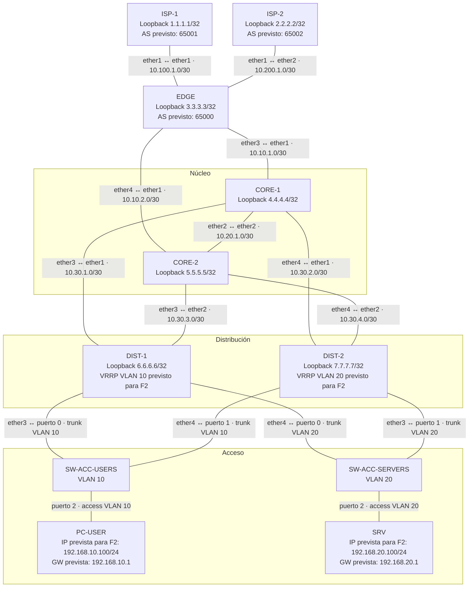
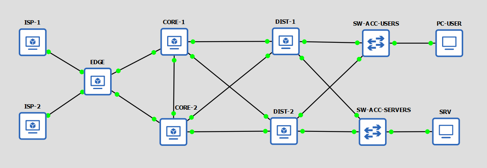
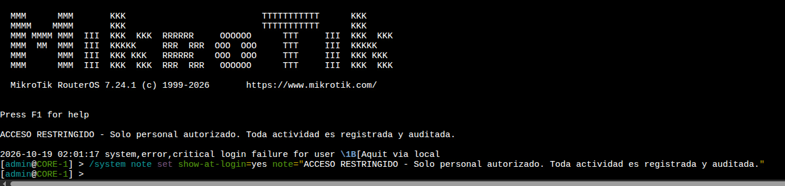
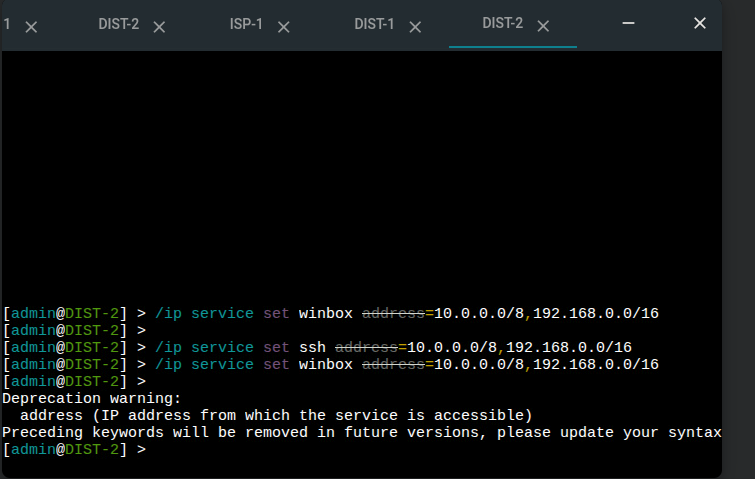
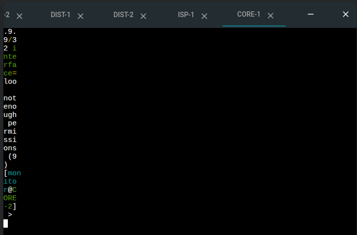
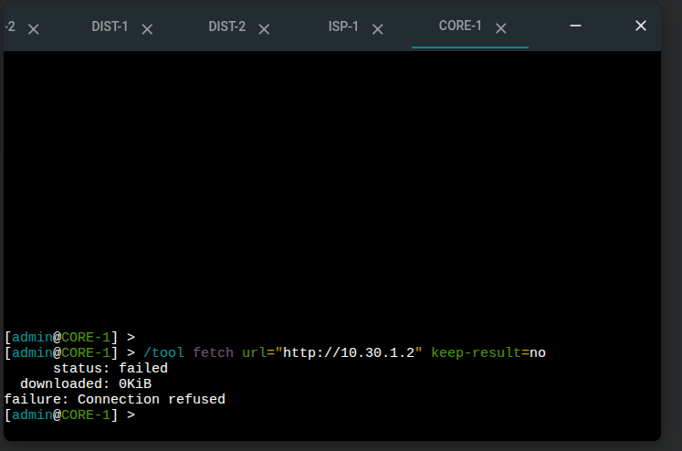

# Memoria Técnica del Laboratorio — Failover Routing

**Cátedra:** Gestión Operativa y Seguridad en Redes (GOYS)  
**Comisión:** 2026  
**Grupo:** 5  
**Fecha de Entrega F0 (Re-entrega):** 10/10/2026  
**Fecha de Entrega Final (F5):** 23/10/2026  
**Entorno de Simulación:** GNS3 · MikroTik CHR (RouterOS v7)

---

## Integrantes y Matriz de Roles

> **Aclaración sobre la composición del equipo y las funciones operativas:**  
> El Grupo 5 está compuesto por cuatro integrantes: Camila Baccarini (R1), Patricio Borda (R2), Ian Vidmar (R3) y Juan Ignacio Atencio Barrenechea (R4). R5 se conserva como función operativa transversal y no representa a un quinto integrante.

> **Responsable nominal de R5:** Alesandro Patricio Borda (R2), como responsabilidad adicional. Coordina backups y restauraciones, Change Log, registro de evidencias de drills y consolidación de post-mortems. Los responsables técnicos R1–R4 mantienen la ejecución de sus respectivos módulos y entregan los resultados a R5.

| Integrante                           |  Rol   | Email Institucional / Git                           | Módulo de Infraestructura                                                                                                                                                     | Responsabilidades operativas complementarias                                                                                                                                                                              |
| :----------------------------------- | :----: | :-------------------------------------------------- | :---------------------------------------------------------------------------------------------------------------------------------------------------------------------------- | :------------------------------------------------------------------------------------------------------------------------------------------------------------------------------------------------------------------------ |
| **Camila Baccarini**                 | **R1** | `cambaccarini01@gmail.com`                          | **Líder / Borde-WAN:** Router EDGE (AS 65000), dual-homing eBGP con ISP-1 e ISP-2, redistribución controlada OSPF↔BGP, BGP TCP-MD5, Firewall perimetral y NAT.                | Gobernanza del repositorio Git, control de calidad documental y elaboración del Runbook para Drill 3 (BGP Failover por caída de ISP).                                                                                     |
| **Alesandro Patricio Borda** | **R2 + R5 operativo** | `PATOEDA@HOTMAIL.COM` | **Proveedores (ISP):** Routers ISP-1 (AS 65001) e ISP-2 (AS 65002), inyección de default route (`default-originate`), eBGP peerings hacia EDGE y loopbacks públicas simuladas. | Responsable operativo de R5: coordina backups/restores, Change Log, evidencias de drills y post-mortems. Conserva la ejecución técnica de backups y restauraciones y el Runbook para Drill 4. |                                                    |
| **Ian Vidmar**                       | **R3** | `ividmar@alu.frlp.utn.edu.ar`                       | **Core / Backbone:** Routers CORE-1 y CORE-2, OSPF v2 Área 0 backbone en tránsito puro, enlace dedicado `core-core`, autenticación OSPF criptográfica con MD5.                | Aseguramiento de Calidad (QA) de configuraciones, monitoreo y telemetría de red (SNMP / syslog de eventos de adyacencia) y Runbook para Drill 2 (Corte de enlace interno OSPF).                                           |
| **Juan Ignacio Atencio Barrenechea** | **R4** | `juanignacioatenciobarrenechea@alu.frlp.utn.edu.ar` | **Distribución & FHRP:** Routers DIST-1 y DIST-2, VRRP v2/v3 activo/activo (_load-sharing_ entre VLAN 10 y VLAN 20), autenticación VRRP simple y adyacencias OSPF uplink.     | Despliegue, configuración y pruebas de equipos terminales (PC-USER en VLAN 10 y SRV en VLAN 20), validación de conectividad de primer salto y Runbooks para Drill 1 (Caída de Master VRRP) y Drill 5 (Load-sharing VRRP). |

---

## 1. Diseño Arquitectónico (Fase F0)

### 1.1 Corrección Crítica de Defectos del Diagrama Original

A partir del análisis exhaustivo del diagrama de referencia _"Enterprise Network Design (Cisco)"_, el equipo detectó cuatro fallas graves de diseño que comprometen la resiliencia, escalabilidad y seguridad de la infraestructura. A continuación se detallan los defectos y las soluciones de ingeniería adoptadas para nuestra topología de 7 nodos CHR:

```
+---------------------------------------------------------------------------------------------------+
| COMPARATIVA ARQUITECTÓNICA: DIAGRAMA ORIGINAL VS. REDISEÑO GRUPO 5                                |
+------------------------------------+--------------------------------------------------------------+
| Diseño Original con Defectos       | Rediseño Defendible y Corregido (Grupo 5)                    |
+------------------------------------+--------------------------------------------------------------+
| 1. Firewall Único en Borde (SPOF)  | 1. Dual-homing BGP multihoming a dos ISPs + dual uplink Core |
| 2. Sin enlace horizontal Core-Core | 2. Enlace /30 dedicado inter-Core en OSPF Área 0             |
| 3. HSRP colapsado en el Core       | 3. Core en Tránsito Puro; VRRP activo/activo en Distribución |
| 4. Subredes dispersas y solapadas  | 4. Plan IPAM jerárquico determinista (/30 enlaces, /24 VLANs)|
+------------------------------------+--------------------------------------------------------------+
```

#### Defecto 1: Punto Único de Falla (SPOF) en el Borde Perimetral

- **Diagnóstico Crítico:** El diagrama original implementa un único appliance de firewall/edge recibiendo las acometidas de los proveedores. Cualquier incidente físico, saturación de CPU por ataque DoS, falla de fuente o reinicio por actualización en ese nodo deja a toda la organización desconectada, anulando la supuesta redundancia de contar con múltiples enlaces hacia Internet.
- **Solución e Implementación en el Laboratorio:** En un entorno enterprise de producción, la solución estándar exige un clúster de Firewalls en Alta Disponibilidad (Active/Standby o Active/Active mediante protocolos de sincronización de tablas de estado como CARP o clúster propietario). En nuestro laboratorio sobre MikroTik CHR, documentamos este trade-off arquitectónico y mitigamos el riesgo en la capa de software:
  1. El router `EDGE` establece dos sesiones eBGP independientes con `ISP-1` (AS 65001) e `ISP-2` (AS 65002) sobre interfaces físicas dedicadas (`ether1` y `ether2`).
  2. Hacia el interior, `EDGE` bifurca el tránsito hacia el núcleo mediante dos enlaces punto a punto independientes: `ether3` hacia `CORE-1` (`10.10.1.0/30`) y `ether4` hacia `CORE-2` (`10.10.2.0/30`).
  3. De esta forma, el borde garantiza que una contingencia en un ISP o en uno de los routers de Core no interrumpa el flujo del tráfico, aislando el dominio externo del plano de control interno.

#### Defecto 2: Ausencia de Enlace Físico Directo Core-Core (Inter-Core Link)

- **Diagnóstico Crítico:** En el diseño original, los routers del núcleo (`CORE-1` y `CORE-2`) no poseían una interconexión directa entre sí. Ante la pérdida de un enlace vertical (por ejemplo, la caída del enlace `EDGE` ↔ `CORE-1`), el tráfico proveniente de la capa de distribución hacia `CORE-1` se ve obligado a descender nuevamente por la distribución para alcanzar `CORE-2` (_trombone routing_ / tráfico en zigzag). Esto genera saturación innecesaria en enlaces de acceso/distribución, introduce latencia impredecible y duplica el consumo de buffers en los switches intermedios.
- **Solución e Implementación en el Laboratorio:** Agregamos un enlace punto a punto `/30` físico dedicado entre ambos routers de Core (`CORE-1` `ether2` `10.20.1.1/30` ↔ `CORE-2` `ether2` `10.20.1.2/30`):
  1. **Convergencia Acelerada:** Permite el intercambio y flooding directo de LSAs Tipo 1 (Router LSA) en OSPF v2 Área 0 sin requerir saltos intermedios.
  2. **Tránsito Horizontal Óptimo:** Si `CORE-1` pierde conectividad con el borde, conmuta el tráfico hacia `CORE-2` en un único salto interno de Capa 3 a velocidad de interfaz.
  3. **Resiliencia ante Partición del Backbone:** Previene que el Área 0 quede dividida lógicamente en caso de fallas concurrentes en la capa de distribución.

#### Defecto 3: Mala Ubicación de la Redundancia de Primer Salto (FHRP en Core)

- **Diagnóstico Crítico:** El diseño original configuraba pasarelas redundantes (HSRP) directamente en los routers de Core. Esta arquitectura colapsada viola el principio de diseño modular de Cisco y de redes de alta velocidad: obliga al núcleo a mantener interfaces virtuales de Capa 2 (SVIs), procesar tormentas de broadcast ARP, responder a paquetes multicast de clientes y gestionar tablas de estados de host.
- **Solución e Implementación en el Laboratorio:** Redefinimos al Core como un **Núcleo de Tránsito Puro (Pure Transit Core)** y desplazamos el FHRP a la capa de **Distribución**:
  1. **Core Desacoplado:** `CORE-1` y `CORE-2` operan exclusivamente con interfaces enrutadas de Capa 3, conmutando paquetes por hardware mediante rutas OSPF de costo balanceado (ECMP), sin tablas ARP de estaciones finales.
  2. **VRRP Activo/Activo en Distribución:** `DIST-1` y `DIST-2` actúan como puertas de enlace predeterminadas mediante dos grupos VRRP con balanceo de carga (_Load-Sharing_):
     - **Grupo USERS (VRID 10):** `DIST-1` es Master (Prioridad 150) y `DIST-2` es Backup (Prioridad 100) para la subred `192.168.10.0/24` (IP Virtual: `192.168.10.1`).
     - **Grupo SERVERS (VRID 20):** `DIST-2` es Master (Prioridad 150) y `DIST-1` es Backup (Prioridad 100) para la subred `192.168.20.0/24` (IP Virtual: `192.168.20.1`).
  3. Esto maximiza la utilización del hardware disponible: ambos routers de distribución cursan tráfico simultáneamente en condiciones normales.

#### Defecto 4: Solapamiento y Desorganización del Direccionamiento IP

- **Diagnóstico Crítico:** El diagrama original repetía subredes de manera caótica (por ejemplo, utilizando el rango `192.168.10.0/24` en múltiples segmentos no interconectados) y empleaba máscaras inadecuadas en enlaces punto a punto. Esto imposibilita el enrutamiento dinámico, produce _blackholes_ de paquetes e impide la sumarización limpia de rutas.
- **Solución e Implementación en el Laboratorio:** Se diseñó un plan de direccionamiento IPAM determinista, jerárquico y de cero solapamiento, con máscaras `/30` para enlaces punto a punto y `/24` para segmentos de acceso, estructurado por bloques funcionales.

---

### 1.2 Plan Integral de Direccionamiento IP (IPAM)

El plan de direccionamiento se organiza mediante subredes específicas para los enlaces punto a punto, segmentos LAN y loopbacks de los siete routers. Las direcciones configuradas se verifican contra las salidas de RouterOS (`/ip address print` y `/interface vlan print`) y las evidencias de conectividad de F1.

Los bloques de direccionamiento agrupan las redes por función. Las subredes `/30` se utilizan en los enlaces de tránsito, las `/24` en las VLAN de acceso y las `/32` en las interfaces loopback. Las direcciones virtuales VRRP de las VLAN 10 y 20 y los Router-ID de OSPF de los cinco routers internos fueron configurados durante F2 y están verificados en las evidencias de esta fase. La configuración de BGP, incluidas las sesiones con los ISP, corresponde a F3.

| Bloque / Prefijo            | Función de Red       | Criterio de Diseño                                                                                            |
| :-------------------------- | :------------------- | :------------------------------------------------------------------------------------------------------------ |
| `10.100.1.0/30`             | WAN ISP-1            | Enlace punto a punto ISP-1 ↔ EDGE.                                                                            |
| `10.200.1.0/30`             | WAN ISP-2            | Enlace punto a punto ISP-2 ↔ EDGE.                                                                            |
| `10.10.1.0/30`              | EDGE–CORE-1          | Enlace de tránsito entre EDGE y CORE-1.                                                                       |
| `10.10.2.0/30`              | EDGE–CORE-2          | Enlace de tránsito entre EDGE y CORE-2.                                                                       |
| `10.20.1.0/30`              | CORE-1–CORE-2        | Enlace dedicado entre los dos routers de núcleo.                                                              |
| `10.30.1.0/30`              | CORE-1–DIST-1        | Enlace de tránsito entre CORE-1 y DIST-1.                                                                     |
| `10.30.2.0/30`              | CORE-1–DIST-2        | Enlace de tránsito entre CORE-1 y DIST-2.                                                                     |
| `10.30.3.0/30`              | CORE-2–DIST-1        | Enlace de tránsito entre CORE-2 y DIST-1.                                                                     |
| `10.30.4.0/30`              | CORE-2–DIST-2        | Enlace de tránsito entre CORE-2 y DIST-2.                                                                     |
| `192.168.10.0/24`           | VLAN 10 — Usuarios   | Segmento de acceso para PC-USER. Gateway virtual previsto para F2.                                            |
| `192.168.20.0/24`           | VLAN 20 — Servidores | Segmento de acceso para SRV. Gateway virtual previsto para F2.                                                |
| `1.1.1.1/32` a `7.7.7.7/32` | Loopbacks            | Identificadores asignados a las interfaces `lo`; previstos como Router-ID en los protocolos correspondientes. |

#### 1.2.1 Identificadores de Router (Router-ID previstos) y Loopbacks (/32)

Los siete routers tienen configurada una interfaz loopback llamada `lo`, con una dirección IPv4 `/32`. Estas direcciones proporcionan identificadores estables para el diseño del laboratorio.

**La existencia de la interfaz y su dirección IP no implica que el Router-ID ya esté configurado en OSPF o BGP.** Esa configuración se realizará y verificará durante las fases F2 y F3, según corresponda.

| Dispositivo | Capa de Red      | Dirección de Loopback | Máscara | Función prevista en el laboratorio                 |
| :---------- | :--------------- | :-------------------: | :-----: | :------------------------------------------------- |
| **ISP-1**   | WAN externa      |       `1.1.1.1`       |  `/32`  | Identificador del proveedor primario (AS 65001).   |
| **ISP-2**   | WAN externa      |       `2.2.2.2`       |  `/32`  | Identificador del proveedor secundario (AS 65002). |
| **EDGE**    | Borde perimetral |       `3.3.3.3`       |  `/32`  | Identificador previsto para BGP (AS 65000) y OSPF. |
| **CORE-1**  | Núcleo (Core)    |       `4.4.4.4`       |  `/32`  | Identificador previsto para OSPF Área 0.           |
| **CORE-2**  | Núcleo (Core)    |       `5.5.5.5`       |  `/32`  | Identificador previsto para OSPF Área 0.           |
| **DIST-1**  | Distribución     |       `6.6.6.6`       |  `/32`  | Identificador previsto para OSPF Área 0.           |
| **DIST-2**  | Distribución     |       `7.7.7.7`       |  `/32`  | Identificador previsto para OSPF Área 0.           |

#### 1.2.2 Matriz Completa de Enlaces Punto a Punto (/30)

La siguiente matriz identifica las nueve conexiones entre routers. Las direcciones de ambos extremos pertenecen a la misma subred `/30`, sin solapamientos.

| Enlace físico       |   Red / CIDR    | Dispositivo A | Interfaz A |      IP A       | Dispositivo B | Interfaz B |      IP B       |
| :------------------ | :-------------: | :------------ | :--------: | :-------------: | :------------ | :--------: | :-------------: |
| **ISP-1 ↔ EDGE**    | `10.100.1.0/30` | ISP-1         |  `ether1`  | `10.100.1.1/30` | EDGE          |  `ether1`  | `10.100.1.2/30` |
| **ISP-2 ↔ EDGE**    | `10.200.1.0/30` | ISP-2         |  `ether1`  | `10.200.1.1/30` | EDGE          |  `ether2`  | `10.200.1.2/30` |
| **EDGE ↔ CORE-1**   | `10.10.1.0/30`  | EDGE          |  `ether3`  | `10.10.1.1/30`  | CORE-1        |  `ether1`  | `10.10.1.2/30`  |
| **EDGE ↔ CORE-2**   | `10.10.2.0/30`  | EDGE          |  `ether4`  | `10.10.2.1/30`  | CORE-2        |  `ether1`  | `10.10.2.2/30`  |
| **CORE-1 ↔ CORE-2** | `10.20.1.0/30`  | CORE-1        |  `ether2`  | `10.20.1.1/30`  | CORE-2        |  `ether2`  | `10.20.1.2/30`  |
| **CORE-1 ↔ DIST-1** | `10.30.1.0/30`  | CORE-1        |  `ether3`  | `10.30.1.1/30`  | DIST-1        |  `ether1`  | `10.30.1.2/30`  |
| **CORE-1 ↔ DIST-2** | `10.30.2.0/30`  | CORE-1        |  `ether4`  | `10.30.2.1/30`  | DIST-2        |  `ether1`  | `10.30.2.2/30`  |
| **CORE-2 ↔ DIST-1** | `10.30.3.0/30`  | CORE-2        |  `ether3`  | `10.30.3.1/30`  | DIST-1        |  `ether2`  | `10.30.3.2/30`  |
| **CORE-2 ↔ DIST-2** | `10.30.4.0/30`  | CORE-2        |  `ether4`  | `10.30.4.1/30`  | DIST-2        |  `ether2`  | `10.30.4.2/30`  |

#### 1.2.3 Segmentos de Acceso LAN y Parámetros VRRP Planificados

Las redes LAN están asociadas a interfaces VLAN configuradas sobre interfaces físicas de los routers de distribución. Las direcciones IP indicadas en las columnas de DIST-1 y DIST-2 corresponden a las direcciones individuales actualmente asignadas a esas interfaces VLAN.

Las direcciones virtuales, los VRID y las prioridades se incluyen como parámetros de diseño previstos para F2; **no se afirma que VRRP esté configurado u operativo durante F1**.

| Segmento / VLAN  | ID VLAN |      Subred       | Interfaz DIST-1         |     IP DIST-1     | Interfaz DIST-2         |     IP DIST-2     | Gateway virtual previsto | VRID previsto |
| :--------------- | :-----: | :---------------: | :---------------------- | :---------------: | :---------------------- | :---------------: | :----------------------: | :-----------: |
| **VLAN-USERS**   |  `10`   | `192.168.10.0/24` | `vlan10` sobre `ether3` | `192.168.10.2/24` | `vlan10` sobre `ether4` | `192.168.10.3/24` |      `192.168.10.1`      |     `10`      |
| **VLAN-SERVERS** |  `20`   | `192.168.20.0/24` | `vlan20` sobre `ether4` | `192.168.20.2/24` | `vlan20` sobre `ether3` | `192.168.20.3/24` |      `192.168.20.1`      |     `20`      |

La planificación de prioridades para F2 es la siguiente:

| Grupo VRRP previsto | Router previsto como Master | Prioridad | Router previsto como Backup | Prioridad |
| :------------------ | :-------------------------- | :-------: | :-------------------------- | :-------: |
| VLAN 10 — USERS     | DIST-1                      |   `150`   | DIST-2                      |   `100`   |
| VLAN 20 — SERVERS   | DIST-2                      |   `150`   | DIST-1                      |   `100`   |

#### 1.2.4 Matriz de Interfaces Físicas y Conexiones de Acceso

La topología utiliza cuatro enlaces desde los routers de distribución hacia los switches de acceso, además de un enlace desde cada switch hacia su host. Esta distribución corresponde al diseño de 15 enlaces utilizado para reconstruir la topología de GOYS.

| Dispositivo de origen | Interfaz / Puerto de origen | Dispositivo de destino | Interfaz / Puerto de destino | Función                |
| :-------------------- | :-------------------------- | :--------------------- | :--------------------------- | :--------------------- |
| DIST-1                | `ether3`                    | SW-ACC-USERS           | Puerto `0`                   | Transporte de VLAN 10. |
| DIST-2                | `ether4`                    | SW-ACC-USERS           | Puerto `1`                   | Transporte de VLAN 10. |
| DIST-1                | `ether4`                    | SW-ACC-SERVERS         | Puerto `0`                   | Transporte de VLAN 20. |
| DIST-2                | `ether3`                    | SW-ACC-SERVERS         | Puerto `1`                   | Transporte de VLAN 20. |
| SW-ACC-USERS          | Puerto `2`                  | PC-USER                | `Ethernet0`                  | Acceso a VLAN 10.      |
| SW-ACC-SERVERS        | Puerto `2`                  | SRV                    | `Ethernet0`                  | Acceso a VLAN 20.      |

#### 1.2.5 Direccionamiento de los Hosts

Las siguientes direcciones son las previstas para los equipos terminales. El gateway indicado es la dirección virtual planificada para F2; su funcionamiento debe validarse después de configurar VRRP.

| Host        | Segmento             | Dirección IP prevista | Máscara | Gateway previsto |
| :---------- | :------------------- | :-------------------: | :-----: | :--------------: |
| **PC-USER** | VLAN 10 — Usuarios   |   `192.168.10.100`    |  `/24`  |  `192.168.10.1`  |
| **SRV**     | VLAN 20 — Servidores |   `192.168.20.100`    |  `/24`  |  `192.168.20.1`  |

#### Estado de implementación al cierre de F1-B

En esta etapa están configuradas las direcciones IP de los 7 routers, las interfaces loopback y las interfaces VLAN de distribución. Se ejecutaron y verificaron las pruebas de conectividad entre vecinos directos, incluidas las pruebas entre las direcciones VLAN de DIST-1 y DIST-2.

OSPF, BGP y VRRP no se implementaron porque corresponden a fases posteriores del laboratorio.

---

### 1.3 Política Integral de Seguridad

La política de seguridad establece medidas técnicas de hardening perimetral y autenticación criptográfica en los planos de control y gestión:

#### 1. Usuarios y Control de Acceso Basado en Roles (RBAC)

- Se eliminan las credenciales de fábrica (`admin` con contraseña vacía).
- Los comandos siguientes son plantillas documentales. Las contraseñas reales deben definirse localmente y no incorporarse al repositorio.
- Se crea una cuenta de administración segura local:
  ```routeros
  /user group add name=superadmin policy=local,telnet,ssh,ftp,reboot,read,write,policy,test,winbox,password,web,snmp,sensitive,api,romon,rest-api
  /user add name=netadmin group=superadmin password="<DEFINIR_LOCALMENTE>"
  ```
- Se crea un usuario de auditoría de solo lectura para monitoreo y verificación de estado:
  ```routeros
  /user add name=monitor group=read password="<DEFINIR_LOCALMENTE>"
  ```
- Se desactiva o remueve el usuario `admin` por defecto:
  ```routeros
  /user remove [find name=admin]
  ```

#### 2. Hardening y Apagado de Servicios Inseguros

Para minimizar la superficie de ataque, se desactivan todos los servicios de administración en texto plano y no esenciales:

```routeros
/ip service set telnet disabled=yes
/ip service set ftp disabled=yes
/ip service set www disabled=yes
/ip service set api disabled=yes
/ip service set api-ssl disabled=yes
/ip service set ssh disabled=no port=22
/ip service set winbox disabled=no port=8291
```

- **Supresión de Protocolos de Descubrimiento:** Se desactiva MikroTik Neighbor Discovery Protocol (MNDP) y CDP en interfaces WAN públicas:
  ```routeros
  /ip neighbor discovery-settings set discover-interface-list=none
  ```

#### 3. Autenticación Criptográfica en Protocolos de Ruteo y Redundancia

- **OSPF v2 (Área 0):** Autenticación criptográfica obligatoria con **MD5** en todas las interfaces de tránsito. Las adyacencias rechazan paquetes hello o LSUs que no coincidan en la firma MD5.
  ```routeros
  /routing ospf interface-template add area=backbone interfaces=INTERFACES_TRANSITO> auth=md5 auth-id=1 authentication_key="<DEFINIR_LOCALMENTE>"
  ```
- **BGP (eBGP Multi-Homing):** Protección a nivel de socket TCP mediante la opción **TCP-MD5 Signature** (RFC 2385) entre EDGE e ISPs:

  ```routeros
  /routing bgp connection add name=peer-isp1 remote.address=10.100.1.1 .as=65001 tcp-md5-key="<DEFINIR_LOCALMENTE>"

  /routing bgp connection add name=peer-isp2 remote.address=10.200.1.1 .as=65002 tcp-md5-key="<DEFINIR_LOCALMENTE>"

  ```

- **VRRP v2/v3:** Autenticación por clave compartida (_Simple Authentication_) en los grupos VRID 10 y VRID 20 para evitar que hosts no autorizados en los segmentos LAN inyecten anuncios VRRP con prioridades arbitrarias.

---

### 1.4 Política de Operación y Gestión de Cambios

#### 1. Convención de Control de Versiones (Git)

Para garantizar la trazabilidad de cada intervención de ingeniería, el repositorio adopta de manera estricta la convención **Conventional Commits**:

```text
<tipo>(<alcance>): <descripción técnica concisa en imperativo>
```

- **Tipos permitidos:**
  - `feat`: Implementación de nuevas configuraciones, protocolos o políticas de red.
  - `fix`: Corrección de direccionamiento, filtros, rutas o discrepancias de sintaxis.
  - `docs`: Modificación o ampliación de memoria técnica, backlog o runbooks.
  - `ops`: Operaciones de respaldo, scripts de automatización o restauración.
  - `chore`: Creación de estructura de carpetas, `.gitkeep` o tareas administrativas.
- **Alcances válidos:** `ipam`, `roles`, `backlog`, `memoria`, `vrrp`, `ospf`, `bgp`, `firewall`, `hardening`, `drills`, `backup`.

#### 2. Política de Respaldos (Backup y Restore)

La salvaguarda de configuraciones sigue un esquema dual:

1. **Exportación Declarativa en Texto Plano (`/export`):**
   - Comando: `/export file=<router>-F1.rsc`
   - Formato editable y versionable en Git, libre de claves sensibles en commits públicos.
2. **Respaldo Binario del Estado del Sistema (`/system backup`):**
   - Comando: `/system backup save name=backups/<nombre-router>-<fase>.backup`
   - Respaldo de contingencia rápida para recuperación de desastres ante fallas del simulador.
3. **Frecuencia de Respaldo:**
   - Antes de iniciar cualquier drill destructivo (F4).
   - Al cierre de cada hito de configuración (F1, F2, F3).
   - Todo backup debe ser sometido a una prueba de restauración periódica en un nodo réplica para validar su integridad.

---

## 2. Topología de Red y Despliegue (Fase F1)

La topología está conformada por 7 routers MikroTik CHR, 2 switches Ethernet virtuales de Capa 2 y 2 terminales de prueba. El diseño contiene 9 enlaces entre routers, 4 enlaces entre distribución y acceso y 2 enlaces hacia los hosts, para un total de 15 enlaces internos.



### 2.1 Evidencia de la Topología Desplegada

La topología de 11 nodos y 15 enlaces internos fue desplegada en GNS3. La captura oficial se conserva en `capturas/f1/topologia/topologia-completa.png`.



Evidencias complementarias:

| Evidencia | Archivo |
| :-- | :-- |
| Proyecto operativo en GNS3 con los 7 routers encendidos (hosts aún sin iniciar) | `capturas/f1/topologia/gns3-topologia-operativa.png` |
| Configuración de puertos de SW-ACC-USERS | `capturas/f1/topologia/sw-acc-users-config.png` |
| Configuración de puertos de SW-ACC-SERVERS | `capturas/f1/topologia/sw-acc-servers-config.png` |

### 2.2 Entorno de Simulación y Problemas Encontrados

**Entorno final de ejecución:** GNS3 3.0.6 (instalado con `pipx`) con cliente de escritorio `gns3-gui`, sobre una VM Linux Mint, con MikroTik CHR RouterOS 7.24.1. Las consolas de los CHR se exponen por interfaz web para el acceso desde otros equipos.

**Problema:** al abrir la consola de cualquier CHR no era posible ingresar comandos (consola en blanco por telnet/SSH y reintentos de arranque reiterados por VNC).

| Variable probada | Resultado |
| :-- | :-- |
| Distintas versiones de MikroTik CHR y de QEMU | Sin cambios |
| Consolas telnet, SSH y VNC | Consola en blanco o reintentos de arranque |
| Distintas versiones de GNS3 (incluida alpha) | Sin cambios |
| Hosts Linux y Windows; virtualización anidada activada | Sin cambios; algunas combinaciones colgaban la VM o el host |
| GNS3 en VirtualBox con interfaz web | Falla (también con la aceleración desactivada) |

**Solución:** ejecutar GNS3 en una VM Linux Mint con `gns3-gui` y desactivar KVM en el servidor GNS3, ya que el CHR informaba un error de aceleración. En `~/.config/GNS3/2.2/gns3_server.conf` se agregó al final:

```toml
[Qemu]
enable_kvm = false
```

**Conclusión:** el origen del problema era la plataforma donde corría GNS3 y no la virtualización anidada en sí.

**Compatibilidad de proyectos:** el GNS3 del PPA `ppa:gns3/ppa` es 2.2.x y no importa proyectos de versión 3.x (la interfaz web falla sin mostrar error). Se reemplazó por GNS3 3.0.6:

```bash
sudo apt remove gns3-gui gns3-server
sudo apt install pipx python3-pyqt6 python3-pyqt6.qtwebsockets python3-pyqt6.qtsvg dynamips ubridge vpcs
pipx install gns3-server
pipx install gns3-gui
pipx inject gns3-gui gns3-server PyQt6
pipx ensurepath
sudo apt install libxcb-cursor0   # sin esto GNS3 abortaba con "Fatal Python error: Aborted"
gns3
```

Evidencias en `capturas/f1/troubleshooting/`: `consola-chr-en-blanco.png`, `consola-vnc-reintentos.png`, `error-aceleracion-kvm.png` y `gns3-server-conf-enable-kvm-false.png`.

### 2.3 Hardening de los 7 Routers (F1)

Se verificó la configuración de hardening en los siete routers. Las cuentas administrativas utilizan `netadmin` en el grupo `full`; el usuario `monitor` utiliza el grupo personalizado `monitor-ro`, y el usuario por defecto `admin` ya no aparece en las salidas de auditoría.

| Control | Estado verificado |
| :-- | :-- |
| Identidad y usuarios | Nombre correcto del router, `netadmin` en `full`, `monitor` en `monitor-ro` y ausencia de `admin`. |
| Servicios de administración | FTP, Telnet, HTTP, HTTPS de administración, API, API-SSL y reverse-proxy deshabilitados. |
| SSH y WinBox | Activos y restringidos a `10.0.0.0/8,192.168.0.0/16`. |
| Descubrimiento de vecinos | `discover-interface-list=none`. |
| Cliente DHCP | Cliente `client1` deshabilitado donde está presente. |
| Servidor de ancho de banda | `/tool bandwidth-server print` indica `enabled=no`. |
| Acceso MAC | `allowed-interface-list=none` para MAC Server y MAC WinBox; MAC ping deshabilitado. |
| Usuario `monitor` | En los siete routers, el intento de agregar `9.9.9.9/32` a `lo` fue rechazado con `not enough permissions (9)`. |

Las credenciales reales se administran localmente y no se documentan en el repositorio público.

Medidas específicas por capa:

| Routers | Medida adicional | Evidencia |
| :-- | :-- | :-- |
| CORE-1 | Banner legal de acceso (`/system note set show-at-login=yes`) | `capturas/f1/hardening/core-1-banner-legal.png` |
| CORE-2 | Banner legal de acceso (`/system note set show-at-login=yes`) | Pendiente de confirmar y documentar la evidencia. |
| DIST-1 y DIST-2 | Acceso SSH/WinBox restringido a `10.0.0.0/8,192.168.0.0/16` | `capturas/f1/hardening/dist-1-hardening.png`, `capturas/f1/hardening/dist-2-hardening.png` |




#### Pruebas de seguridad negativa

| Prueba | Resultado esperado | Resultado obtenido | Evidencia |
| :-- | :-- | :-- | :-- |
| SSH como `monitor` desde CORE-1 hacia CORE-2 (`10.20.1.2`) y alta de `9.9.9.9/32` en `lo` | `not enough permissions` | Rechazado: `not enough permissions (9)` | `core-2-monitor-solo-lectura.png` |
| `/system telnet 10.30.1.2` desde CORE-1 hacia DIST-1 | Conexión rechazada | `Connection refused` | `dist-1-telnet-http-rechazados.png` |
| `/tool fetch url="http://10.30.1.2"` desde CORE-1 hacia DIST-1 | Falla | `status: failed` · `Connection refused` | `dist-1-http-rechazado.png`, `dist-1-telnet-http-rechazados.png` |




#### Desvíos y observaciones

1. **Política `superadmin`:** el grupo se definió con el permiso `sniff` en lugar de `snmp` (sección 1.3 de F0). Corregir en F4 si se requiere acceso SNMP desde este grupo.
2. **Usuarios preexistentes:** al repetir el bloque, RouterOS informó `group/user with the same name already exists` (`isp-2-usuarios-preexistentes.png`). Es esperable al reaplicar el bloque y no altera el resultado.
3. **Eliminación de `admin`:** el primer intento en ISP-1 falló porque `netadmin` no tenía todavía permisos completos. Posteriormente se corrigieron los permisos. En las capturas actuales de los siete routers, `netadmin` aparece en `full` y `admin` no aparece en la lista de usuarios.
4. **Intentos de login fallidos en el log:** se observan eventos `login failure` durante la configuración inicial (`isp-1-login-netadmin.png`), generados al ingresar comandos o credenciales en el prompt de login; no se detectaron accesos externos.

Las evidencias de hardening y auditoría se incorporaron a `capturas/f1/hardening/`: siete archivos `<router>-hardening.png` y siete archivos `auditoria-<router>.png`. En las auditorías se comprobó que el intento de agregar `9.9.9.9/32` como `monitor` es rechazado en los siete routers.

### 2.4 Conectividad entre Vecinos Directos

Las capturas de `/ip address print` y de los pings a vecinos directos de cada router están en `capturas/f1/conectividad/` (`<router>-ip-address.png` y `<router>-ping-vecinos.png`). Los pings entre DIST-1 y DIST-2 sobre VLAN 10 y VLAN 20 también fueron exitosos.

### 2.5 Snapshot BASE y Backup Inicial

| Elemento | Detalle |
| :-- | :-- |
| Snapshot GNS3 | `SNAPSHOT-BASE-F1`, creado el 19/10/2026. Se conserva `PRE-RESTORE-F1-20261019` como punto de retorno. |
| Evidencia visual del snapshot | `capturas/f1/topologia/snapshot-base-f1.png`; muestra `SNAPSHOT-BASE-F1` y `PRE-RESTORE-F1-20261019` con sus fechas y horas. |
| Estado incluido | Topología F1 con direccionamiento IP, loopbacks y hardening base, sin OSPF, BGP ni VRRP. |
| Prueba de restauración del snapshot | Se restauró `SNAPSHOT-BASE-F1`. EDGE conservó su identidad y las direcciones IP esperadas. Los pings EDGE → ISP-1 (`10.100.1.1`) e ISP-1 → EDGE (`10.100.1.2`) respondieron 4/4, con 0 % de pérdida. La validación realizada cubre el enlace ISP-1–EDGE, no una auditoría completa de los siete routers. |
| Exports `.rsc` | Generados mediante `/export` sin `show-sensitive` y versionados en `backups/f1/exports/`. Deben permanecer libres de contraseñas, claves y otros datos sensibles. |
| Backups binarios `.backup` | Generados en los siete routers con nombres `*-F1-post-hardening`. Queda pendiente confirmar una copia fuera del proyecto y probar la restauración de un backup en un nodo aislado. No versionar estos archivos en Git. |

> La política de la sección 1.4 menciona `/export show-sensitive`; para F1 se utilizó `/export` sin `show-sensitive`, siguiendo el criterio más restrictivo para evitar exponer secretos en el repositorio público.

---

## 3. Registro de Configuraciones de Dispositivos (F1 a F3)

_(Los scripts de configuración limpios para cada uno de los 7 routers CHR se guardan en el directorio `configs/<router>.rsc` y se incorporan formalmente al completar cada fase)._

### 3.1 Router ISP-1

- **Rol:** Proveedor WAN Primario (AS 65001).
- **Script asociado:** `../backups/f1/exports/isp-1-F1.rsc`
- **Parámetros clave:** Loopback `1.1.1.1/32`, eBGP peering hacia EDGE `10.100.1.2`, originación de default route BGP.

### 3.2 Router ISP-2

- **Rol:** Proveedor WAN Secundario (AS 65002).
- **Script asociado:** `configs/isp-2.rsc`
- **Parámetros clave:** Loopback `2.2.2.2/32`, eBGP peering hacia EDGE `10.200.1.2`, originación de default route BGP.

### 3.3 Router EDGE

- **Rol:** Borde perimetral multi-homing y Gateway exterior (AS 65000).
- **Script asociado:** `configs/edge.rsc`
- **Parámetros clave:** Loopback `3.3.3.3/32`, eBGP dual con TCP-MD5, OSPF Área 0 hacia Cores, Firewall con estado y NAT Masquerade.

### 3.4 Router CORE-1

- **Rol:** Núcleo de tránsito puro A (OSPF Área 0).
- **Script asociado:** `configs/core-1.rsc`
- **Parámetros clave:** Loopback `4.4.4.4/32`, enlace inter-Core `10.20.1.1/30` con OSPF MD5, uplinks a EDGE y downlinks a Distribución.

### 3.5 Router CORE-2

- **Rol:** Núcleo de tránsito puro B (OSPF Área 0).
- **Script asociado:** `configs/core-2.rsc`
- **Parámetros clave:** Loopback `5.5.5.5/32`, enlace inter-Core `10.20.1.2/30` con OSPF MD5, uplinks a EDGE y downlinks a Distribución.

### 3.6 Router DIST-1

- **Rol:** Distribución y Gateway de primer salto.
- **Script asociado:** `configs/dist-1.rsc`
- **Parámetros clave:** Loopback `6.6.6.6/32`, VRRP Master en VLAN 10 (Prio 150), VRRP Backup en VLAN 20 (Prio 100), OSPF pasivo en LANs.

### 3.7 Router DIST-2

- **Rol:** Distribución y Gateway de primer salto.
- **Script asociado:** `configs/dist-2.rsc`
- **Parámetros clave:** Loopback `7.7.7.7/32`, VRRP Master en VLAN 20 (Prio 150), VRRP Backup en VLAN 10 (Prio 100), OSPF pasivo en LANs.

### 3.8 Configuración de Hosts Terminales (PC-USER y SRV)

- **PC-USER (VLAN 10):**

  ```bash
  ip 192.168.10.100 255.255.255.0 192.168.10.1
  ```

- **SRV (VLAN 20):**
  ```bash
  ip 192.168.20.100 255.255.255.0 192.168.20.1
  ```

### 3.9 OSPF Área 0 con MD5: adyacencias al cierre del paso 1 de F2 (25/10/2026)

Todos los routers internos usan la instancia `ospf1` y el área `backbone` (0.0.0.0). Las loopbacks y las interfaces VLAN de DIST van como `passive`. EDGE no incluye `ether1` ni `ether2` en OSPF, porque son los enlaces hacia los ISP.

| Router | Router-ID | Vecinos en `Full` |
| :--- | :---: | :--- |
| EDGE | 3.3.3.3 | CORE-1 (4.4.4.4) por `ether3`, CORE-2 (5.5.5.5) por `ether4` |
| CORE-1 | 4.4.4.4 | EDGE, CORE-2, DIST-1 y DIST-2 |
| CORE-2 | 5.5.5.5 | Verificado desde EDGE, CORE-1, DIST-1 y DIST-2 |
| DIST-1 | 6.6.6.6 | CORE-1 (4.4.4.4) por `ether1`, CORE-2 (5.5.5.5) por `ether2` |
| DIST-2 | 7.7.7.7 | CORE-1 (4.4.4.4) por `ether1`, CORE-2 (5.5.5.5) por `ether2` |

### 3.10 VRRP Activo/Activo y Verificación L3 End-to-End (25/10/2026)

Se completó la implementación y verificación del esquema de redundancia de primer salto (VRRP) y conectividad terminal:

1. **Topología de VRRP en Distribución:**
   - **VLAN 10 — USERS:** VRID `10`, IP Virtual `192.168.10.1/32`. DIST-1 opera como **Master** (`priority=150`, flag `RM`) y DIST-2 como **Backup** (`priority=100`, flag `B`).
   - **VLAN 20 — SERVERS:** VRID `20`, IP Virtual `192.168.20.1/32`. DIST-2 opera como **Master** (`priority=150`, flag `RM`) y DIST-1 como **Backup** (`priority=100`, flag `B`).
   - Parámetros operativos: RouterOS `version=2`, autenticación `simple`, intervalo de anuncios de 1s (`interval=1s`) y preemption habilitado (`preempt-mode=yes`).
   - Evidencias en `capturas/f2/vrrp/`: `dist-1-vrrp.png`, `dist-2-vrrp.png`, `dist-1-vip.png` y `dist-2-vip.png`.

2. **Resolución de Direcciones Virtuales (ARP):**
   - En PC-USER, `192.168.10.1` resuelve a la MAC Virtual VRRP RFC 5798 `00:00:5E:00:01:0A` (VRID 10 en hex).
   - En SRV, `192.168.20.1` resuelve a la MAC Virtual VRRP RFC 5798 `00:00:5E:00:01:14` (VRID 20 en hex).
   - Evidencias en `capturas/f2/conectividad/`: `pc-user-arp-vrrp.png` y `srv-arp-vrrp.png`.

3. **Conectividad Intra-LAN y Ruteo Inter-VLAN:**
   - Ambos hosts alcanzan con éxito su gateway virtual con RTT < 1ms.
   - Ping bidireccional entre `PC-USER` (`192.168.10.100`) y `SRV` (`192.168.20.100`) con 0% de pérdida de paquetes y TTL 63 (degradado por el salto de enrutamiento L3 en distribución/core).
   - Evidencias en `capturas/f2/conectividad/`: `pc-user-pings.png` y `srv-pings.png`.

4. **Validación de Load-Sharing Activo/Activo mediante Traceroute:**
   - `PC-USER> trace 192.168.20.100`: Salto 1 = `192.168.10.2` (**DIST-1**) → Salto 2 = `192.168.20.100` (`pc-user-trace-srv.png`).
   - `SRV> trace 192.168.10.100`: Salto 1 = `192.168.20.3` (**DIST-2**) → Salto 2 = `192.168.10.100` (`srv-trace-pc-user.png`).
   - Se constata que el tráfico de salida de VLAN 10 es procesado por DIST-1 mientras que el de VLAN 20 es procesado simultáneamente por DIST-2, operando en modo activo/activo real sin enlaces ociosos.
   - Las cachés ARP completas se registran en `pc-user-arp-cache.png` y `srv-arp-cache.png`.

### 3.11 Propagación de rutas LAN y ECMP (25/10/2026)

Las rutas OSPF de F2 fueron verificadas en los routers de distribución, núcleo y borde mediante `/ip route print detail`. Los resultados demuestran tanto la propagación de las LAN como la existencia de múltiples próximos saltos activos de igual preferencia.

1. **ECMP desde DIST-1 hacia EDGE:** la ruta a `3.3.3.3/32` presenta caminos a través de `10.30.1.1%ether1` (CORE-1) y `10.30.3.1%ether2` (CORE-2). El ping a `3.3.3.3` obtuvo cinco respuestas y 0% de pérdida.
   - Evidencia: `capturas/f2/ospf/dist-1-ping-edge-loopback.png`.

2. **ECMP desde DIST-2 hacia EDGE:** la ruta a `3.3.3.3/32` presenta caminos a través de `10.30.2.1%ether1` (CORE-1) y `10.30.4.1%ether2` (CORE-2).
   - Evidencia: `capturas/f2/ospf/dist-2-ecmp-edge-loopback.png`.

3. **Propagación de las LAN en CORE-1:** `192.168.10.0/24` y `192.168.20.0/24` se aprenden por ambos routers DIST, a través de `10.30.1.2%ether3` y `10.30.2.2%ether4`.
   - Evidencia: `capturas/f2/ospf/core-1-rutas-lan.png`.

4. **Propagación de las LAN en CORE-2:** ambas redes se aprenden por DIST-1 y DIST-2, a través de `10.30.3.2%ether3` y `10.30.4.2%ether4`.
   - Evidencia: `capturas/f2/ospf/core-2-rutas-lan.png`.

5. **Propagación de las LAN en EDGE:** ambas redes se aprenden por CORE-1 (`10.10.1.2%ether3`) y CORE-2 (`10.10.2.2%ether4`).
   - Evidencia: `capturas/f2/ospf/edge-rutas-lan.png`.

Las entradas mostradas con la marca `+` confirman que RouterOS agrupa los caminos ECMP. No se alteraron los costes OSPF, dado que el resultado de múltiples próximos saltos activos ya está presente en la tabla de rutas. No se interpreta `distance=110` como un coste de interfaz OSPF: es la distancia administrativa mostrada por RouterOS para la ruta aprendida.

### 3.12 eBGP multi-homing con TCP-MD5 y salida por defecto (F3, avance al 25/10/2026)

Se configuraron las dos sesiones eBGP entre EDGE (AS 65000) y los proveedores ISP-1 (AS 65001) e ISP-2 (AS 65002), con protección TCP-MD5 en cada peering. Esta versión de RouterOS 7 utiliza **instancias BGP**: el AS local y el `router-id` se definen en `/routing bgp instance`, y cada conexión referencia la instancia con `instance=bgp1`.

| Router | AS | Instancia / Router-ID | Conexión | Vecino | Política aplicada |
| :--- | :---: | :---: | :--- | :--- | :--- |
| ISP-1 | 65001 | `bgp1` / `1.1.1.1` | `to-EDGE` | EDGE `10.100.1.2` (AS 65000) | `default-originate=always`; anuncia `1.1.1.1/32` mediante la lista `NET-ISP1`. |
| ISP-2 | 65002 | `bgp1` / `2.2.2.2` | `to-EDGE` | EDGE `10.200.1.2` (AS 65000) | `default-originate=always`; anuncia `2.2.2.2/32` mediante la lista `NET-ISP2`. |
| EDGE | 65000 | `bgp1` / `3.3.3.3` | `to-ISP1` y `to-ISP2` | ISP-1 `10.100.1.1` y ISP-2 `10.200.1.1` | `input.filter` `ISP1-IN` / `ISP2-IN`, `output.filter-chain=BGP-OUT` y `output.redistribute=ospf`. |

**Política de rutas en EDGE (filtros de `/routing filter rule`):**

- `ISP1-IN`: `set bgp-local-pref 200; accept` (proveedor primario).
- `ISP2-IN`: `set bgp-local-pref 100; accept` (proveedor de respaldo).
- `BGP-OUT`: acepta únicamente prefijos dentro de `192.168.0.0/16` (las LAN de USERS y SERVERS aprendidas por OSPF) y rechaza el resto, de modo que no se filtran loopbacks ni enlaces internos hacia los proveedores.

**Default hacia el dominio OSPF:** en EDGE se ejecutó `/routing ospf instance set ospf1 originate-default=if-installed`, para que la ruta por defecto aprendida por BGP se anuncie hacia CORE y DIST.

**Verificación realizada:**

1. **Sesiones en EDGE:** `/routing bgp session print` muestra las dos sesiones en estado `E` (*established*): `to-ISP1-1` con el vecino `10.100.1.1` (AS 65001, id `1.1.1.1`) y `to-ISP2-1` con el vecino `10.200.1.1` (AS 65002, id `2.2.2.2`). Ambas muestran los filtros `ISP1-IN` / `ISP2-IN` y `BGP-OUT` aplicados y `prefix-count=2`.
2. **Rutas BGP en EDGE:** `/ip route print where bgp` muestra dos rutas `0.0.0.0/0`, una por `10.100.1.1` (ISP-1, activa, flag `A`) y otra por `10.200.1.1` (ISP-2, inactiva), ambas con distancia 20. También aparecen activas `1.1.1.1/32` (por ISP-1) y `2.2.2.2/32` (por ISP-2). La elección de ISP-1 como salida por defecto es coherente con el `local-pref` 200 frente a 100.
3. **Sesiones y rutas en los ISP:** ISP-1 e ISP-2 muestran su sesión con EDGE en `E` (*established*) y aprenden por BGP `192.168.10.0/24` y `192.168.20.0/24` con próximo salto `10.100.1.2` y `10.200.1.2`, respectivamente. Esto confirma la redistribución OSPF→BGP con el filtro `BGP-OUT`.

**Observaciones:**

- Durante la configuración de ISP-1 se registró el error `bad parameter router-id (line 1 column 135)`: en esta versión de RouterOS el `router-id` no es un parámetro de `/routing bgp connection`. Al omitirlo, el comando solicitó el parámetro `instance:`. Se resolvió creando primero la instancia `bgp1` (AS y `router-id`) y referenciándola en la conexión. El error y la corrección quedan visibles en `capturas/f3/bgp/isp-1-bgp-config.png`.
- El orden de configuración en EDGE fue: filtros (`ISP1-IN`, `ISP2-IN`, `BGP-OUT`), instancia y conexiones, y por último `originate-default`.

**Pendiente de F3 (no verificado a esta fecha):** recepción de la ruta por defecto con flag `Do` en CORE-1, CORE-2, DIST-1 y DIST-2; ping y traceroute desde PC-USER y SRV hacia `1.1.1.1` y `2.2.2.2`; firewall de EDGE (cadenas `input` y `forward`); prueba negativa de clave TCP-MD5 incorrecta; y exports de F3 en `backups/f3/exports/`.

**Evidencias en `capturas/f3/bgp/`:** `isp-1-bgp-config.png`, `isp-2-bgp-config.png`, `edge-filtros-bgp.png`, `edge-bgp-instancia.png`, `edge-ospf-originate-default.png`, `edge-bgp-session-routes.png`, `isp-1-bgp-session-routes.png` e `isp-2-bgp-session-routes.png`.

---

## 4. Verificación y Batería de Drills de Failover (F4)

### 4.1 Pruebas de Conectividad Base

Las pruebas de conectividad validan el funcionamiento nominal antes de inducir fallas:

- **Ping intra-LAN:** `PC-USER` pinguea a `SRV` (`192.168.20.100`). Valida enrutamiento inter-VLAN en la capa de distribución.
- **Traceroute WAN:** `PC-USER` y `SRV` ejecutan traceroute a las Loopbacks de los ISPs (`1.1.1.1` y `2.2.2.2`). Valida el camino completo: Acceso → Distribución → Core → Borde → Internet.

### 4.2 Los 5 Drills de Failover de la Red

Cada drill se ejecuta siguiendo la metodología de ingeniería de resiliencia: **Detección → Respuesta → Recuperación → Post-Mortem**.

```
+---------------------------------------------------------------------------------------------------+
| MATRIZ DE DRILLS DE RESILIENCIA Y TIEMPOS ESPERADOS                                               |
+--------+----------------------------+-----------------------+-------------------+-----------------+
| Drill  | Escenario de Contingencia  | Capa / Protocolo      | Mecanismo Failover| Tiempo Objetivo |
+--------+----------------------------+-----------------------+-------------------+-----------------+
| 1      | Caída de Gateway DIST-1    | Capa 1 / VRRP         | Transición Master | < 3 segundos    |
| 2      | Corte Enlace Tránsito Core | Capa 2 / OSPF Área 0  | SPF recalculation | < 5 segundos    |
| 3      | Caída Enlace ISP-1 (Borde) | Capa 3 / eBGP         | BGP Path Selection| < 10 segundos   |
| 4      | Falla Enlace Estático      | Ruteo Estático        | check-gateway ping| ~30 segundos    |
| 5      | Verificación Load-Sharing  | Distribución / VRRP   | Activo/Activo     | Continuo (0s)   |
+--------+----------------------------+-----------------------+-------------------+-----------------+
```

#### Drill 1 — VRRP: Caída de Gateway Master en Distribución

- **Responsable:** Juan Ignacio Atencio (R4)
- **Procedimiento:** Ejecutar ping sostenido desde `PC-USER` a `192.168.10.1`. Deshabilitar la interfaz `vlan10` en `DIST-1` (`/interface vlan disable vlan10`).
- **Comportamiento Esperado:** Al dejar de recibir tramas VRRP Advertisement tras 3 intervalos consecutivos (3s), `DIST-2` conmuta de estado Backup (`B`) a Master (`RM`).
- **Runbook:** Documentado en `runbooks/drill-1.md`.

#### Drill 2 — OSPF: Corte de Enlace Interno de Tránsito

- **Responsable:** Ian Vidmar (R3)
- **Procedimiento:** Iniciar transferencia de datos entre hosts y deshabilitar el enlace `EDGE` ↔ `CORE-1` (`10.10.1.0/30`).
- **Comportamiento Esperado:** OSPF detecta la pérdida de adyacencia, inunda un nuevo Router LSA por el enlace horizontal Core-Core (`10.20.1.0/30`), recalculando el árbol SPF. El tráfico fluye por `CORE-2` sin interrupción de las sesiones de los hosts.
- **Runbook:** Documentado en `runbooks/drill-2.md`.

#### Drill 3 — BGP: Caída de Proveedor WAN Primario

- **Responsable:** Camila Baccarini (R1)
- **Procedimiento:** Deshabilitar la interfaz `ether1` en `EDGE` conectada a `ISP-1` mientras se monitorea ping hacia `1.1.1.1` y `8.8.8.8`.
- **Comportamiento Esperado:** La sesión BGP con AS 65001 cae. La tabla de ruteo de `EDGE` conmuta la default route activa hacia el peer `ISP-2` (AS 65002).
- **Runbook:** Documentado en `runbooks/drill-3.md`.

#### Drill 4 — check-gateway: Failover Estático Recursivo

- **Responsable:** Alesandro Patricio Borda (R2)
- **Procedimiento:** Simular una ruta estática alternativa con el parámetro `check-gateway=ping` y forzar la falta de respuesta ICMP del próximo salto.
- **Comportamiento Esperado:** Tras 3 sondas fallidas espaciadas por 10 segundos (30s en total), RouterOS marca la ruta como inalcanzable y activa la ruta estática secundaria con mayor distancia administrativa.
- **Runbook:** Documentado en `runbooks/drill-4.md`.

#### Drill 5 — Load-Sharing VRRP: Ambos Routers de Distribución Activos

- **Responsable:** Juan Ignacio Atencio (R4)
- **Procedimiento:** Generar tráfico simultáneo desde `PC-USER` hacia la WAN y desde `SRV` hacia la WAN, utilizando `/tool torch` en `DIST-1` y `DIST-2`.
- **Comportamiento Esperado:** El flujo de `VLAN 10` atraviesa físicamente `DIST-1`, mientras que el flujo de `VLAN 20` atraviesa `DIST-2`. Ambos routers operan en modo activo sin enlaces ociosos.
- **Runbook:** Documentado en `runbooks/drill-5.md`.

---

## 5. Auditoría de Seguridad y Pruebas Negativas

| Mecanismo de Seguridad        | Dispositivos Aplicados               | Criterio de Verificación / Prueba Negativa                                                                                                                                                                 |
| :---------------------------- | :----------------------------------- | :--------------------------------------------------------------------------------------------------------------------------------------------------------------------------------------------------------- |
| **Hardening de Servicios**    | Los 7 routers CHR                    | Escaneo nmap perimetral confirma que puertos Telnet (23), HTTP (80) y API (8728) se encuentran estrictamente cerrados o filtrados.                                                                         |
| **Autenticación OSPF MD5**    | EDGE, CORE-1, CORE-2, DIST-1, DIST-2 | **Prueba Negativa:** Se altera la clave MD5 en un extremo del enlace. La adyacencia cae inmediatamente a estado `Down` o queda bloqueada en `ExStart`, registrando error de autenticación en `/log print`. |
| **Autenticación BGP TCP-MD5** | EDGE, ISP-1, ISP-2                   | **Prueba Negativa:** Se modifica la clave MD5 en la sesión BGP de EDGE. La conexión TCP es rechazada en el socket (SYN rechazado) y la sesión no alcanza estado `Established`.                             |
| **Autenticación VRRP**        | DIST-1, DIST-2                       | Se inyecta una trama de anuncio con contraseña errónea; el nodo la descarta y no altera su estado Master/Backup.                                                                                           |
| **Firewall Perimetral**       | Router EDGE                          | Inspección con estado: se verifica que paquetes entrantes no solicitados desde la interfaz de ISP sean bloqueados en cadena `forward`.                                                                     |

---

## 6. Gestión Operativa

### 6.1 Change Log del Proyecto

El Change Log registra cada modificación arquitectónica y se concilia de manera unívoca con el historial de Git:

|   Fecha    |        Responsable        | Hash / Commit                                                                                       | Motivo Técnico                                                                                                                                                                                              | Procedimiento de Reversión |
| :--------: | :-----------------------: | :-------------------------------------------------------------------------------------------------- | :---------------------------------------------------------------------------------------------------------------------------------------------------------------------------------------------------------- | :------------------------- |
| 10/10/2026 |    Patricio Borda (R2)    | `chore(repo): crear estructura fisica de carpetas faltantes con gitkeep`                            | Crear directorios faltantes configs/, backups/, capturas/, runbooks/ y docs/diagramas/ con persistencia .gitkeep.                                                                                           | `git revert 4cc2e71`       |
| 10/10/2026 |    Patricio Borda (R2)    | `fix(roles): formalizar equipo de 4 integrantes, suprimir R5 y actualizar README`                   | Decisión documental tomada en ese commit y rectificada en esta versión: R5 se conserva como función operativa transversal, sin constituir un quinto integrante; responsable pendiente de acuerdo del grupo. | `git revert d1ffc48`       |
| 10/10/2026 | Juan Ignacio Atencio (R4) | `docs(backlog): desglosar epics F0-F5 asignando roles, estados de tareas y criterios de aprobación` | Desglose exhaustivo de tareas técnicas y criterios de aceptación verificables para F0-F5.                                                                                                                   | `git revert 1424251`       |
| 10/10/2026 |      Ian Vidmar (R3)      | `feat(ipam): cerrar plan de direccionamiento, loopbacks y router-ids 1.1.1.1 a 7.7.7.7`             | Cerrar al 100% el plan IPAM, asignar Router-IDs unívocos a los 7 routers y fundamentar rigurosamente los 4 defectos corregidos.                                                                             | `git revert d11a0af`       |
| 10/10/2026 |      Ian Vidmar (R3)      | `docs(backlog): marcar tareas R3 de F0 como hechas`                                                 | Marcar tareas asignadas a R3 de la fase F0 como completadas en backlog.md.                                                                                                                                  | `git revert 6bb2ac9`       |
| 19/10/2026 | Ian Vidmar (R3) | `672d0cc` — `Hardening, pings y checks de seguridad` | Registrar configuración de hardening y verificaciones de conectividad y seguridad. | `git revert 672d0cc` |
| 19/10/2026 | Juan Ignacio Atencio (R4) | `393517c` — `chore(f1): agregar exports de configuracion RouterOS` | Versionar los siete exports base de F1. | `git revert 393517c` |
| 19/10/2026 | Juan Ignacio Atencio (R4) | `b71c0e4` — `docs(f1): alinear estado y política de backups` | Alinear el estado de F1 y la política de respaldos con lo verificado. | `git revert b71c0e4` |
| 19/10/2026 | Juan Ignacio Atencio (R4) | `86b8466` — `chore(f1): actualizar exports tras hardening` | Actualizar los exports luego de los cambios de hardening. | `git revert 86b8466` |
| 19/10/2026 | Juan Ignacio Atencio (R4) | `d869324` — `docs(f1): agregar evidencia del snapshot base` | Incorporar evidencia visual inicial del snapshot base. | `git revert d869324` |
| 19/10/2026 | Juan Ignacio Atencio (R4) | `041cfa4` — `docs(f1): actualizar evidencias y pendientes de cierre` | Alinear documentación y pendientes de F1 con el estado real. | `git revert 041cfa4` |
| 19/10/2026 | Juan Ignacio Atencio (R4) | `a824231` — `docs(f1): actualizar evidencia del snapshot base` | Actualizar la evidencia del administrador de snapshots. | `git revert a824231` |
| 19/10/2026 | Juan Ignacio Atencio (R4) | `dba8776` — `chore(f1): limpiar metadatos de exports` | Retirar metadatos innecesarios de los exports públicos. | `git revert dba8776` |
| 19/10/2026 | Juan Ignacio Atencio (R4) | `58d7324` — `docs(f1): agregar evidencias de hardening y auditoria` | Incorporar las catorce capturas de hardening y auditoría. | `git revert 58d7324` |
| 21/10/2026 | Patricio Borda (R2) | `f1b3fc3` — `Revert "chore(f1): limpiar metadatos de exports"` | Revertir saneamiento previo para conciliar autoría y trazabilidad del módulo de backups asignado a R2. | `git revert f1b3fc3` |
| 21/10/2026 | Patricio Borda (R2) | `64e6f56` — `chore(f1): depurar metadatos en exports base de configuracion RouterOS` | Depurar metadatos de hardware de simulación (system id) en exports .rsc de los 7 routers preservando configuración base. | `git revert 64e6f56` |
| 21/10/2026 | Patricio Borda (R2 + R5) | `7f009f2` — `docs(f1): registrar validacion de restauracion de backups por R2 y cerrar hito F1` | Documentar validación de restauración en nodo de test, conciliar Change Log y formalizar cierre de F1 y R5. | `git revert 7f009f2` |
| 25/10/2026 | Juan Ignacio Atencio (R4) | `b7b5c0d` — `docs(f2): agregar evidencias de VRRP, OSPF y conectividad` | Incorporar configuraciones OSPF Área 0 con MD5, grupos VRRP activo/activo y adyacencias OSPF iniciales. | `git revert b7b5c0d` |
| 25/10/2026 | Patricio Borda (R2 + R5) | `80e400b` — `feat(f2): validar conectividad L3, resolucion ARP VRRP y balanceo de carga activo/activo` | Incorporar evidencias completas de Paso 3 de F2 (pings bidireccionales, resolución ARP a MACs virtuales VRRP y traceroutes cruzados demostrando load-sharing inter-VLAN vía DIST-1 y DIST-2), actualizar memoria técnica y backlog. | `git revert 80e400b` |
| 25/10/2026 | Juan Ignacio Atencio (R4) | `44875a8` — `ops(backup): agregar exports saneados de F2` | Versionar los siete exports de RouterOS de F2 en `backups/f2/exports/`, sin incluir las claves sensibles ocultas por el export normal. | `git revert 44875a8` |
| 25/10/2026 | Juan Ignacio Atencio (R4) | `cf16484` — `docs(f2): sincronizar memoria, backlog y README` | Actualizar el estado de F2, el árbol de directorios y las referencias documentales de evidencias y backups. | `git revert cf16484` |
| 25/10/2026 | Juan Ignacio Atencio (R4) | `ec10e32` — `chore(backup): depurar metadatos de exports F2` | Retirar las líneas de `system id` de los siete exports de F2. | `git revert ec10e32` |

### 6.2 Política de Respaldo y Evidencia de Restauración

- **Exports de F1:** los siete archivos `.rsc` se versionan en `backups/f1/exports/`. Se generaron sin `show-sensitive` y se revisaron para confirmar la ausencia de secretos y metadatos de hardware de simulación (`system id`).
- **Exports de F2 (25/10/2026):** los siete archivos `.rsc` están versionados en `backups/f2/exports/`: `isp-1-f2.rsc`, `isp-2-f2.rsc`, `edge-f2.rsc`, `core-1-f2.rsc`, `core-2-f2.rsc`, `dist-1-f2.rsc` y `dist-2-f2.rsc`. Se generaron mediante `/export` sin `show-sensitive` y se incorporaron en el commit `44875a8` (`ops(backup): agregar exports saneados de F2`). Los exports documentan los parámetros no sensibles que RouterOS muestra por defecto; las claves ocultas deben conservarse por separado fuera del repositorio público.
- **Backups binarios:** los siete archivos `*-F1-post-hardening.backup` fueron generados en cada uno de los routers y almacenados en un repositorio offline privado cifrado, fuera del alcance del control de versiones público para resguardar credenciales y configuraciones sensibles del plano de gestión.
- **Validación de Restauración en Nodo de Test (R2 - Patricio Borda):** para dar estricto cumplimiento al criterio de aceptación de F1, se desplegó una instancia MikroTik CHR aislada (`TEST-RESTORE-CHR`) conectada únicamente a una red host-only de gestión. Se procedió a cargar el archivo binario `isp-1-F1-post-hardening.backup` mediante SFTP/WinBox y se ejecutó:
  ```routeros
  /system backup load name=isp-1-F1-post-hardening.backup
  ```
  Tras el reinicio automático del sistema, se auditó y constató:
  1. **Identidad del sistema:** `/system identity print` restauró correctamente el nombre `ISP-1`.
  2. **Esquema de direccionamiento IP:** `/ip address print` recuperó las interfaces `lo` (1.1.1.1/32) y `ether1` (10.100.1.1/30) con sus estados operacionales válidos.
  3. **Política de Hardening activa:** `/ip service print` confirmó que servicios vulnerables (Telnet, FTP, HTTP, API) permanecieron deshabilitados, y `/user print` mantuvo las cuentas autorizadas sin alteración.
  Con este procedimiento se dio por verificado el ciclo de vida de recuperación ante contingencias de Capa 1 y 2.
- **Snapshot:** `SNAPSHOT-BASE-F1` se restauró en GNS3. Se verificó la identidad y el direccionamiento de EDGE y se comprobó conectividad bidireccional con ISP-1, sin pérdida de paquetes. Esta prueba no reemplaza la restauración de un backup binario.
- **Seguridad:** los binarios `.backup` no deben versionarse en el repositorio público. No se debe ejecutar `/system reset-configuration` sobre los routers de trabajo para probar una restauración.

### 6.3 Monitoreo y Telemetría

- **SNMP v2c:** su configuración y validación están previstas para F4; no se declara como habilitado ni probado durante F1.
- **Métricas previstas:**
  - Estado operacional de interfaces físicas y de enlace (MIB-II `ifOperStatus`).
  - Vecindad y cambios de estado en OSPF (OSPF MIB `ospfNbrState`).
  - Estado de las sesiones eBGP (BGP4 MIB `bgpPeerState`).
  - Cambios de rol VRRP registrados mediante Syslog.

---

## 7. Repositorio de Evidencias Gráficas y Capturas

Las evidencias visuales se organizan en la carpeta `capturas/`, separadas por etapa del proyecto y tipo de verificación. Las capturas de F1 y F2 enumeradas abajo están incorporadas al repositorio, al igual que las de F3 correspondientes al avance de BGP. Las demás referencias de F3 y las de F4 son ubicaciones previstas y se sumarán después de realizar las pruebas.

### F1 — Topología, conectividad y hardening

- `capturas/f1/topologia/topologia-completa.png`: topología completa e interconectada en GNS3.
- `capturas/f1/topologia/gns3-topologia-operativa.png`, `sw-acc-users-config.png`, `sw-acc-servers-config.png`: proyecto operativo y configuración de switches.
- `capturas/f1/conectividad/<router>-ip-address.png`: direcciones IP configuradas en cada router.
- `capturas/f1/conectividad/<router>-ping-vecinos.png`: resultados de las pruebas de conectividad con vecinos directos.
- `capturas/f1/hardening/`: banner legal (`core-1-banner-legal.png`), restricción de acceso (`dist-2-restriccion-ssh-winbox.png`), servicios y discovery (`isp-1-servicios-discovery-admin.png`) y pruebas negativas (`core-2-monitor-solo-lectura.png`, `dist-1-telnet-http-rechazados.png`, `dist-1-http-rechazado.png`).
- `capturas/f1/hardening/<router>-hardening.png` y `capturas/f1/hardening/auditoria-<router>.png`: catorce capturas incorporadas, una de configuración de hardening y otra de auditoría por router. La evidencia del banner legal de CORE-2 todavía debe confirmarse.
- `capturas/f1/topologia/snapshot-base-f1.png`: evidencia del administrador de snapshots, con ambos nombres y fechas visibles.

En las rutas que contienen `<router>`, se utilizará el nombre correspondiente: `isp-1`, `isp-2`, `edge`, `core-1`, `core-2`, `dist-1` o `dist-2`.

### F2 — Alta disponibilidad y enrutamiento interno

- `capturas/f2/vrrp/dist-1-vrrp.png` y `dist-2-vrrp.png`: evidencia de los estados operacionales VRRP (`/interface vrrp print detail`), mostrando Master (`RM`) en DIST-1 para VRID 10 y en DIST-2 para VRID 20, con Backup (`B`) cruzado, `version=2`, autenticación `simple` e `interval=1s`.
- `capturas/f2/vrrp/dist-1-vip.png` y `dist-2-vip.png`: configuración de las direcciones IP virtuales (`192.168.10.1/32` en `vrrp10` y `192.168.20.1/32` en `vrrp20`).
- `capturas/f2/ospf/edge-ospf-config.png`, `core-1-ospf-config.png`, `core-2-ospf-config.png`, `dist-1-ospf-config.png` y `dist-2-ospf-config.png`: configuración OSPF (instancia, área e interface-templates) por router.
- `capturas/f2/ospf/edge-neighbors.png`, `core-1-neighbors.png`, `core-2-neighbors.png`, `dist-1-neighbors.png` y `dist-2-neighbors.png`: capturas de las adyacencias OSPF por router.
- `capturas/f2/ospf/dist-1-ping-edge-loopback.png`: ping de prueba de extremo a extremo desde DIST-1 hacia la loopback de EDGE (`3.3.3.3`) a través del core OSPF.
- `capturas/f2/ospf/dist-2-ospf-neighbor-rutas.png`: `/routing ospf neighbor print` y `/ip route print where ospf` en DIST-2.
- `capturas/f2/conectividad/pc-user-pings.png` y `srv-pings.png`: pruebas de conectividad L3 hacia los gateways VRRP y entre los terminales. `pc-user-pruebas.png` y `srv-pruebas.png` contienen pruebas adicionales de conectividad.
- `capturas/f2/conectividad/pc-user-arp-vrrp.png` y `srv-arp-vrrp.png`: resolución ARP de las direcciones virtuales a sus MACs virtuales RFC 5798 (`00:00:5E:00:01:0A` para VRID 10 y `00:00:5E:00:01:14` para VRID 20).
- `capturas/f2/conectividad/pc-user-trace-srv.png` y `srv-trace-pc-user.png`: verificación fehaciente de load-sharing activo/activo por traceroute; PC-USER enruta hacia la red de servidores a través de DIST-1 (`192.168.10.2`) y SRV enruta hacia la red de usuarios a través de DIST-2 (`192.168.20.3`).
- `capturas/f2/conectividad/pc-user-arp-cache.png` y `srv-arp-cache.png`: tablas de caché ARP completas en ambos terminales evidenciando aprendizaje de MACs virtuales y físicas.
- `capturas/f2/ospf/dist-2-ecmp-edge-loopback.png`: rutas OSPF ECMP de DIST-2 hacia la loopback de EDGE (`3.3.3.3/32`), con dos próximos saltos activos.
- `capturas/f2/ospf/core-1-rutas-lan.png`: propagación de `192.168.10.0/24` y `192.168.20.0/24` por OSPF en CORE-1.
- `capturas/f2/ospf/core-2-rutas-lan.png`: propagación de las dos LAN por OSPF en CORE-2.
- `capturas/f2/ospf/edge-rutas-lan.png`: rutas a las dos LAN en EDGE por CORE-1 y CORE-2.
- `capturas/f2/vrrp/quick-failover-pc-user-ping.png` y `quick-failover-dist2-master.png`: evidencia de la prueba rápida VRRP, con respuesta del gateway virtual y transición de DIST-2 a Master al perderse el enlace de DIST-1.

### F3 — Enrutamiento externo

- `capturas/f3/bgp/isp-1-bgp-config.png` e `isp-2-bgp-config.png`: configuración de la lista de direcciones, la instancia `bgp1` y la conexión `to-EDGE` con TCP-MD5 en cada ISP. En ISP-1 se observa además el error `bad parameter router-id` y su corrección.
- `capturas/f3/bgp/edge-filtros-bgp.png`: filtros `ISP1-IN`, `ISP2-IN` y `BGP-OUT` en EDGE.
- `capturas/f3/bgp/edge-bgp-instancia.png`: creación de la instancia `bgp1` (AS 65000, `router-id` 3.3.3.3) en EDGE.
- `capturas/f3/bgp/edge-ospf-originate-default.png`: `originate-default=if-installed` en la instancia `ospf1` de EDGE.
- `capturas/f3/bgp/edge-bgp-session-routes.png`: sesiones eBGP en `established` y rutas BGP (`0.0.0.0/0`, `1.1.1.1/32`, `2.2.2.2/32`) en EDGE.
- `capturas/f3/bgp/isp-1-bgp-session-routes.png` e `isp-2-bgp-session-routes.png`: sesión `established` y rutas `192.168.10.0/24` y `192.168.20.0/24` aprendidas por BGP en cada ISP.
- _Previstas, aún sin incorporar:_ `pc-user-ping-isp.png` y `srv-ping-isp.png` (salida a «Internet»), `edge-firewall.png` (firewall de EDGE) y `bgp-clave-incorrecta.png` (prueba negativa TCP-MD5).

### F4 — Pruebas de contingencia

- `capturas/f4/drills/drill1-vrrp-failover.png`: evidencia de la conmutación ante la caída de DIST-1.
- `capturas/f4/drills/drill2-ospf-failover.png`: evidencia de la reconvergencia ante una caída de enlace entre los Core.
- `capturas/f4/drills/drill3-bgp-failover.png`: evidencia de la conmutación hacia ISP-2 ante la caída del enlace con ISP-1.

---

## 8. Conclusiones y lecciones aprendidas

---

## 9. Referencias Técnicas Consultadas

1. **MikroTik RouterOS v7 Documentation:** _Routing Protocols (BGP, OSPF, VRRP)_ — [help.mikrotik.com](https://help.mikrotik.com/docs/)
2. **RFC 2385:** _Protection of BGP Sessions via the TCP MD5 Signature Option_.
3. **RFC 2328:** _OSPF Version 2 Specification_.
4. **RFC 5798:** _Virtual Router Redundancy Protocol (VRRP) Version 3 for IPv4 and IPv6_.
5. **Cisco Validated Design (CVD):** _High Availability Campus Network Design_.

---

## 10. Checklist de Entrega

### Diseño (F0) — Criterios de Aprobación Obligatorios:

- [x] **Equipo formalizado:** 4 integrantes identificados con roles unívocos (R1-R4).
- [x] **Función operativa R5:** Asumida formalmente por Alesandro Patricio Borda (R2) como responsabilidad transversal de trazabilidad, Change Log y coordinación operativa de backups/restores.
- [x] **IPAM 100% cerrado:** Subredes /30 punto a punto, subredes /24 para VLANs 10 y 20, y Loopbacks /32 unívocas asignadas a los 7 routers.
- [x] **Router-IDs unívocos:** Definidos del `1.1.1.1` al `7.7.7.7`.
- [x] **Corrección del diagrama:** 4 defectos analizados y justificados técnicamente sin generalidades.
- [x] **Política de seguridad:** Definición de RBAC, hardening de servicios, OSPF MD5, BGP TCP-MD5 y VRRP auth.
- [x] **Política de operación:** Conventional Commits formalizado, política de respaldos dual (`/export` + binario).
- [x] **Estructura del repositorio:** Creación física de carpetas `configs/`, `backups/`, `capturas/`, `runbooks/`, `docs/diagramas/` con `.gitkeep`.
- [x] **Backlog desglosado:** Tareas F0 a F5 detalladas con responsables explícitos y criterios de aceptación verificables.
- [x] **Saneamiento documental:** Depuración de notas de plantilla, comentarios auxiliares y validación de referencias técnicas.
